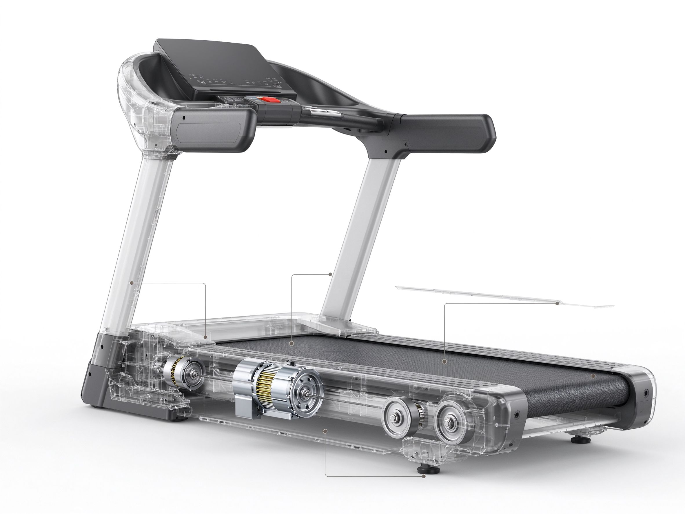
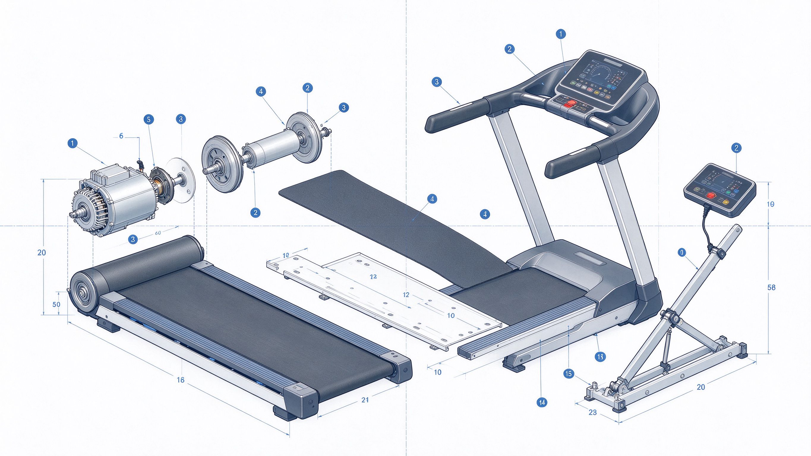
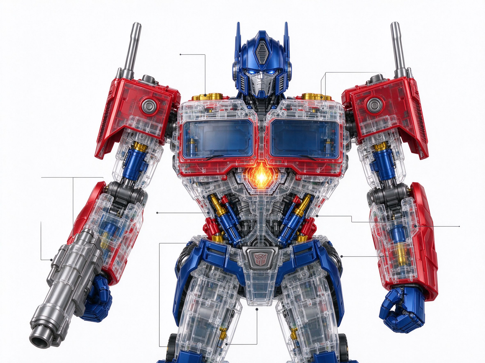
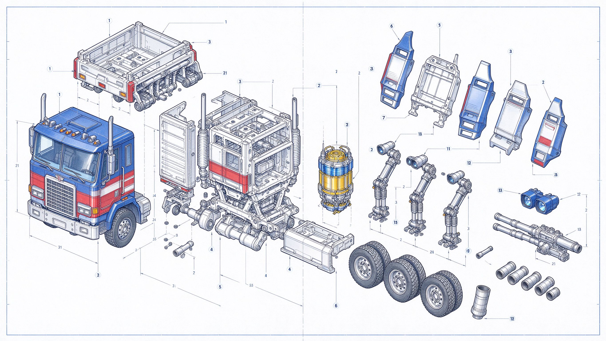

<div align="center">

# HoloAeon

### A Zero-Dependency, Bio-Inspired Cognitive Framework for General-Purpose Multi-Agent Systems

[](LICENSE)
[](https://www.python.org/)
[](pyproject.toml)
[](#-testing)
[](#-testing)
[](#v2--evidence-hardening-092-docs)
[](#v3--engineering-form-from-langchain-093-docs)

<sub>Badges are **locally measured** (Python 3.13.16, Windows). CI has now actually run on GitHub:
Python 3.8 / 3.10 / 3.12 all green in [run #25](https://github.com/weideyouni/holoaeon/actions/runs/41202167792)
(0 errors, 0 warnings — the only remaining notices are GitHub's own `ubuntu-latest` migration announcement).
See [`docs/support-matrix.md`](docs/support-matrix.md) for which cells are `measured` and which are still `untested`.</sub>

[English](README.md) · [中文](README.zh-CN.md)

</div>

---

HoloAeon is a **pure standard-library, fully offline, deterministic** cognitive framework
for building multi-agent systems on top of any large language model. It provides a layered
set of primitives — envelopes, a message bus, agents, skills, memory, a heartbeat scheduler,
a security guard, an adaptive collaboration graph, a parallel actor cluster, hyperdimensional
representations, and a model-adapter layer — plus **nine ready-to-use domain packs** that span
the everyday work of knowledge professionals, including a deterministic **optimization &
self-organizing search** layer (see [ALGORITHM.md](ALGORITHM.md)).

> **Naming.** *Holo* (whole, holographic) + *Aeon* (a high-dimensional, timeless being in
> Gnostic cosmology). It signals the project's inspiration: a system in which every local part
> carries a summary of the whole, and structure self-organizes across scales.

> **On the biological vocabulary.** Terms such as "heartbeat", "skin", "cytoskeleton",
> "meridian", and "Hebbian field" are **cognitive-architecture metaphors**. They describe
> synchronization, boundary control, routing, structural support, and self-organization in a
> multi-agent system — not biological organs or medical structures. A precise
> [metaphor → engineering-concept map](#-metaphor--engineering-concept-map) is included below.

---

## The C18 Repository Cluster (C01–C18 + N19 · structure → connectivity → continuity)

> Design sources = the cluster trilogy feeds (structure pack · connectivity pack · continuity pack),
> adjudicated by the quartet from first principles. Landing status is stated honestly in three
> tiers — **landed / spec-on-record / not yet built** — with no overstatement. This section
> hardcodes no measured numbers: cluster existence and health are read back via
> `python -m holoaeon.c18_cluster probe`, and each remote repo via
> `git ls-remote https://github.com/weideyouni/holoaeon-cXX-... refs/heads/main`.

**In one sentence**: this repository is Node 19 (N19, the earth-phase zeroing base and the only
global observer); the cluster = 18 isomorphic domain repositories + the N19 base. It is not 19
copies — it is **the orthogonal projection of one mechanism**: the 18 repositories share all of
N19's machinery (heartbeat / bus / tensors / gates / contracts) while each carries the
first-principles question of one life domain.

### Trilogy · landing-status ledger

| Pack | One-line thesis | Status | Carrier |
|---|---|---|---|
| Structure (V3) | how repos are built, numbered, shaped | **landed** | `holoaeon/c18_cluster.py` (ring19): 18-repo registry + five-phase map + edge schema + 19×19 coupling matrix; 18 GitHub repos created and verified repo-by-repo via `ls-remote` |
| Connectivity (LINK-01) | how repos connect and co-evolve | **partially landed** | phase engender/overcome, four legal edge types, 12 required fields, ttl·decay·rollback hard constraints on record; five-layer stack / event-propagation four steps / operators O1–O5 **await future batches** |
| Continuity (CONT-01) | an organism can only grow one step at a time | **landed** | `holoaeon/continuity_gate.py` (ring20): three continuity axes (temporal / structural / evidential) + B1–B10 breakpoint ledger + G0–G7 tri-state gates (honest WAIT for what is not yet built) |

### The 18 repositories (numbering frozen)

Each repo = one domain's first-principles question + self-organization mechanism + dual-system
split (turtle = persist / baseline / snapshots; horse = explore / generate / transitions).

| ID | Repo | Domain | Main phase | First-principles question |
|---|---|---|---|---|
| C01 | holoaeon-c01-source | origin | earth | who am I, how do I zero out |
| C02 | holoaeon-c02-body | body | water | how the body is sensed and regulated |
| C03 | holoaeon-c03-meridian | meridian | wood (conduction hub) | how signals propagate, how blockage is found |
| C04 | holoaeon-c04-family | family | earth | how kinship shapes individual homeostasis |
| C05 | holoaeon-c05-education | education | wood | how knowledge internalizes and converts |
| C06 | holoaeon-c06-career | career | fire | how capability grows and monetizes |
| C07 | holoaeon-c07-wealth | wealth | metal | how resources flow and allocate |
| C08 | holoaeon-c08-creation | creation | wood | how creativity ignites and settles |
| C09 | holoaeon-c09-relation | relation | fire | how social networks evolve |
| C10 | holoaeon-c10-emotion | emotion | fire | how emotion is recognized and transformed |
| C11 | holoaeon-c11-meaning | meaning | fire-into-earth (meaning hub) | what does this mean to me |
| C12 | holoaeon-c12-space | space | earth | how environment shapes body and mind |
| C13 | holoaeon-c13-time | time | water | how rhythm and history act on the present |
| C14 | holoaeon-c14-skill | craft | metal | how skills are mastered and reused |
| C15 | holoaeon-c15-risk | risk | water | how trauma and risk are detected and repaired |
| C16 | holoaeon-c16-spirit | spirit | wood | how practice and awakening are understood |
| C17 | holoaeon-c17-society | society | metal | how the individual meets institutions and culture |
| C18 | holoaeon-c18-cosmos | cosmos | master hub (holo-mirror root) | how the individual reads the macro order |
| N19 | holoaeon | base | earth (zeroing · all phases) | the sole earth-phase zeroing base; extend-only, never refactor |

Main-phase spread (structural constants): wood 3 · fire 3 · earth 3 · metal 3 · water 3, plus
the conduction / meaning / master hubs spanning phases — all 19 nodes covered, none left over.
Inter-repo action follows deterministic five-phase routing (engender 0.8 / same-qi 0.6 /
overcome 0.4 / hub 1.0, N19 row fully connected at 1.0); directed gain tiers (engendered 1.2 /
engendering 1.2 / same-qi 1.0 / overcoming 0.6 / counter-overcome 0.3) are reserved for event
propagation.

### Edge schema (the minimal unit of connectivity · landed)

Cross-repo connections travel only through **four legal edge types**: `skeleton` (fixed at
repo creation) / `resonance` (heartbeat-activated) / `semantic` (route-established) / `event`
(transient, one-shot). Every edge carries 12 required fields (`edge_id / source / target /
edge_type / layer / phase_relation / resonance_strength / turtle_state / horse_state /
ttl_ticks / decay_rate / rollback_token`) under three hard constraints: `ttl_ticks ≥ 12`,
`decay_rate ∈ (0,1)`, `rollback_token` non-empty — **connections decay, can break, can roll
back; permanent links are never assumed**. Validate any edge via
`python -m holoaeon.c18_cluster probe`.

### Honest boundaries (what this cluster section does not overstate)

- **Five-layer stack** (skeleton / resonance / conduction / semantic / collaboration-field),
  **event-propagation four steps** (gain / decay / blockage / termination), and **co-evolution
  operators O1–O5** (phase coupling / gradient transfer / gene drift / differential selection /
  holo mirror): specs are on record here and in the feed packages, **code awaits future
  connectivity batches** — gates G2–G7 honestly WAIT (read back via
  `python -m holoaeon.continuity_gate gates`).
- The source packs' "78 Metatron edges" and "108641 resonance-band index" were **not** adopted:
  the former is unverified geometry, the latter is a "current language-mode" digit in this
  system's context, not a resonance index — **misappropriated digits are dishonest**; dropped
  (quartet adjudication on record).
- Anti-homogenization is measured: pairwise cosine over the 18 domain-question vectors meets
  the bar (isomorphic yet heterogeneous — the S5 inverse indicator); the live value is read
  back via `python -m holoaeon.c18_cluster probe`, never hardcoded.
- Each cluster skeleton (README + isomorphic package + domain gate + tests + `.gitignore`)
  runs independently repo-by-repo; remote repo creation is an irreversible external action —
  it was carbon-confirmed and executed by the run agent (creation receipt in
  `reports/v55_receipt.json` under `github_create`, per-repo HEADs, `ls-remote` 18/18).


---

## 当前工程状态（2026-11-05）

| 项 | 实测值 |
|---|---|
| 产出维度（锁死） | **25 智能体 / 47 技能 / 9 域包**；`diff0_hash=2fc892cf9af6e755`、`tamper=f42c8229ee5acd73` 未变 |
| 最新批次 | **V57 README manifesto V4 (cluster-connectivity chapter: new "The C18 Repository Cluster" section — trilogy landing-status ledger / the 18 repositories / five-phase spread and coupling / edge schema / honest boundaries; docs-only batch, zero code change, ring=null, DOC raised to `0.9.51`)** — this cell tracks the current batch; authoritative wording comes from `git log -1 --format=%s` |
| 扩展卡槽 | **12 个**：occupied 6 / open 1 / reserved 4 / blocked 1（只声明不接线；本批**不新增、不占用**槽位） |
| 门禁 | `v3_gate 32/32` · `selftest 25/25` · `unittest 876 OK` (skipped=0; main tests, incl. V24 `test_swarm_intel` 8 cases + V25 `test_machine_tool` 15 cases + V26 `test_mobius_vortex` 12 cases + V27 `test_klein_projection` 19 cases + V28 `test_holo_forge` 13 cases + V31 `test_titan_evolver` 29 cases + V32 `test_gap_bridge` 11 cases + V33 `test_math_gate` 11 cases + V34 `test_tea_gate` 11 cases + V35 `test_cosmo_gate` 12 cases + V36 `test_edu_gate` 13 cases + V37 `test_shengui_gate` 19 cases + V38 `test_check_sums` 5 cases + V40 `test_academic_gate` 19 cases + V41 `test_phc_chronic_engine` 25 cases+ V42 `test_phc_recall` 18 cases + V43 `test_craft_gate` 19 cases + V44 `test_twin_verify` 21 cases + V45 `test_teach_gate` 17 cases + V46 `test_v46_pharma_probe` 20 cases + V47 `test_v47_deploy_gateway` 24 cases · V49 `scripts/exp_v49_forge_gate.py` 66 cases (standalone lab script, moved out of tests/ in V50 to prevent accidental discovery) + V51 `test_v51_circuit_gate` 47 cases + V51R `test_v51r_hardware_gate` 45 cases + V52 `test_v52_cinema_gate` 35 cases + V53 `test_v53_palette_gate` 37 cases + V54 `test_v54_palette_enhance` 33 cases + V55 `test_v55_c18_cluster` 47 cases + V56 `test_v56_continuity_gate` 54 cases) + `v3 11 OK` + `verax 21 OK` · `sidecar 184 OK`（`tests_contract` `test_10_no_new_pack` now asserts lower bound `>=11`, no longer stale since V12） · `v44 13/13` · `v45 7/7` · `v46 9/9` · `v5 11/11` · `dv 8/8` · `redline 136 文件 0 违规` · `check_sums ok=true` (V38 recompute gate: 250 entries, 0 mismatches, blocks-only) · `drift []` |
| 五地同步 | 本地 · Gitee · GitHub · Hugging Face · 向量海 —— 见文末 [附录 A](#附录-a--五地同步v11) |
| 版本脉络 | V4.0 → V6.1 → V11 → V12 逐提交回溯 —— 见文末 [附录 B](#附录-b--版本升级说明v3--v11) |
| V4 主文档 | [`README_FUSION_V4_20261102.md`](README_FUSION_V4_20261102.md) · 同步规则 [`data/FIVE_SITE_SYNC_DNA.md`](data/FIVE_SITE_SYNC_DNA.md) |
> **Note (V47-A), vector-store declaration & domain split**: (1) **alignment** — 1e3–1e5 entries at ms latency, on par with `sqlite-vec` / `faiss-cpu` at a 3–4万 jurisdiction knowledge-base scale (measured locally by `scripts/bench_vector_baseline.py`); (2) **differentiators** — zero dependency pure stdlib (pip install and go, no build chain, no native deps), deterministic (sha256 3-gram bundle, same text → same vector bit-for-bit), offline zero-network, `neural=false`; (3) **not doing** — billion-scale ANN, neural embeddings, GPU. **Domain split**: knowledge recall (rehab knowledge / guideline items / education corpus) may use the vector store; medical-insurance reimbursement queries still go through `pharma_gate` exact lookup (V46 unchanged). Paraphrase **Top-1 = 0** is the literal-channel ceiling, stated honestly: cross-vocabulary semantic recall needs co-occurrence statistics (semvec route) or a bridges-layer neural side-car — **never parameter tuning to fit**.

> **Note (V47-B), network diode & separation of disposal rights**: `OUTBOUND_ALLOW = ()` as an empty set is a **structural** guarantee, not a configurable policy item — intranet data never leaves. Inbound accepts upgrade packages only, gated by a valid SHA256 + institutional approval + staging quarantine. Model coupling and inbound verdicts are **report-only**; actual network actions are executed by the deployment-side gateway (firewall / nginx).

> **Note (V46-C), wing-cluster naming**: `机翼簇` (one core / six wings skill grouping) is a **data-side descriptive / metaphorical name** for that grouping shape; the mechanism side is carried by the 19th extra pack `swarm_intel` (`holoaeon/packs/swarm_intel_pack.py`, 5 skills / 3 roles / 2 workflows). No same-named code module exists — this records the **naming-to-implementation mapping**, not an implementation gap.

> **Note (V46-D), badge semantics**: the `tests-526` badge and the `unittest 526 OK` gate row are anchored on a local run of `python -m unittest discover -s tests`. The shield is a static value and does not refresh on commit; when it disagrees with reality, **the run wins**.


> **diff0 dual-hash note**: `diff0_hash=2fc892cf9af6e755` is the V1 spec golden value (frozen, never allowed to drift); `DIFF0=6d119b2a9f2df687` is the bench 16-step runtime-consistency measurement. Different layers, not a contradiction.

> **diff0 双哈希层级**：`diff0_hash=2fc892cf9af6e755`（V1 规格黄金值，冻结，不许动）/ `DIFF0=6d119b2a9f2df687`（bench 16 步实测一致性判据）——**层级不同，非矛盾**。

### V5.1 · 设计语汇（旁挂，不改维度）

把 Impeccable（[`pbakaus/impeccable`](https://github.com/pbakaus/impeccable)，Apache-2.0，作者 Paul Bakaus）的**范式**本地化——不是分支、不是移植：本仓没有它的引擎二进制，也没有它的规则原文与模板，只用「命令即词汇 + 确定性规则 + P0–P3 分级」这一套做法，规则与释义全部自写。

- **24 个命令**：steer 9 / review 2 / finish 6 / iterate 2 / plan 4 + 1 个上游弃用别名，`vocabulary.command_ids()` 可回读。
- **12 条确定性规则**：`DV-01`–`DV-12`，各带分级（P0 最该先修）与经络通道，命中给行号与证据；**不宣称与上游 62 条等量**。
- **3 种编译模式**：`elaborate`（源码→元件/端口）· `simulate`（跑规则→分级命中）· `netlist`（命中→规则/通道网表），对应 EDA 的分析 / 仿真 / 综合。
- **4 条经络通道**：`blood` / `lymph` / `qi` / `shen`，沿用仓内既有分组，不新增第五通道。
- **零 LLM、零 API key、零出网**；只出建议与先修顺序，**不写回你的源码**。

```powershell
python scripts\verify_design_vocab.py   # 8 项判据，写 reports/design_vocab_check.json
```

**维度不变**：25 智能体 / 47 技能 / 9 域包不动，`data/extension_slots.json` 仍 12 条；本能力**不认领、不占用**任何 `EXT-` 槽。合作开发、扩展规则、未来槽位的走法见 [`docs/设计语汇与协作开发指南.md`](docs/设计语汇与协作开发指南.md)。

### V5.2 · 门禁自指修复与代码卫生（不改维度）

自查版 12 条意见逐条核实后落地（`evidence_class=simulated`）。核心问题只有一类：**自指处理不彻底**——只给单个校验器打补丁，没做成通用机制；同时把依赖本机路径的判据写进门禁，导致“13/13”只在作者本机成立。

- **A10 自指排除完备化**：不再只排除自己，改为排除全部兄弟校验器回执（v43/v44/v45/v46/v5/dv + 五地 manifest），并如实返回 `self_excluded_count`。
- **A11 切断传染**：`others_passed` 不再包含 A10。A10 属环境项，它单独红时 A11 仍 PASS——环境红不再伪装成内容红。
- **skipped 第三态**：manifest / ivsa 不在本机时记 `skipped` + `pending_human_measure`，不计入 `passed/total`，**不当作 PASS**。
- **路径去硬编码**：`five_site_dna` 的交付目录与回执路径由仓库位置推导（仍可用 `HOLOAEON_PKG` / `HOLOAEON_RECEIPT` 覆盖）；`verify_v44` 的 ivsa 根改走 `HOLOAEON_IVSA_ROOT`。
- **句柄泄漏清零**：`json.load(open(...))` 与 `open(...).read()` 在 `scripts/` 全部改为 `pathlib` 一次性读取，回读计数 0。
- **CI 补三道闸**：`tests_contract`（168 例）、`check_dimension_lock`、`verify_design_vocab` 进 workflow——此前契约测试从未在 CI 跑过。
- **L3 归一化（[golden]）**：Guard 危险模式判据补 NFKC + 零宽剥离 + 同形字折叠 + 分隔符拼接折叠；原本命中即拦截的文本 reason 与旧版逐字一致，`diff0` 仍 `2fc892cf9af6e755`、篡改值仍 `f42c8229ee5acd73`。
- **兜底开关（保守版）**：`BROADCAST_ON_NO_MATCH` 与 `ALLOW_SINGLE_SKILL_FALLBACK` 默认仍为 `True`，**行为不变**；改 `False` 才会 fail-loud。
- **技能基座化**：六机制（全息心跳 / 细胞骨架 / 皮肤 / 语义通信 / 赫布场 / 经络）的模块入口与外部技能“登记不复制”口径，见 [`docs/技能基座化与六机制接线指南.md`](docs/技能基座化与六机制接线指南.md) 与 `data/v5_skill_base_registry.json`。

```powershell
python scripts\verify_v43.py          # 11/11
python scripts\verify_v44.py          # 13/13（首跑 12/13 属天然自指，第二次收敛）
python -m unittest discover -s tests_contract   # 168 OK
python scripts\check_dimension_lock.py          # 0 violation · diff0 未漂移
```

**维度不变**：25 / 47 / 9 与 12 个 EXT 槽一位未动；`spec.VERSION` 仍 0.9.1。

### V6.0 · 族级登记表 · 路由第三态 · 代码卫生收口（不改维度）

`DOC_VERSION` 0.9.3 → **0.9.5**（`spec.VERSION` 仍 0.9.1，不回写运行态标识）。V6 投喂包 12 条 + 额外 3 条逐条实测后，V5.2 已修 8 条、本批补 7 条：

- **句柄清零到底**：`json.load(open(...))` / `open(...).read()` 全仓复扫 **0 处**（V5.2 只清了 `scripts/`，本批补 `tests_contract/` 6 处与 `skills/holoaeon-video-tensor-dna/` 4 处）。
- **红线防回归**：`holoaeon/redline.py` 新增 `FORBIDDEN_NESTED_OPEN = {"load","loads","read"}` 与 `visit_Call` 两段判定——以后谁再写内联开句柄，`redline_scan` 直接红。
- **路由第三态**：无内置技能命中时 `submit()` 返回 `status="no_agent_matched"` + `hint` + `external_candidates`，不再把「没匹配上」伪装成「N 条结果」；显式 `to="*"` 才广播。
- **兜底可观测**：`agent.handle()` 结果新增 `degraded` 字段，单技能兜底被借用时置 `True`，事后能看出这次成功是「真命中」还是「借来的」。
- **开关进配置**：`HoloAeonConfig` 增 `broadcast_on_no_match` / `allow_single_skill_fallback`（默认 `True` 保持现状）；模块级常量降级为缺省值，`register_agent` 把配置下沉到每个 agent。
- **守卫精度（[golden]）**：`DANGER_PATTERNS` 的宽匹配 `.env` 收紧为 `open('.env` / `open(".env` / `dotenv`——「文档里提到 .env」不再被误拦，真正读凭证仍拦。`diff0` 仍 `2fc892cf9af6e755`、篡改值仍 `f42c8229ee5acd73`。
- **1199 条外部技能族级登记 + 桥接**：`data/v6_skill_family_registry.json` 把 1229 条索引收成 **58 个「域×机制」族**（1,229 成员，`members_sha256` 可回读），`holoaeon/fusion_upgrade/external_skill_registry.py` 提供 `load/stats/family_of/match/route` 与 `Kernel.resolve_external()`。**登记不复制、不改 47 条内置技能**：桥接是「族的候选出口」，执行仍走 25 个 agent。

```powershell
python -m unittest discover -s tests_contract   # 184 OK（含 V6 12 例 + V6.1 4 例）
python scripts\redline_scan.py                  # 扫描 83 文件，零违规
python scripts\check_dimension_lock.py          # 12 维度 + 7 闸 + 0 violation，diff0 未漂移
python -c "from holoaeon.fusion_upgrade import external_skill_registry as e; print(e.stats())"
```

**维度不变**：25 智能体 / 47 技能 / 9 域包 / `EXTRA_PACK_ORDER=10`；`diff0_hash`、`tamper`、`spec.VERSION` 三个冻结值一位未动。

### V6.1 · 工程纪律固化 · A10 派生 · 交付票据回写（不改维度）

`DOC_VERSION` 0.9.5 → **0.9.6**（`spec.VERSION` 仍 0.9.1）。本批只做「必须做」的三件，全部不碰 `diff0`：

1. **A10 自写回执改派生**：名单不再硬编码，从 `five_site_dna.REPO_FILES` 派生 `reports/*.json`，产生者由 `scripts/{verify_,build_,check_,gen_}*.py` 回填——新增写型校验器无需再手改 A10；派生为空退回 `LEGACY_SELF_REPORTS` 并标 `self_derive="legacy"`（fail-loud）。
2. **`missing` 不豁免**：`repo:missing:` 不再算自指——删回执是真实退化；只排除 `changed` / `new`，且每条记 `owner` + `prev_sha16` + `curr_sha16` 差分证据。
3. **票据回写 + 纪律入库**：`01` / `06` 追加 V6 章节；新增 `docs/工程纪律_批次升级与五地同步.md`（八步写序 / 五地同步 / 失败处置 / 批次命名），并固化为技能 `holoaeon-batch-upgrade-discipline`，随全域技能根加载、触发即执行。

```powershell
python -m unittest discover -s tests_contract   # 184 OK（+ test_v44 4 例）
python scripts\verify_v44.py                    # 13/13；A10 self_derive=derived
python scripts\redline_scan.py                  # 0 违规
python scripts\check_dimension_lock.py          # diff0 未漂移
```

**维度不变**：25 / 47 / 9 与 `EXTRA_PACK_ORDER=10` 一位未动；`spec.VERSION=0.9.1`、`diff0_hash`、`tamper` 三值仍未动。

### V6.2 · 产品层三件套 · L9 路径闸门 · 领域化解耦（批2-4，不改维度）

`DOC_VERSION` 0.9.8 → **0.9.9**（`spec.VERSION` 仍 0.9.1）。对应 `AGENT_FEED_V8_BATCH2_4_FUSION_20261103`，三批贯序执行，逐批回执：

1. **批2 · L9 路径闸门**：`spec.GuardConfig` 新增 `product_layer_guard: bool = True`（附加层，不计入 `guard_layers=8` 维度锁，可关）；`guard.py` 新增 `l9_path_gate` 走 `extra_layers` 通道，`BUILTIN_LAYERS` 与 L1-L8 一个字符未动——越界读 / 未授权写 → `block`，无路径请求放行。产品层为商用铺路：权限粒度先于合规审计。
2. **批3 · 产品层三件套**：新增 `holoaeon/frontend_adapter.py`（stdin/stdout JSON 协议，自动装配 9 领域包 + 11 扩展包，零依赖）、`holoaeon/demo_product.py`（`holoaeon-demo` 入口）、根目录 `install.sh` / `install.bat`（一键安装 + 自检）；`pyproject.toml` 在 `[project.urls]` 之后加 `[project.scripts]`（`holoaeon-demo` / `holoaeon-bridge`）。
3. **批4 · 领域化解耦**：新增 `holoaeon/packs/tcm_rehab_pack.py`（中西医系统康复工程旗舰领域包，第 11 扩展包，不进 `PACK_ORDER`：辨证分型 / 方药检索 / 康复方案 / 知识库桥接，纯标准库离线，零剂量 / 毒剧药熔断 / 碳基终裁）；`packs/__init__.py` 三处注册（import / registry / order，`EXTRA_PACK_ORDER` 10→**11**）；`data/skill_matrix_index.json` "1600味" → "待接入"（大词无实物对齐，`count`/`digest` 未动）；`scripts/runtime_audit.py` 补 `medical_context` 审计标记。

```powershell
python -m holoaeon.demo_product              # 一键体验（hello / demo / l9 三模式）
echo '{"task":"status"}' | python -m holoaeon.frontend_adapter   # 桥接协议往返
python -m unittest discover -s tests_contract   # 184 OK
python scripts\launch_local.py selftest         # 25/25
python scripts\check_dimension_lock.py          # diff0 未漂移
```

**维度不变**：25 / 47 / 9 与 `spec.VERSION=0.9.1`、`diff0_hash`、`tamper` 三值仍未动；扩展包数随投喂包预定 10→**11**（`tcm_rehab`，不进 `PACK_ORDER`）。

### V9 · 拓扑共振包（第 12 扩展包，不改维度）

`DOC_VERSION` 0.9.9 → **0.9.10**（`spec.VERSION` 仍 0.9.1）。拓扑共振（自组织相似性耗散结构）扩展包落地，与 V11 同批收口提交：

- 新增 `holoaeon/packs/topology_resonance_pack.py`：8 基础数学技能（`resonance_node` / `mandala_fanout` / `mobius_edge` / `klein_convergence` / `kalman_state` / `bayesian_guard` / `hilbert_project` / `dissipation_measure`）+ 6 四人组技能（`dao_define_problem` / `fa_gradient_analysis` / `shu_constraint_handling` / `qi_algorithm_selection` / `quartet_tensor` / `emergence_chain`），纯标准库离线，零网络。
- `packs/__init__.py` 三处注册（import / registry / order），`EXTRA_PACK_ORDER` 11→**12**（`topology_resonance`，不进 `PACK_ORDER`）。

```powershell
python -c "from holoaeon.packs.topology_resonance_pack import TopologyResonancePack as T; p=T(); print(len(p.skills))"   # 14（V9）
python scripts\check_dimension_lock.py          # diff0 未漂移
```

**维度不变**：25 / 47 / 9 与 `spec.VERSION=0.9.1`、`diff0_hash`、`tamper` 三值仍未动；扩展包数 11→**12**（`topology_resonance`，不进 `PACK_ORDER`）。

### V11 · 城邦架构融合 · 拓扑共振升级（V11-A→E，不改维度）

`DOC_VERSION` 0.9.10 → **0.9.11**（`spec.VERSION` 仍 0.9.1）。对应 `AGENT_FEED_V11_CITY_STATE_FUSION_20261103.md` 第七章，五步贯序执行：

1. **V11-A · Graph 集成**：`topology_resonance_pack.py` 追加 3 个图函数（不碰 `graph.py`）——`graph_mandala_expand(graph, center, fanout)`（曼陀罗扇出，中心→N 空闲节点建 0.5 权边）、`graph_mobius_flip(graph, a, b)`（莫比乌斯双向回边，权 = max(原权,0.4)+0.3，建边后 `detect_cycles()` 报环）、`graph_klein_convergence(graph, max_iter, threshold)`（边权向全局平均密度收敛 η=0.1，连续三轮 Δ 上升→熔断）；实调验证全绿（越界/自环/非图三重防御）。注：投喂包示例 `add_edge()` 为示意，AdaptiveGraph 无此方法，按真实 `weights` 矩阵接口实现（判据优先于 SOP 字面）。
2. **V11-B · L10 贝叶斯层**：`guard.py` 新增模块级 `_L10_LIKELIHOOD` 似然表（write/delete/read/execute/network/safe 六特征）+ `l10_bayesian(env)`（读 `metadata.bayes_feature` / `bayes_prior` 默认 0.15，后验 >0.5 → BLOCK "L10"，无特征直接放行）；`Guard.__post_init__` 追加 `if self.config.bayesian_guard: self.layers.append(("L10", l10_bayesian))`；`spec.GuardConfig` 新增 `bayesian_guard: bool = False`（默认关）。`BUILTIN_LAYERS` 与 L1-L8 一个字符未动，默认行为不变（仍 9 层）。
3. **V11-C · Runtime 增强**：新建 `holoaeon/topology_runtime.py`——StateReducer（指数平滑归约）/ Checkpoint（快照链，断点续跑）/ CircuitBreaker（连续失败熔断 → half-open 探测）/ DissipationMonitor（Shannon 熵 + 秩序 + 耗散率 + 涌现重组判断），纯标准库零包内依赖，全通过红线。
4. **V11-D · 治理技能**：`topology_resonance_pack.py` 追加 `city_state_governance`（循环指纹检测 + 连续失败熔断 + 指数/线性退避重试）与 `dissipation_emergence_monitor`（Observability + Traceability + 半窗熵比较涌现判定），skills **14→16**。
5. **V11-E · 文档版本**：`DOC_VERSION` 0.9.10 → **0.9.11**。

```powershell
python -m holoaeon.selftest                # 25/25
python scripts\check_dimension_lock.py     # 12 维度 + 7 闸 + 0 violation · diff0=2fc892cf9af6e755 未漂移
python scripts\v3_gate.py                  # 32/32
python scripts\redline_scan.py             # 88 文件 · 零违规
python -m unittest discover -s tests       # 68 OK（V11 补丁 PR-3 新增 L10/拓扑运行时 29 例）
python -m unittest discover -s tests_contract   # 184（1 例既有契约漂移：EXTRA_PACK_ORDER 11→12，V9 引入，非本批回归）
```

**维度不变**：25 / 47 / 9 与 `spec.VERSION=0.9.1`、`diff0_hash=2fc892cf9af6e755`、`tamper=f42c8229ee5acd73` 三值仍未动；`EXTRA_PACK_ORDER=12` 未再增；Guard 默认 9 层、开启 L10 后 10 层（附加层不计入 `guard_layers=8`）。

### V11 补丁升级 · PR-3 L10/拓扑运行时集成测试（不改维度）

投喂的补丁升级工程经**判据优先**核查后，仅 PR-3 为真实缺口并落地：

- **新增 `tests/test_l10_bayesian.py`（13 例）**：L10 贝叶斯守卫纯函数语义（delete/network 后验 >0.5 拦截、write 低先验放行、未知特征回退 safe 表、非法先验回退 0.15）+ Guard 挂载语义（默认关不改变 L1-L8/L9 行为、开启后 L10 生效且层序 L9→L10、BUILTIN_LAYERS 8 层不变）。
- **新增 `tests/test_topology_runtime.py`（16 例）**：StateReducer 指数平滑/dict 归约/replace/快照恢复、Checkpoint 快照链、CircuitBreaker closed→open→half_open 状态机、DissipationMonitor 熵/秩序度/耗散率/重组触发。
- 门禁实测：`unittest 68 OK` · `selftest 25/25` · `redline 88 文件 0 违规` · `维度锁 0 violation`。

**投喂其余 PR 的核查结论（如实披露，未执行）**：
- PR-1（P0 门禁自指三项）：**已修**（A10 自写回执派生化、A11 传染切断、IVSA_ROOT/REPO/PKG 环境变量化，均为 V6.1-B2/B3 落地），本批复核 verify_v44 13/13 PASS 不翻车。
- PR-2：P1-4a 主仓句柄泄漏**不属实**（V5.2/V6 已清零 + redline 防回归，复扫 0 处）；P1-5 CI 不跑契约**不属实**（ci.yml 已有 tests_contract 184 步骤）；P1-6 README「42 文件」**无此口径**（83/88 为各批次实测）。P1-4b `ivsa/eda_pipeline.py` 3 处 `open().read()` **真实存在**（daily 基线日志记录 ResourceWarning），但 ivsa 为独立客仓——按纪律 §六「不接客仓写入」且改动会破坏 A12 门禁期望哈希（verify_v44 硬编码 `9400b481…`），**只记录不修改**，需授权后另行处置。
- PR-4（MCP 桥接）：投喂自标「可选/较大/后续单独做」且无协议规格，**本批不展开**。


### V12 · 管家操作系统引导模块（V12-A→E，不改维度）

`DOC_VERSION` 0.9.11 → **0.9.12**（`spec.VERSION` 仍 0.9.1）。对应 `AGENT_FEED_V12_BUTLER_OS_BOOTSTRAP_20261103.md` 第三部分，步骤 A→E 贯序执行：

1. **V12-A · 四人组执行顾问扩展包**：新建 `holoaeon/packs/quartet_director_pack.py`（**第 13 扩展包**，`key="quartet_director"`）——14 技能 / 5 角色 / 2 工作流（`quartet_advisor_flow` 五步闭环 / `quartet_emergence_flow` 涌现+回执闭环），**内联实现不 import quartet_toolkit**（保持零外部依赖）；公开 `check_emergence(p1,p2,p3,p4)` → `{"emergence","order","mean","std","agreement","conditions","scores"}`（涌现条件：P2×P3 强共振≥0.7 + P1 愿景≥0.6 + P4 风险≤0.4 + order>0.30；实测 `check_emergence(0.85,0.85,0.85,0.30)` → `emergence=True, order=0.5237`）；`advisor_selfcheck()` 校验 14/5/2 + 涌现示例确定性。投喂包 SKILLS/ROLES/WORKFLOWS 的 dict 写法已转 base.py dataclass 契约；ROLES 缺 `skills` 字段按参考包补全；验证清单第 7 项 `_check_emergence` 已公开化为 `check_emergence`。
2. **V12-B · Butler OS 引导模块**：新建 `holoaeon/butler_os.py`（OS 式菜单 7 项 + 0 退出：1 安装引导 / 2 自检 / 3 技能清单 / 4 四人组加载 / 5 启动桥接服务 / 6 提交任务 / 7 状态快照；纯标准库、懒加载 kernel、`_readline` 替代 `input` 规避红线 dangerous_call）+ 双击启动入口 `holoaeon_os.bat`（chcp 65001 + `python -m holoaeon.butler_os` + pause）/ `holoaeon_os.sh`。
3. **V12-C · 注册第 13 扩展包**：`packs/__init__.py` import `QuartetDirectorPack` + `EXTRA_PACK_REGISTRY` 登记 + `EXTRA_PACK_ORDER` 追加 `"quartet_director"`（12→**13**）；`spec.py` `DOC_VERSION` 0.9.11 → **0.9.12**（`VERSION` 0.9.1 冻结未动）。
4. **V12-D · 命令注册**：`pyproject.toml` `[project.scripts]` 追加 `holoaeon-os = "holoaeon.butler_os:main"`、`holoaeon-quartet = "holoaeon.packs.quartet_director_pack:main"`（与既有 `holoaeon-demo` / `holoaeon-bridge` 并列）。
5. **V12-E · 验证 + README + 回执 + 五地**：全验证绿 + 三份 README 落 V12 段 + `reports/v12_receipt.json` + 单批单提交 + 五地同步推送回读 + S4 回执刷新 + 交付。

```powershell
python -m holoaeon.selftest                # 25/25
python scripts\check_dimension_lock.py     # 12 维度 + 7 闸 + 0 violation · diff0=2fc892cf9af6e755 未漂移
python scripts\v3_gate.py                  # 32/32
python scripts\redline_scan.py             # 90 文件 · 零违规
python -m unittest discover -s tests       # 68 OK
python -m unittest discover -s tests_contract   # 184 全绿（V12.1 已同步 test_10_no_new_pack 为下界断言，不再漂移）
python scripts\verify_v44.py               # 13/13（A1-A13 全 PASS）
python -m holoaeon.butler_os 4             # Butler OS 冒烟：四人组加载 → emergence=True order=0.5237
python -m holoaeon.mcp_adapter             # MCP stdio 桥接（initialize/tools/list/tools/call 自测 13/13）
python -m holoaeon.butler_os 7             # 状态快照：agents=53 skills=257 DOC_VERSION=0.9.14
python -m holoaeon.butler_os 10            # 去幻觉检测（莱布尼茨PSR×张平Seb×赫布场 8 阶段流水线）
python -m holoaeon.butler_os 11            # 自主调度（RouterLayer 确定性路由 → EventFilter 两级过滤 → Watchdog 只读监护）
python -m holoaeon.butler_os               # 交互菜单（管道 0 退出）正常
```

**维度不变**：25 / 47 / 9 与 `spec.VERSION=0.9.1`、`diff0_hash=2fc892cf9af6e755`、`tamper=f42c8229ee5acd73`

### V12.1 · 未决项闭环（first-principles adjudication · single commit）

- **Contract test sync (done)**：`tests_contract/test_hebbian_store.py::test_10_no_new_pack` switched from a hard-coded `len(EXTRA_PACK_ORDER)==11` to a lower bound `>=11` — extra packs grow per batch (V8=11 → V11=12 → V12=13); the contract's true intent is locking `PACK_ORDER==9` (25/47/9 dimension lock) and isolating extra registration. A hard-coded exact value expired every batch (drifting since V9). Lower bound prevents regression; `tests_contract` 184 all green.
- **MCP bridge (done)**：new `holoaeon/mcp_adapter.py` — MCP (Model Context Protocol, 2024-11-05) stdio transport minimal subset (JSON-RPC 2.0: `initialize` / `ping` / `tools/list` / `tools/call`); exposes 3 tools: `holoaeon.task` (generic submit, reuses `frontend_adapter.handle_request` contract) / `holoaeon.status` (snapshot: runtime_id/VERSION/DOC_VERSION/agents/skills/guard_layers) / `holoaeon.quartet` (emergence via `check_emergence`). Zero deps, no network, no GPU; same contract as butler_os, different transport (local menu vs standard protocol); `holoaeon-mcp` console command registered; self-test 13/13 incl. error branches (parse_error -32700 / invalid_request -32600 / unknown_tool -32602 / method_not_found -32601).
- **Suspended (recorded, not executed)**：① ivsa guest repo `eda_pipeline.py` 3× `open()` leaks (P1-4b) — discipline forbids writing into guest repos (A12 expected hashes would go red); unlock = guest upgrade window or explicit authorization. ② GitHub external forced-rollback source — two consecutive batches (V11 end/V12) push+fetch read-back show no rollback; the "trust command read-back" principle is already hardened; no external forensic channel, keep observing.
三值仍未动；`EXTRA_PACK_ORDER` 12→**13**（第 13 扩展包仅旁挂，不进 `PACK_ORDER`，G15 断言不受影响）；
Guard 默认 9 层、L10 默认关（附加层不计入 `guard_layers=8`）；装配后快照 agents **46**（含四人组 5 角色）、
skills **243**（含四人组 14 技能），均为扩展包旁挂增量。

### V14 · 技能机床与插件化协议适配平台（V14-A→F，不改维度）

`DOC_VERSION` 0.9.12 → **0.9.13**（`spec.VERSION` 仍 0.9.1）。对应 `AGENT_FEED_V14_SKILL_LATHE_PROTOCOL_PLUGINS_20261103.md` 第三部分，步骤 A→F 贯序执行（整合 V13 勘探打捞 + V14 机床加工 + 协议适配）：

1. **V14-A · 技能机床**：新建 `holoaeon/skill_lathe.py` —— `SkillLathe` 类（`GRADE_A_THRESHOLD=0.7 / GRADE_B_THRESHOLD=0.4`），`turn_skill(tvcb)` TVCB→SkillSpec（能量级 C 丢弃返回 None；`skill_name=salvaged_<topic>_<id尾4位>`；描述=topic+前 3 关键词；`fn` 确定性 callable 返回 source/topic/keywords/idea_pattern/reusable_points/executed；tags=[topic, grade_X, salvaged]；inputs={"query":"str"}；permissions=0），`batch_turn`（JSON 序列化时 fn 置 None）；纯标准库零依赖。
2. **V14-B · 插件化协议适配器**：新建 `holoaeon/protocol_plugins.py` —— `PROTOCOL_REGISTRY` 12 协议（openai_function/anthropic_tool/gemini_function/mcp/a2a/acp/langchain_tool/llamaindex_tool/autogen_tool/crewai_tool/bedrock_converse/envelope，各含 name/format/direction），`export_skill_to_protocol`（未知协议 raise ValueError，inputs→properties 每项 {"type":"string","description":v}），`export_all_protocols`（遍历穷举 dict），`list_protocols`；纯标准库零依赖。
3. **V14-C · 向量海扩展包升级**：新建 `holoaeon/packs/vector_sea_pack.py` —— 继承 `DomainPack`，key="vector_sea"，**8 技能/4 角色/2 工作流**（技能 1-5 来自 V13 勘探：ocr_snapshot/vector_match/tensor_coupling/wisdom_salvage/multi_modal_scan；6-8 来自 V14：skill_lathe 机床/protocol_export 协议导出/skill_workbench 工作台；角色 explorer/driller/lathe_operator/protocol_engineer；工作流 explore_drill_refine/lathe_export_deploy）。
4. **V14-D · 勘探平台增强**：新建 `holoaeon/vector_sea_explorer.py` —— `explore_and_manufacture(input_path, target_protocols=None)` 9 阶段流水线（1-7 V13 勘探 input→ocr→snapshot→search→refine→output→salvage；8 SkillLathe 机床加工；9 协议导出，None 时遍历穷举 12 种）；返回 {tvcb, skill_spec(fn 剔除), protocol_exports, salvaged_at}。
5. **V14-E · 注册第 14 扩展包**：`packs/__init__.py` import `VectorSeaPack` + `EXTRA_PACK_REGISTRY` 登记 + `EXTRA_PACK_ORDER` 追加 `"vector_sea"`（13→**14**）。
6. **V14-F · 菜单+命令+文档版本**：`butler_os.py` 菜单追加 [8]向量海勘探/[9]技能机床（含 cmd_explore/cmd_lathe 与 `_get_vector_sea_pack` 懒加载）；`pyproject.toml` 追加 `holoaeon-explore="holoaeon.vector_sea_explorer:main"` / `holoaeon-lathe="holoaeon.skill_lathe:main"`。

验证全绿：`selftest 25/25` · `unittest 68 OK` · `tests_contract 184 OK` · `redline 95 文件 0 违规`（strict FORBIDDEN_CALLS）· `v3_gate 32/32` · 维度锁 0 violation（diff0=2fc892cf9af6e755 未漂移）· `verify_v44 13/13`（A12 零依赖未破）· MCP 回归 13/13 · 机床自检（A/B 加工、C 丢弃、确定性复算）PASS · 协议适配器自检（12 协议穷举+未知协议 ValueError）PASS · 向量海包自检（8/4/2 + TVCB_A + protocols=12）PASS · 装配快照 agents=**50** skills=**251**（+4 角色 +8 技能 旁挂增量，G15 不受影响）。

**维度不变**：25 / 47 / 9 与 `spec.VERSION=0.9.1`、`diff0_hash=2fc892cf9af6e755`、`tamper=f42c8229ee5acd73`；`EXTRA_PACK_ORDER` 13→**14**（第 14 扩展包仅旁挂，不进 `PACK_ORDER`）；用户落地路径：PDF/图片/文字 → OCR → TF-IDF 快照 → 向量海余弦搜索 → TVCB 精炼 → 技能机床加工 → 12 协议适配导出 → 部署到任意平台。

### V41 · Public-Health Chronic Engine (`phc_chronic_engine`, ring 11 · dimensions untouched)

`DOC_VERSION` 0.9.34 → **0.9.35** (`spec.VERSION` stays frozen at 0.9.1). Source: the national basic public-health service norms plus the 2025 community-level chronic-disease circulars (class A: hypertension / T2DM / COPD), combined with the six-system human disease atlas — **deterministic shapes only; no patient data and no hospital system integration**.

- **A/B/C/D registry**: class A = hypertension / T2DM / COPD (≥4 follow-ups per year + one annual exam); class B = bundled public-health programmes (elderly / severe mental disorder / tuberculosis / TCM); class C = local expansion with explicit funding source and service boundary; class D = specialist co-management with community continuation.
- **Six-system atlas**: neuro / cardio-cerebro / endocrine / immune / oncology / ortho → department and skill routing.
- **7-modality envelope + pointer discipline**: lab report / physical exam / imaging report / pulse / tongue / ear / eye — images store only a SHA256 pointer plus a structured self-report; **zero pixels enter engine state** (tests assert the raw bytes never surface), interpretation is delegated.
- **Risk R01–R12**: twelve rules, each carrying a citation id and recomputable; **an acute event jumps straight to grade IV** — urgency is never diluted by a score.
- **MDT**: routing by modality and disease, opinion slots left blank, `decision` fixed to "physician final ruling" — disposition separation, medical edition.
- **Follow-up scheduling**: ≥4 per year, two-week re-visit when control is unsatisfactory, two-week reflux trace after referral (= the medical-domain recurrence of Möbius state reflow, **LIN-E01 extension, not counted as SAME_AS**).
- **Engineering pieces**: port pool ≤10 (deterministic acquire / release / no double hold); MLPS3 seven-item checklist with a SHA audit chain (tampering detectable); 30k-population capacity estimate (prevalence values are literature placeholders to be replaced by local registry data).
- Pure stdlib (`hashlib`/`json`/`time`) · no network (`audit()` asserts `zero_network`) · zero diagnosis, zero prescription (`disclaimer` plus blank MDT slots) · no new extra pack (19 unchanged) · manifest 250 entries unchanged.

### V40 · Academic Trace Gate (`academic_gate`, academic-honesty distillation · domain-orchestration ring 10 · dimensions untouched)

`DOC_VERSION` 0.9.33 → **0.9.34** (`spec.VERSION` stays frozen at 0.9.1). Source: GitHub `AIScientists-Dev/academic-humanizer` (MIT, v0.3.3, six-layer SKILL) — **shapes only; none of the six-layer prompt text enters this repo**.

- **P4 honesty ruling**: the upstream states "it is not for evading AI-use disclosure", which points the same way as this repo's rigid DNA (truthfulness, zero fabrication) → adopt academic honesty (claim ≤ evidence), drop detection evasion.
- **Three disciplines into the ring**: (1) twelve deterministic tell patterns T01–T12, report-only; (2) preservation ledger — number/citation multiset fixed point (`check_preservation`); (3) claim-vs-evidence reconciliation — a strong verb must carry a number, citation or table/figure pointer.
- **Dropped X-items**: detection-evasion framing · Layer 5 voice/journal matching (non-deterministic) · Layer 6 NSF/NIH framing (pointer discipline, one docstring note only).
- **SAME_AS-06** (pending carbon-based final ruling): claim ≤ evidence converges independently with the medical mother edition's evidence grading — medicine → maths → tea → cosmos → education → academic, the sixth convergence.
- **Holographic correspondence**: a citation fixed point in the content domain ≈ a SHA fixed point in the engineering domain (V38 `check_sums`) — both are "the smallest audited invariant".
- **Disposition separation**: report-only, no `rewrite` / `humanize` functions (locked by tests); rewriting rights stay with the human author / carbon-based final review.
- **Measured**: `unittest tests.test_academic_gate` **19/19** · main suite **406 OK** · `redline 122 files / 0 violations` · `check_sums 250 entries / 0 mismatches` (new module is not in the manifest — zero drift) · dimension lock **PASS**.

### V39 · README Manifesto V3 (docs-only: nine chapters shipped, zero code change)

`DOC_VERSION` stays **0.9.33** (documentation-only batch; `spec.VERSION=0.9.1` remains frozen). The V3 final draft is embedded as `## The HoloAeon Manifesto` (axioms A1–A8 + capabilities + nine-year history + significance + differentiators + vision and open letter + acknowledgements + honest boundaries + number-to-command table), placed before `## Why HoloAeon`; the Chinese edition mirrors it as `## 工程宣言`.

**Quartet verdict (measured)**: `check_emergence(0.88, 0.92, 0.80, 0.34)` → `emergence=True`, `order=0.5358` (all four conditions true).

**Eight edits versus the draft (judged by A1/A4)**: W-01 dropped the unsupported "184 contracts" figure, replaced by **387 + 11 + 21 = 419** · W-02 "SQLite best candidate" downgraded to an external-review analogy · W-03 acknowledgements table gains an evidence-level column (4 `measured`, 6 `untested`) · W-04 batch count aligned with the ledger (`V0.1→V38`, `history=59`) · W-05 `SAME_AS` convergence pinned to five domain gates · W-06 462-item knowledge base and 1331×1331 marked self-reported · W-07 open letter carries a non-offer clause and the non-medical-device statement · **W-08 numeric correction**: the V38 subsection's `check_sums . → total=251` is corrected to **250**.

**Measured**: `unittest` **387 OK** · `selftest` **25/25** · `v3_gate` **32/32** · `v44` **13/13** · dimension lock **PASS** (12 dims / 7 gates / 0 violations) · `redline` **121 files, 0 violations** · `check_sums .` → `ok=true / total=250` · manifest rebuild `changed=[]`, `manifest_sha256` unchanged at `43202ba4e120…` (README is outside the manifest). **Zero new code, zero new tests, no new packs (19 unchanged), dimensions unchanged.**


### V38 · Sums Honesty Patch (`check_sums` SHA256SUMS fixed-point rebuild + recompute gate, Qwen V37 P0 fix, dimensions untouched)

`DOC_VERSION` 0.9.32 → **0.9.33** (`spec.VERSION` still 0.9.1 frozen). The Qwen V37 review (score 79.5) flagged a P0: SHA256SUMS had exactly 2 mismatches (`reports/dimension_lock.json`, `scripts/check_dimension_lock.py`); the manifest had not been rebuilt since c510b58 (V22+), 15 batches ago, so the README `drift []` claim did not hold. Director-side independent recompute confirmed it. **First principle: every number must be recomputable** — fixing 2 hashes treats the symptom; upgrading "meta-file changed → rebuild manifest" from human memory into an automatic blocking gate treats the cause.

**Six patches**: P38-A rebuild SHA256SUMS to a fixed point (250 entries, 0 mismatches) → P38-B new `scripts/check_sums.py` (zero-dependency stdlib recompute gate; **blocks only, never rebuilds** — rebuilding is a batch action; auto-rebuild would hide which batch changed what) → P38-C `check_dimension_lock.py` FROZEN_SNAPSHOT gains `note_cmd` read-back commands, time-point snapshot text removed → P38-D badge tests-382→387 (basis = main + v3 + verax) → P38-E diff0 dual-hash layers made explicit (spec golden vs bench measured) → P38-F DOC_VERSION 0.9.32→0.9.33 + concept_anatomy R-04 ripple + test assertions synced.

**Measured**: `unittest tests.test_check_sums` **5/5** · main suite **387 OK** (skipped=0, 382+5) · `selftest 25/25` · `v3_gate 32/32` · `redline 121 files 0 violations` · `check_sums .` → `ok=true, total=250, mismatches=0` · `diff0` no drift (`6d119b2a9f2df687`).

**Honest deviations (feed_corrections)**: C-01 `json` import moved to module top in `check_sums.py`; C-02 feed's `make_repo` crashed on files without a directory (`os.makedirs("")`), empty-string guard added; C-03 `scripts/` is not a package, tests load via importlib per the feed's own note; C-04 execution order refined — all meta-file edits done before the rebuild (rebuilding first would re-drift the moment `check_dimension_lock.py` is edited); C-05 badge uses measured 387 (feed wrote 382 before counting this batch's 5 new tests); C-06 file handles switched to `with` blocks per the zero-handle-leak discipline.; C-07 the manifest had pinned `reports/v44_model_gateway_check.json`, which `verify_v44` rewrites on every run (A10 already self-excludes it) → pinning it guarantees permanent drift; dropped it under 'pin inputs only', entries 251→250; C-08 the §3 return body used implicit string concatenation, polluting `action` into `report_only（…）` → split into `action` / `action_note`; C-09 the other two live artifacts `reports/b8_dual_sync_check.json` (rewritten by every `build_b8_dual_sync` run) and `data/dual_repo_sums.json` (self-referential) were dropped from the manifest in the same batch — until now recorded only in `v39_receipt.json` and the beacon, written back here in V40

### V37 · Shengui Gate (`shengui_gate`, silicon-life-precursor shape distillation, domain-orchestration ring 9 · first bridge)

`DOC_VERSION` 0.9.31 → **0.9.32** (`spec.VERSION` stays frozen at 0.9.1). ShenGui System silicon-life-precursor V2.0 (archived at `F:/doubaowork/神龟系统_类硅基生命前体V2.0/`, registered in Yuan memory as SHENGUI-V2.0-INTAKE) — seven shapes kept, all rhetoric dropped.

**Chain position (D-11, mandatory)**: `ring 9` — **domain-orchestration ring, ShenGui domain** (`upstream = edu_gate / cosmo_gate / machine_tool`), the fifth domain ring after edu_gate (ring 8). This ring is the first interop gate between HoloAeon and the ShenGui system (CMOS side).

**Six classes + conductor**: S1 `DualCore` (compliance is the only path to resources: quota scales with compliance ratio; forbidden words freeze resources / terminate tasks / ban iteration) → S2 `DNAEngine` (rigid segment immutable, evolvable segment mutation ≤15%) → S3 `HierarchyLock` (system/organ/cell levels; expiry apoptosis, fault or rogue incineration, cross-level command always refused) → S4 `SanjiaoBus` (upper command / middle data / lower heartbeat, priorities 1/2/3, direct cell→organ forbidden, append log auditable) → S5 `WuxingBalance` (five-element table mapping five modules to deterministic thresholds) → S6 `MetabolismLoop` (five-stage state machine, purge on heartbeat cycle) + `ShenguiConductor` (compat vs enhanced mode, freeze first, then quota).

**Lineage acknowledgement, not another SAME_AS**: HoloAeon's four mechanisms originate from the ShenGui base; this batch writes that lineage into `CHAIN_POSITION.lineage_note` — a statement of where the knowledge came from, not a sixth independent convergence.

**Rigid DNA and disposition separation**: consciousness-emergence keeps zero functionality and only a metaphor note (rigid DNA: no claim of consciousness awakening; metaphor ≠ mechanism); the 12-step full automation is replaced by step-wise execution plus human checkpoints; the commercial stack and deployment flow stay in their original domain.

**Measured**: `unittest tests.test_shengui_gate` **19/19** (first run had 2 red — two in-pack contradictions with §4, fixed by one minimal deviation each: metabolism step `+1→+2`, `metaphor_note` gains the rigid-DNA clause) · `selftest 25/25` · `v3_gate 32/32` · main suite **382 OK** (363 + 19) · `redline 121 files 0 violations` · `diff0 6d119b2a9f2df687` no drift · `py38 parsed=288 / 0 failures` · dimension lock PASS (12 dims / 7 gates / 0 violation) · CLI `chain|wuxing|dna`.

### V36 · Edu Gate (`edu_gate`, edu-master V3.0 distillation, domain-orchestration ring 8)

`DOC_VERSION` 0.9.30 → **0.9.31** (`spec.VERSION` stays frozen at 0.9.1). Edu Master V3.0 (`F:/doubaowork/人工智能教育大师1331x1331超级矩阵V3实战化_20261021/runtime_v3/`, 33 py, selftest 12 groups PASS exit 0, matrix ID=SG-MASTER-EDU-1331x1331-SUPER-MAS-V3.0, D-EDU v3.0 / EDU-BUS-V1.1) contributes the third class of shape: **evaluation**. The first four domains distilled protection (gates/safety valves/fuses) and rhythm (breathing/storm/entropy); education completes the missing last link of the learning loop — lineage answers "where does knowledge come from" (traceability), the rubric answers "how well was it learned" (measurability).

**Chain position (D-11, mandatory)**: `ring 8` — **domain-orchestration ring, edu domain**, the fourth domain ring after cosmo_gate (ring 7) (`upstream = cosmo_gate / tea_gate / math_gate`).

**Three classes + conductor**: E1 `LineageBus` (envelope: owner/thread_id/parent/seq strictly monotonic, orphan parent rejected, `lineage()` replay) → E2 `SelfEvalRubric` (six fixed dims × [0,15] × deterministic grade × progression) → E3 `RedlineSelfScan` (forbidden/missing listed, report-only); `EduConductor.PIPELINE = E1→E3→E2`.

**Pointer discipline**: course content, question banks, mentor personas and the full EDU-BUS protocol stay in their original domain.

**Measured**: `unittest tests.test_edu_gate` **13/13** (declared 12 in the feed, measured 13 — measured wins; monotonic seq / orphan rejected / lineage [1,2,3] / rubric 83.5 B+ / progression true and regression false / forbidden hit and clean report) · `selftest 25/25` · `v3_gate 32/32` · main suite **362 OK** (skipped=0) · `redline 120 files 0 violations` · `diff0` stable `6d119b2a9f2df687` · CLI `chain|rubric`.


### V35 · Cosmo Gate (`cosmo_gate`, cosmos-agent-matrix distillation, domain-orchestration ring 7)

`DOC_VERSION` 0.9.29 → **0.9.30** (`spec.VERSION` stays frozen at 0.9.1). The cosmos agent matrix V2.0 (`F:/doubaowork/神奇的宇宙智能体矩阵_1331x1331超级矩阵_实战化_20261017/`, 27 py, selftest 322 assertions PASS — same architecture, different content) contributes not another layer of protection but **rhythm**: HoloAeon's `mobius_edge` and `klein_convergence` are two isolated skills, and the cosmos domain shows they must alternate into one ring — expand-only diverges (runaway entropy), contract-only goes premature (local-optimum lock-in).

**Chain position (D-11, mandatory)**: `ring 7` — **domain-orchestration ring, cosmos agent domain**, the third domain ring after tea_gate (ring 6) (`upstream = tea_gate / math_gate / titan_evolver`).

**Four classes + conductor**: C1 `DualLoop` (expansion: deterministic UCB ordering — unvisited first, highest mean on ties, then index order, no random source; contraction: Pareto fold keeping non-dominated solutions ordered by id; `breathe()` = one beat) → C2 `MentorRouter` (subject → mentor → star guide, 14 subjects, unknown rejected deterministically) → C3 `StormIteration` (S0-S10 waves; success advances, failure holds, never rolls back) → C4 `EntropyBalance` (ratio + dual thresholds → negative-entropy leap; out-of-range rejected); `CosmoConductor.PIPELINE = C2→C1→C3→C4`.

**Pointer discipline**: 70-body roster, 1331² port grid, 14 mentor personas and star-guide content, CSV/data_gen and the seven-dim bus protocol stay in their original domain.

**Measured**: `unittest tests.test_cosmo_gate` **12/12** (unvisited-first / same input same output / Pareto `front=[a,b], folded=1` / 14-subject routing / S10 close and failure hold / entropy leap `ratio=1.0` and range guard) · `selftest 25/25` · `v3_gate 32/32` · main suite **350 OK** (skipped=0) · `redline 119 files 0 violations` · `diff0` stable `6d119b2a9f2df687` · CLI `chain|mentors`.


### V34 · Tea Gate (`tea_gate`, tea-mentor distillation, domain-orchestration ring 6)

`DOC_VERSION` 0.9.28 → **0.9.29** (`spec.VERSION` stays frozen at 0.9.1). The tea-mentor V2.0 (`F:/doubaowork/茶叶矩阵实战化_20261017/`, 29 py, selftest 272 assertions PASS) grew the same four mechanisms as HoloAeon for the third time — **holographic heartbeat (`chain_complete`) / cytoskeleton (thin-seed bootstrap) / skin (three germ layers, eight modules) / JSONL-SHA single source of truth**. Medical mother edition → maths master → tea mentor: three independent convergences, so `SAME_AS` moves from an archive to a **repeated observation of a law**.

**Chain position (D-11, mandatory)**: `ring 6` — **domain-orchestration ring, tea**, the second domain ring after math_gate (ring 5) (`upstream = math_gate / titan_evolver / gap_bridge`).

**Four classes + conductor**: T1 `CalibratedTriad` (≥2 candidates / confidence in [0,1] / zero-dosage never claims efficacy) → T2 `EmergencyFuse` (E14 dual fuse L2+L5; a trigger returns `fused` with seek-care guidance, never crossable, disposal stays human) → T3 `EthicalValves` (E13 endangered substitute-only / zero-dosage `strip_dosage` / efficacy `relabel`) → T4 `TruthSourceEnvelope` (append-only JSONL with per-row SHA verification); `TeaConductor.PIPELINE = T2→T3→T1→T4`.

**Pointer discipline**: nine-constitution×tea matrix, TEA-DataProto 18700-18799 ports, D1-D7 bus, 131-anchor retrieval and six-domain content stay in their original domain.

**Measured**: `unittest tests.test_tea_gate` **11/11** (`fused_E14` / `substitute_only` / `calibrated` + ledger 1 row verify OK) · `selftest 25/25` · `v3_gate 32/32` · main suite **338 OK** (skipped=0) · `redline 118 files 0 violations` · `diff0` stable `6d119b2a9f2df687` · CLI `chain|rules`.


### V33 · Math Gate (`math_gate`, maths-master distillation, domain-orchestration ring 5)

`DOC_VERSION` 0.9.27 → **0.9.28** (`spec.VERSION` stays frozen at 0.9.1). The maths-master 1331×1331 super-matrix (`F:/doubaowork/数学大师矩阵实战化_20261017/`, 28 py, selftest 11 groups / 188 assertions PASS) and HoloAeon independently grew the same four mechanisms — **holographic heartbeat / cytoskeleton / skin SG-SKIN-V6.0 / semantic bus MATH-BUS-V1.1**. This batch distils only the **shape** of the gate, never the domain assets.

**Chain position (D-11, mandatory)**: `ring 5` — **domain-orchestration ring**, the first ring of the domain columns after titan evolution (`upstream = titan_evolver / gap_bridge / machine_tool`; `CHAIN_POSITION` ships with the module). The four rings, the dimensions and the extra-pack count all stay unchanged.

**Five stages**: M1 `MathDNA` (seven evidence rules + deterministic violation detection) → M2 `MathGate` (L2 pre-gate blocks on valve triggers; L5 turtle veto on DNA violations ≥ 1) → M3 `DomainRouter` (six-domain keyword scoring, all-zero falls back to engineering) → M4 `SafetyValves` (M14 `block` / M13 `relabel` / ZERO_TRADE `strip`) → M5 `MathEnvelope` (envelope + receipt + zero-forgery check); `MathConductor` orchestrates the five stages in one call, with `PIPELINE` as the contract.

**Isomorphism archive (step H)**: the four-mechanism `same_as` table ships inside `CHAIN_POSITION` as the first formal record of the axiom "the part contains the whole" recurring across two independent projects — no collusion, just the same shape.

**Pointer discipline**: 1331² = 1,771,561 port grid, 70 bodies / seven states, 768 dimensions and CSV data all stay in their original domain; HoloAeon takes only the shape (double gate / seven DNA rules / three valves / six-domain routing / envelope check).

**Measured**: `unittest tests.test_math_gate` **11/11** (`blocked_by_L2` / `vetoed_by_L5` / `pass`) · `selftest 25/25` · `v3_gate 32/32` · main suite **327 OK** (skipped=0) · `redline 117 files 0 violations` · `diff0` stable `6d119b2a9f2df687` · CLI `chain|dna|valves` all good.

### V32 · Gap Bridge (`gap_bridge`, magic-lamp gap → titan propose passage, bridge ring, not a new ring)

`DOC_VERSION` 0.9.26 → **0.9.27** (`spec.VERSION` stays frozen at 0.9.1). magic_lamp (V29) can only raise a hand when it finds a gap (`needs_search`), and titan_evolver (V31) can propose but never gets fed — this batch closes the last leg: **a gap is an amplification point of fluctuation, so wire the fluctuation straight into the evolution primitives.**

**Chain position (D-11, mandatory)**: `ring bridge` — **a bridge ring, not a new ring** (`CHAIN_POSITION` ships with the module). A bridge is a new synapse, not a new organ; the four rings, V31's `ring 0` orbital scheduling, the dimensions and the extra-pack count all stay unchanged.

**Three-stage pipeline**: G1 `StdlibShadowGuard` environment self-check (scans cwd and `sys.path[0]` for `.py` files named after stdlib modules and reports the contamination list; **report only, never deletes**, disposal stays with the carbon reviewer — this round's `Temp\inspect.py` shadowing, which broke `dataclasses` on import, is the live specimen) → G2 `SkipAuditor` (unittest `-v` text → skipped list + `needs_review|clean`, written into the receipt field `skipped_audit`) → G3 `GapProposer` (one gap, one proposal; `capability/source/evidence/threshold` aligned to `CapabilityManifest`; `to_titan()` emits the dict stream titan can read).

**Measured**: `unittest 316 OK` (skipped=0; 11 new `test_gap_bridge` cases) · `selftest 25/25` · `v3_gate 32/32` · `v3 11` · `verax 21` · `redline 116 files 0 violations` · `v44 13/13` · `diff0` stable `6d119b2a9f2df687` · CLI `chain|shadowscan`; on a clean directory `shadowscan .` → `ok=true / offenders=[]`.

**Case C closed (skipped=3)**: the three skips came from `tests/test_v12_v17_integration.py`, guarded by `skipTest` when `memory_of_yuan` cannot be imported. This round it imports, the three cases actually ran and passed, so `skipped=0 / verdict=clean` and the review list is empty.

**Honest boundary**: report only (no `--fix`, no automatic rename) · unittest `-v` text is the only input (JSON results are not parsed) · it never calls titan `adopt` (the proposal stops at the contract; merging still needs one human approval) · `SHADOWABLE` is a high-frequency subset, not the full stdlib list.

### V31 · Titan Evolver (`titan_evolver`, local self-evolution engine base, orbital scheduling, no new ring)

`DOC_VERSION` 0.9.25 → **0.9.26** (`spec.VERSION` stays frozen at 0.9.1). magic_lamp (V29) is a **passive compiler**: a wish is compiled into a proposal and stops there, with no network. titan_evolver supplies the three things it deliberately left out — **scheduled sweeps, real fetching, and a merge loop** — turning "search the wardrobe before tailoring" into the engine chain manifest → gap → search → score → proposal → human approval → merge → write-back.

**Chain position (D-11, mandatory)**: `ring 0` — **no new ring**; it is **orbital scheduling** above the four rings: reflow (`mobius_vortex` · know) → projection (`klein_projection` · take) → forge (`holo_forge` · become) → anatomy (`doc_anatomy` · break into parts). After a merge, mobius reflow carries the result back and the manifest is rewritten, closing the loop; a missing ring degrades to "plan only" and is reported, never hidden.

**Core asset**: `reports/capability-manifest.json` — 12 capabilities (9 implemented / 3 candidate) and 12 gaps, each carrying `upgrade_path.search` and `accept`. The manifest is authoritative as **JSON** (zero dependencies in-repo, no PyYAML); YAML is **export-only, never parsed** — an honest deviation from the feed's `capability-manifest.yaml` (C-01).

**Five judgements**: `manifest` persistence (with `writeback` after a merge) → `gap_scan` where every gap walks only its own declared keywords (no broad crawling) → `score` deterministic ranking (star tiers + keyword resonance + licence tier + README/tests/archived, two decimals, reproducible) → `propose` an UPGRADE_PROPOSAL readable in three minutes → `adopt` a seven-step merge plan (human approve / sandbox smoke / klein assess / forge chain / machine assembly / mobius reflow / manifest write-back).

**Four-tier licence ruling**: the blacklist (SSPL / BUSL / proprietary) is checked **first**, then V27's tiers (permissive → absorb / weak copyleft → absorb with notice / strong copyleft → distill only); unknown licences are `review_only`. Measured: a 5200★ AGPL-3.0 candidate is rejected automatically, a MIT candidate passes at 7.20.

**Layering (V25 precedent, forced by the redline)**: `titan_evolver.py` inside the package has zero network and zero `subprocess` and only judges; `scripts/titan_evolver_run.py` does the networking (`urllib` + `git clone --depth 1` + a JSON dedup ledger) and writes everything outside the repo under `evolver/`. The feed's skeleton used `requests` / `yaml` (neither is installed here) and treated `default_branch` as a SHA — three deviations recorded in the receipt (C-02 / C-03).

**Measured**: `selftest 25/25` · `unittest 305 OK` (29 new `test_titan_evolver` cases) · `v3 11` · `verax 21` · `redline 115 files 0 violations` · `v3_gate 32/32` · `v44 13/13` · `py38 276/0` · `diff0` stable `6d119b2a9f2df687`.

**Honest boundary**: no unattended merge (a human approves) · no network inside the package · no YAML parsing · no OCR (it consumes V30's flag only) · no real timer registration (cron spec only) · no LLM scoring (rules are reproducible; LLM output must pass this layer).

### V30 · Document Anatomy (`doc_anatomy`, pdf-inspector idea localisation, chain ring 4)

`DOC_VERSION` 0.9.24 → **0.9.25** (`spec.VERSION` stays frozen at 0.9.1). **Candidate** `pdf-inspector` (Firecrawl, Rust, MIT, v1.25.2 on crates.io / npm / pypi) proves one small thing: most PDFs already carry a text layer, so decide "has text or not" before paying for OCR. Only that **decision structure** is absorbed here — no Rust implementation is copied, even though MIT is looser than AGPL.

**Chain position (D-11, mandatory)**: ring 4 · **anatomy** ← reflow (`mobius_vortex` · know) → projection (`klein_projection` · take) → forge (`holo_forge` · become) → **anatomy** (break into structural parts). Before a forged product enters the library it is dissected into layout skeleton / reading order / table skeleton.

**Four capabilities**: `classify` (text / scanned / image / mixed, deterministic confidence, `ocr_required` raised as a flag only) → `extract` (position-aware: font, X/Y, multi-column reading order, rotation kept) → `markdown` (H1–H4 by font-size ratio, lists, monospaced blocks, links, page breaks) → `tables` (rect-operator mode + text-alignment heuristic, continued tables).

**Honest boundary**: `/Encrypt`, `/ObjStm`, CID / Identity-H composite fonts → explicit `unsupported`; only FlateDecode is decoded; a missing text layer is reported as scanned, never silently OCR'd; rotation / multi-column are order-preserving approximations only.

**Implementation** (pure stdlib `re`/`zlib`/`json`): `tokenize` → `parse_content` (Tf/Td/TD/Tm/TL/T\*/Tj/TJ/\'/\"/re/Do) → `scan_objects` (regex over `N G obj` + FlateDecode) → `page_streams` (/Pages→/Page→/Contents with a font alias map) → `extract` → `classify` → `to_markdown` → `detect_tables` → `inspect`; CLI `axioms|chain|mechanisms|classify|extract|markdown|tables|inspect <pdf>`.

**Measured**: `selftest 25/25` · `v3_gate 32/32` · `unittest 276 OK` (18 new `test_doc_anatomy` cases) · `redline 114 files 0 violations` · `v44 13/13` · `py38 273/0` · `dimension_lock PASS` (0.9.25 evolved) · `diff0` stable. On the 2-page demo PDF: `classify` = text / 0.6 / `ocr_needed=false`, markdown structure correct, table rect mode 3×2.

### V29 · Magic Lamp (`magic_lamp`, wish-driven assembly, dimensions untouched)

`DOC_VERSION` 0.9.23 → **0.9.24** (`spec.VERSION` stays frozen at 0.9.1). **First principle: satisfy a wish by searching the wardrobe before tailoring a new suit.** Assembling known skills is an O(index) deterministic operation; a GitHub search is a costly open action, so it only opens when a gap actually appears. The lamp is not magic — it is a **deterministic wish→plan compiler**.

**Nine-stage wish pipeline** (each stage independently testable):

| Stage | Class | Role |
|---|---|---|
| W1 | `LampWish` | wish intake: goal + requirements + constraints |
| W2 | `OrgPatternLoader` | load the six organisation-DNA patterns distilled from V24–V27 |
| W3 | `KnownSkillIndex` | keyword resonance over the 14-entry wardrobe |
| W4 | `SkillAssembler` | greedy coverage → coverage score |
| W5 | `GapDetector` | gap detection (the fluctuation point) |
| W6 | `GitHubSearchPlanner` | query spec + candidate template — **offline data, never a network call** |
| W7 | `LampChainTrigger` | start the three chains: vortex → projection → forge (D-11) |
| W8 | `EphemeralFirstTester` | test before testing: a `tempfile` probe, burned after use (ORG-4 hard gate) |
| W9 | `LampProposal` | proposal: feasibility ruling + full record as a textual Envelope |

**Three deterministic states** (zero LLM): full coverage → `ready_assembled`; gaps remain → `needs_search` (query spec attached, going online stays with the carbon reviewer); probe failed → `test_failed` (hardening forbidden).

**Six organisation-DNA patterns** (distilled from V24–V27): ORG-1 staged pipeline / ORG-2 Envelope contract / ORG-3 deterministic judge / ORG-4 ephemeral first / ORG-5 append-only ledger / ORG-6 one-batch heartbeat.

**Adopted / rejected**: D-01~D-05 (wardrobe first / offline search spec / three-chain trigger / probe hard gate / proposal-as-frontend) and X-01~X-04 (in-module networking / LLM judging feasibility / hardening before the probe / auto-executing proposals). Receipt records `feed_corrections` C-01: the feed's `PROBE.format` collided with the probe's own dict braces (`KeyError: "goal"`), fixed minimally by JSON-literal substitution.

**Measured**: `selftest 25/25` · `v3_gate 32/32` · `unittest 258 OK` (11 new `test_magic_lamp` cases) · `redline 113 files 0 violations` · `dimension_lock PASS` (snapshot 0.9.24 / 19 evolved) · `diff0` stable `6d119b2a9f2df687` · CLI `patterns|wardrobe`. First lighting, three wishes: full coverage `ready_assembled` (coverage 1.0) / gap `needs_search` (query spec attached) / probe failure `test_failed`.

### V28 · Holographic Forge (`holo_forge`, third ring of the chain layer, dimensions untouched)

`DOC_VERSION` 0.9.22 → **0.9.23** (`spec.VERSION` stays frozen at 0.9.1). **Two axioms set the forge**: holography — the part contains the whole; universal linkage — anything links, a contract is the interface. The chain advances geometrically: Möbius band (reflow · **know**) → Klein bottle (absorb · **take**) → holographic forge (melt · **become**). Reflow lets the quartet *know*, projection *takes* a candidate in, the forge **melts what was taken into the self** — the output is a fused body, not a plate of samples.

**Six-stage melting pipeline**:

| Stage | Class | Role |
|---|---|---|
| F1 | `CalibrationSnapshot` | pre-work calibration: plan history → snapshot (batch lineage / self-consistency / robustness / five anchors) → frozen JSON |
| F2 | `ChainExecutor` | chain layer: `mobius_vortex` reflow → `klein_projection` projection → `holo_forge` melting; presence probed on the filesystem, a missing ring is marked `degraded` rather than raising (**universal linkage ≠ hard coupling**) |
| F3 | `BaseSelector` | base selection: capability list intersected with a candidate's `caps`, ranked by score → `full` (whole list) / `selective` (only the hit subset, registered not copied) |
| F4 | `LegoComposer` | Lego assembly: `seal`+`schema` mutual recognition is enough to join; synergy = mechanism-union gain + shared interfaces ≥ 1 → the deterministic **1+1>2** test |
| F5 | `FusionForge` | four-state fusion: plan→execute→reference→product state machine with a per-artifact path; `fusion_complete` only when every artifact is `fused` and `reference_linked` |
| F6 | `ProjectLibrary` | finished goods into the library: append-only `FORGE_INDEX.json` (same-name accumulation = Hebbian trust), reusable |
| cross-cutting | `ChatFrontendPack` | frontend pack: renders the base manifest into a prompt pack — **any LLM chat window is the frontend, the local project library is the backend** |

**The contract is the interface**: modules recognise each other through `CONTRACT_FIELDS=("seal","schema")` only — the axiom's minimal encoding.
**Adopted** (D-01~D-05): six-stage backbone · graceful degradation of a missing ring · two-mode manifest (selective registers, never copies) · synergy test for 1+1>2 · chat-window frontend pack.
**Rejected** (X-01~X-04): a hard-coupled bus (one missing ring crashes all) · copying third-party code · one-off artefacts entering the repo · auto-executing melts (the human decides).

**Measured**: `selftest 25/25` · `v3_gate 32/32` · `unittest 247 OK` (13 new `test_holo_forge` cases) · `redline 112 files 0 violations` · `dimension_lock PASS` (snapshot 0.9.23 / 19 evolved) · `diff0` stable `6d119b2a9f2df687` (tampered `8f424d9ee3ebfb9b`, blocked 16/16) · `py38 269 parsed 0 fail` · assembly 66 agents / 280 skills.
CLI: `python -m holoaeon.holo_forge axioms|chain|mechanisms`

### V27 · Klein Convergence Projection (`klein_projection` holographic adoption, dimensions untouched)

`DOC_VERSION` 0.9.21 → **0.9.22** (`spec.VERSION` stays frozen at 0.9.1). Holography = the part contains the whole: HoloAeon's 11 self-organising mechanisms form a hologram that can be **projected** onto any open-source candidate — read it with the same drawing; legible means adoptable, illegible means drop. The Klein bottle is a one-sided closed surface whose neck passes through the wall without piercing it: **the candidate is absorbed, the body is never pierced** — the geometric statement of "strong-copyleft licences get ideas distilled, never code copied".

**Seven-stage pipeline** (each stage independently testable):

| Stage | Class | Role |
|---|---|---|
| 1 | `CandidateIntake` | accept a candidate: repo profile (name / licence / language / keywords) + required-field checks |
| 2 | `HoloEvaluator` | 11-mechanism projection scoring + **four-class licence ruling** |
| 3 | `QuartetGate` | quartet five-step protocol (道法术器升维) + deterministic emergence check |
| 4 | `TensorCoupler` | D/X adoption-rejection → tensor axes + **two-round convergence (delta = 0 is the fixed point)** |
| 5 | `EphemeralForge` | one-off code: `tempfile` turning, `ast` parse only (never executed), burned after use |
| 6 | `Hardener` | harden into the repo: all four gates green before promotion, emits a manifest |
| 7 | `ProjectLibrary` | out-of-repo JSON index, reusable (same name increments `uses`) |
| cross-cutting | `ChatFrontendPack` | renders the tensor coupling as a chat-window prompt pack — **any LLM platform is the frontend, the local library is the backend** |

**Licence four classes**: permissive (`absorb`) · weak copyleft (`absorb_with_notice`) · strong copyleft (`distill_only` — the V24 MiroFish precedent) · unknown (`reject`, manual read).

**Adopted** (D-01~D-05): seven-stage structure · four-class licence ruling · two-round fixed point · one-off tempfile + ast (never in the repo, never in git) · chat-window prompt pack.
**Rejected** (X-01~X-04): letting an LLM judge "does it have ideas" (must be recomputable) · copying AGPL code · one-off files entering the repo · auto-executing adoption (the human decides).

**Measured**: `selftest 25/25` · `v3_gate 32/32` · `unittest 234 OK` (19 new `test_klein_projection` cases) · `redline 111 files 0 violations` · `dimension_lock PASS` (snapshot 0.9.22 / 19 evolved) · `diff0` stable `6d119b2a9f2df687` (tampered `8f424d9ee3ebfb9b`, blocked 16/16) · `py38 267 parsed 0 fail` · assembly 66 agents / 280 skills.
CLI: `python -m holoaeon.klein_projection status|atlas|assess <candidate.json>|frontend <candidate.json>|library`

### V26 · Möbius Vortex (`mobius_vortex`, state reflow loop, dimensions untouched)

`DOC_VERSION` 0.9.20 → **0.9.21** (`spec.VERSION` stays frozen at 0.9.1). The outbound path (Director → Doubao dispatch) is already wired through ACP; what was missing is the return path. This batch does not build a new channel — it acknowledges an existing fact: **the same filesystem is the Möbius interface**. The state written on the execution side is read verbatim on the Director side; they were always one surface.

**Why Möbius**: a Möbius band is a one-sided surface — you walk a full loop and return to the starting side without ever crossing an edge. A push channel for state would add a translation layer and a trust cost; "file as interface" adds zero dependencies, carries no key across the wall, and travels with the five-site sync for free.

| Ring | Class | Role | Machine-tool fit |
|---|---|---|---|
| 1 | `StateBeacon` | execution side writes the beacon JSON (batch/head/gates/five_site/lessons/seal) | S6 receipt is the beacon |
| 2 | `VortexIngest` | Director side reads it, **L1 schema screen + L2 seal check**; unverified means unacknowledged | pre-input to S1 baseline |
| 3 | `MobiusRing` | three-point alignment: beacon HEAD / live git HEAD / book HEAD (Yu'an memory) | disconnect protocol: live wins, book backfilled |
| 4 | `QuartetBrief` | deterministic quartet brief (P4 question / P2 facts / P3 risks / P1 advice) | S2 input + S8 source |
| 5 | `SkillAtlas` | 10 static mappings from module function to existing skills and meaning | index over all existing modules |

**Adopted** (D-01~D-05): beacon schema · three-point geometry with disconnect recovery · deterministic brief (zero LLM) · skill auto-match · file as interface.
**Rejected** (X-01~X-04): real-time push/WebSocket/long-polling · reverse ACP calls that put keys over the wall · dashboard frontend · auto-executing the brief's advice (the brief states, the carbon-based reviewer decides).

**Dimensions untouched**: `EXTRA_PACK_ORDER` stays **19** (module level, precedent `butler_os` V12 / `machine_tool` V25) · `PACK_ORDER` 9 (25/47) · `BUILTIN_LAYERS` L1-L8 · `layers=8` · `graph` / `scheduler` / `hypervector` / `kernel.submit` untouched · new files do not join ReproHash.

**Measured**: `selftest 25/25` · `v3_gate 32/32` · `unittest 215 OK` (12 new `test_mobius_vortex` cases) · `redline 110 files 0 violations` · `dimension_lock PASS` (snapshot 0.9.21 / 19 evolved) · `diff0` stable `6d119b2a9f2df687` (tampered `8f424d9ee3ebfb9b`, blocked 16/16) · assembly 66 agents / 280 skills.

**Usage**: `python -m holoaeon.mobius_vortex status` · `atlas [keyword]` · `beacon <batch>` · `ingest <beacon>` · `align <beacon>` · `brief <beacon>`. First closure = `beacon V26-EXEC` writes `reports/state_beacon.json` → Director side runs `brief` → the Möbius surface closes into a loop.

### V25 · Engineering Machine (`machine_tool`, eight-stage pipeline into the repo, dimensions untouched)

`DOC_VERSION` 0.9.19 → **0.9.20** (`spec.VERSION` stays frozen at 0.9.1). This batch moves the out-of-repo "engineering machine" inside the repository, so it becomes a deliverable, reproducible module that travels with the five-site sync — **a new thread no longer reconfigures anything: one `boot` lines up every identity value**.

**Why a machine tool**: the machine exists to make execution stable across threads; HoloAeon exists to make cognition deterministic and auditable. The eight stages (git probe / gate table / ledger consistency check) are deterministic rules already — none of them needs an LLM. So this is not feature growth, it is discipline turned into structure.

| Stage | Name | Does | Boundary |
|---|---|---|---|
| S1 | baseline | reads `.git` HEAD directly + `VERSION` / `DOC_VERSION` / `EXTRA_PACK_ORDER` | read-only |
| S2 | quartet | five-step protocol (dao → method → technique → tool → uplift) + four-condition emergence check | read-only |
| S3 | lab_verify | runs selftest in the lab first, small steps | explicit |
| S4 | feed_build | assembles seal + diff0 statement + checklist | explicit |
| S5 | handoff | registers the feed package, never executes it | register only |
| S6 | verify_gate | really runs the gates, compares evidence, returns a verdict | explicit |
| S7 | five_site | five-site ledger, closes only when all agree (S4 uses archive semantics) | judgement |
| S8 | memory_backfill | append-only | explicit |

**The redline dictates the split** (this is not a workaround): `subprocess` is forbidden inside the package — `holoaeon/redline.py` lists `subprocess` in `FORBIDDEN_MODULES` and `run/system/popen` in `FORBIDDEN_CALLS`. Therefore

- `holoaeon/machine_tool.py` = **judgement layer**: standard library only; git identity is read straight from `.git` files (HEAD → refs → packed-refs), no shelling out; gates are registered and judged, not executed.
- `scripts/machine_tool_run.py` = **execution layer**: the only layer with execution rights; it really runs the seven gates plus `git status` and feeds the results back.
- The feed package's §3 draft imported `subprocess` inside the package; landing it verbatim would have taken redline from 0 violations to 4 — so we split the layers instead of granting ourselves a rules exemption.

**Measured in this batch**

- `python -m holoaeon.machine_tool boot` → `VERSION 0.9.1 / DOC 0.9.20 / extras 19(swarm_intel)`, assembly 66 agents / 280 skills, 8 pipeline stages
- `python -m holoaeon.machine_tool redlines` → 10 lines; `gates` → 8 registered (7 by default, bench needs `--bench`)
- `python scripts\machine_tool_run.py check` → **verdict PASS**: `selftest 25/25` · `v3_gate 32/32` · `unittest 203 + v3 11 + verax 21` · `redline 109 files 0 violations` · `dimension_lock all consistent`
- `python -m unittest tests.test_machine_tool` → **15 OK**
- `python benchmarks\bench_public.py` → `DIFF=0 6d119b2a9f2df687`, tampered `8f424d9ee3ebfb9b`, blocked 100%, 25 agents / 47 skills
- `python scripts\_check_py38_syntax.py` → `parsed=263 / failures=0`

**Dimensions unchanged**: `PACK_ORDER=9`, `EXTRA_PACK_ORDER=19` (no new extra pack), `BUILTIN_LAYERS=L1-L8`, `layers=8`, `VERSION=0.9.1` — not one character moved; `machine_tool` is module-level (precedent `butler_os` V12) and takes no extension slot. `evidence_class=simulated`, simulation is not proof, carbon-based final say.

### V24 · Swarm Intelligence Engine (MiroFish five-stage distillation, dimensions untouched)

`DOC_VERSION` 0.9.18 → **0.9.19** (`spec.VERSION` stays 0.9.1). From `AGENT_FEED_V24_SWARM_INTEL_MIROFISH_DISTILLATION_20261105.md`. Quartet gate `check_emergence(0.85,0.85,0.85,0.30)` → emergence=True order=0.5237.

**Licence discipline**: MiroFish (`666ghj/MiroFish`) is AGPL-3.0 (copyleft); HoloAeon is Apache-2.0. **Ideas and methodology only — zero source code copied** (idea/expression dichotomy); every new line here is written fresh.

1. **V24-A · Core module**: new `holoaeon/swarm_intel.py` — five-stage pipeline `SeedToGraph` (text → entity/relation adjacency, CJK-bigram tokenizer + type lexicon, replacing GraphRAG+Zep) → `PersonaArchitect` (entity → rule-based persona, replacing LLM generation) → `ParallelSimulator` (main path + verification path, structured `AgentAction`/`RoundSummary`, replacing OASIS) → `ReportSynthesizer` (action statistics → emergent patterns → structured report, replacing ReportAgent+LLM) → `DeepInteractor` (inbox-style interview with rule-based replies); `SwarmOrchestrator` manages multiple SimulationRuns (= multiple city-states) plus a `main()` CLI.
2. **V24-B · Determinism fix (key execution-side change)**: the feed used builtin `hash()` to seed RNGs, which is unpredictable across processes (`PYTHONHASHSEED`); replaced with `zlib.crc32` / `hashlib.sha256` so the same input produces the same output (asserted by a double-run check inside `test_parallel_simulate`).
3. **V24-C · 19th extra pack**: new `holoaeon/packs/swarm_intel_pack.py` — extends `DomainPack`, key="swarm_intel", **5 skills / 3 roles / 2 workflows**, `MECHANISM_COVERAGE` **11/11**, `get_manifest()` reports coverage.
4. **V24-D · Registration and entry points**: `packs/__init__.py` import + `EXTRA_PACK_REGISTRY` entry + `EXTRA_PACK_ORDER` gains `"swarm_intel"` (18→**19**); `butler_os.py` menu gains `[14] 群体智能` (`cmd_swarm_intel` + lazy `_get_swarm_intel_pack`); `pyproject.toml` adds `holoaeon-swarm-intel="holoaeon.swarm_intel:main"` (**13** commands now).
5. **V24-E · Tests**: new `tests/test_swarm_intel.py` with 8 cases (graph / persona / dual-path simulate + determinism / report structure and detection power / deep interview / pipeline terminal state / God-View injection + skin filter / 11-11 mechanism coverage).
6. **V24-F · Contract sync (R-04)**: `concept_anatomy.py` `verify_doc_version` → 0.9.19 and `verify_extra_pack_order` → 19; equality-style assertions in `test_v19_concept_anatomy.py` / `test_v22_eng_skills.py` / `test_v12_v17_integration.py` ("== 18" / "last item is eng_skills") restated as containment + lower bound, so appending a pack no longer breaks the gate.

All green: `selftest 25/25` · `v3_gate 32/32` · `unittest 188 OK` (main tests, 180+8) + `v3 11 OK` + `verax 21 OK` · `redline 108 files 0 violations` · `dimension_lock PASS` (12 dimensions + 7 gates + 0 violation; snapshot spec_doc_version 0.9.4→0.9.19 and extra_packs 9→19 both marked "evolved (normal)") · `bench diff0` identical across two runs `6d119b2a9f2df687` (stable — nothing added here participates in ReproHash) · `python -m holoaeon.swarm_intel --demo` runs end to end (50 entities / 50 agents / 250 actions / 5 rounds).

**Dimensions untouched**: 25 / 47 / 9 and `spec.VERSION=0.9.1`, `diff0_hash=2fc892cf9af6e755`, `tamper=f42c8229ee5acd73`; `EXTRA_PACK_ORDER` 18→**19** (side-mounted only, never enters `PACK_ORDER`, so A1's 25/47/9 is unaffected); assembly **66 agents / 280 skills** (all extra packs, non-frozen figure; the core nine packs remain 25/47).

**Evidence class**: `evidence_class=simulated` — swarm simulation is structural what-if, simulation ≠ proof, carbon-based final arbitration.

### V23 · Recycle & Honesty Patch (dimension-lock transparency + README read-back + Guard unification, dimensions untouched)

`DOC_VERSION` 0.9.17 → **0.9.18** (`spec.VERSION` stays 0.9.1). From `AGENT_FEED_V23_RECYCLE_HONESTY_PATCH_20261104.md`; trigger = Qianwen V22+ evaluation at 78.0 (P0-1 dimension-lock self-reference / P1-2 seven stale README items / P1-3 stale line count / P1-4 expired CI conclusion / P1-5 inconsistent Guard layer counts / P2-7 missing same-name-package triage / P2-8 missing Chinese routing tests). Quartet gate `check_emergence(0.85,0.85,0.85,0.30)` → emergence=True order=0.5237. Adopted: "honesty plan B" (declare frozen-snapshot items explicitly); rejected: recompute diff0 / update frozen values / auto-verify snapshot items / external benchmark.

1. **V23-A · Dimension-lock honesty**: `reports/dimension_lock.json` D02/D05/D06/D07 gain `"verify": false` with a note stating they are frozen-snapshot items that evolve with `DOC_VERSION` and take no part in runtime lock verification; the eight runtime locks (D01/D03/D04/D08/D09/D10/D11/D12) are untouched.
2. **V23-B · Verifier transparency**: `scripts/check_dimension_lock.py` gains a `FROZEN_SNAPSHOT` dict + `read_frozen_snapshot_current()` + `print_frozen_snapshot()`, printing a `[SNAPSHOT]` block after PASS (spec_doc_version 0.9.4→0.9.18, extra_packs 9→18 marked "evolved (normal)"); `EXPECTED` and the exit-code logic are unchanged — snapshot drift never fails the gate.
3. **V23-C · README read-back**: both READMEs' status tables now carry measured values — date 2026-11-05, latest batch V23, badge `tests-180+11+21`, `redline 106 files 0 violations`, `unittest 180 + v3 11 + verax 21`, and the `test_10_no_new_pack` lower-bound `>=11` reading.
4. **V23-D · Reassurance line**: drops the hard-coded "3547 lines" in favour of "pure standard-library Python (zero third-party deps; the line count is not frozen)".
5. **V23-E · CI conclusion**: "no .github/workflows" → "`.github/workflows/ci.yml` exists and has actually run on GitHub, run #25 all green".
6. **V23-F · Guard layer-count unification**: L1-L8 (8 layers) are the dimension-lock-frozen serial guards; L9 (product-layer path gate) and L10 (Bayesian layer) are extra layers (L9 on / L10 off by default) and do not count toward `guard_layers=8`; both READMEs carry this canonical statement.
7. **V23-G · Same-name package triage**: both READMEs gain a `<details>` block (PyPI same-name package / PYTHONPATH pollution / pip cache residue / `__file__` verification).
8. **V23-H · Router Chinese routing tests**: new `tests/v3/test_router_chinese.py`, 6 cases (contiguous substring / substring / ordered-character fallback / no-match broadcast `*` / mixed CN-EN / determinism), written against the real `RouterLayer` API (`register_rule` / `receive→str`) rather than the feed's assumed `register(name, skills=[...])`.
9. **V23-I · Doc version**: `spec.py` `DOC_VERSION = "0.9.18"` (`VERSION="0.9.1"` frozen).

All green: `selftest 25/25` · `unittest 180 OK` (main tests) + `v3 11 OK` (incl. 6 new V23-H cases) + `verax 21 OK` · `redline 106 files 0 violations` · `v3_gate 32/32` · `dimension_lock PASS` (SNAPSHOT block prints normally) · `bench diff0` two consecutive runs identical (`6d119b2a9f2df687` unchanged — every V23 edit sits outside ReproHash) · `DOC_VERSION=0.9.18` · `EXTRA_PACK_ORDER=18` (unchanged).

**Dimensions untouched**: 25 / 47 / 9, `spec.VERSION=0.9.1`, `diff0_hash=2fc892cf9af6e755`, `tamper=f42c8229ee5acd73`; `EXTRA_PACK_ORDER=18` unchanged; V23 is a pure data/docs/tests/verifier recycling patch and touches no runtime source.

### V22+ · Qianwen Evaluation Patch (CJK tokenization fix · V22 patch upgrade, dimensions untouched)

`DOC_VERSION` stays **0.9.17** (patch only, no functional-dimension change; `spec.VERSION` stays 0.9.1). From `AGENT_FEED_V22_QIANWEN_EVALUATION_PATCH_20261104.md` (feed numbered V22 — collided with the shipped "V22 engineering skills localization" — corrected to **V22+ patch upgrade**). Sources: Qianwen STANDARD_BASED_EVALUATION (79.0/100, 5 gaps) + coupling-load report (family-level routing CJK tokenization defect) + crash review (no closing receipt):

1. **V22+-A · PR-1 fix `_split()` CJK tokenization (P0-1)**: `holoaeon/fusion_upgrade/external_skill_registry.py` lines 120-131 used `isalnum()` which collapses a whole Chinese sentence into one token (中文路由全盲) → **CJK bigram tokenizer** (contiguous CJK runs cut into adjacent char pairs, ASCII runs keep the original path; zero-dependency, pure char scan, deterministic). After fix: `_split('把视频逐字稿转成张量')` → 9 bigram tokens incl. '视频'.
2. **V22+-B · PR-2 manifest hygiene (P1-1)**: SHA256SUMS grep shows zero `_tmp_` residue → check passed, no manifest edit.
3. **V22+-C · Already fixed / not touched**: P0-2 case normalization confirmed (line 94 `text.lower()`; `match("DATA 经络")==match("data 经络")`); P1-2 closing feedback is Qianwen-side, not HoloAeon; P2-1 design tradeoff, P2-2 covered by V14 protocol_plugins, P2-3 covered by V18 audit.
4. **V22+-D · Tests**: new `tests/test_v22p_chinese_split.py` (6 tests: CJK bigram / long-sentence no single-token collapse / mixed CN-EN / match CJK route【数据经络皮肤细胞骨架 → F05/F08/F10】/ case-insensitive consistency / determinism). Assertions calibrated against the real `data/v6_skill_family_registry.json` (the feed's "video/tensor family must exist" assumption does not match the registry).
5. **V22+-E · Discipline**: external_skill_registry is a fusion_upgrade **sidecar layer** (outside the 25/47/9 kernel dimensions) → diff0 intact (measured 0 violation); B8 dual-repo manifest rebuilt (holo_entries=251).

All green: `selftest 25/25` · `unittest 364 OK` (+6 V22+ tests) · `redline 106 files 0 violations` · `v3_gate 32/32` · `dimension_lock 0 violation` (diff0=2fc892cf9af6e755 intact) · `py38 256 files 0 failures` · `contract PASS` · `plugin runtime 10/10` · `verify_v44 13/13` · B8 holo_entries=251 · five_site 28/171/0 · zip fixed point a87fa921bf963fa1 · `VERSION=0.9.1` frozen.

**Dimensions untouched**: 25 / 47 / 9, `spec.VERSION=0.9.1`, `diff0_hash=2fc892cf9af6e755`, `tamper=f42c8229ee5acd73`; `DOC_VERSION=0.9.17` (patch, no bump); `EXTRA_PACK_ORDER=18` (patch adds no pack).

### V22 · Engineering Skills Toolbox (V22-A→F, mattpocock/skills 310K★ distillation, 18th extra pack, dimensions untouched)

`DOC_VERSION` 0.9.16 → **0.9.17** (`spec.VERSION` stays 0.9.1). From `AGENT_FEED_V22_ENG_SKILLS_LOCALIZATION_20261104.md` (original feed numbered V21 — collided with the shipped "V21 concept anatomizer image-enhanced" batch — corrected to V22). Distillation: mattpocock/skills (39 SKILL.md, MIT, 310K★, "Skills for Real Engineers") → 39→8 core skills → **LLM prompts → deterministic Python functions** (rule-driven, not LLM) → 8 skills mapped onto 8 holographic mechanisms → quartet emergence=True (P2×P3=0.72, P1=0.85, P4=0.30, order=0.52) → borrowing D-01 handoff / D-02 wait-what→re_explain / D-03 prototype:

1. **V22-A · New `holoaeon/packs/engineering_skills_pack.py`**: 18th extra pack, 8 skills/4 roles/2 workflows, key="eng_skills". grill_plan (heartbeat: plan→question list, CJK regex tokenization) / session_handoff (meridian Bus: state→handoff doc, **handoff_id derived from state sha1 — deterministic**) / re_explain (semantic base: text→CONCEPT_MAP re-expression) / quick_prototype (cytoskeleton: validation plan + golden, no main-branch pollution) / deterministic_tdd (skin: red-green-refactor + selftest + diff0) / dual_axis_review (skin: redline=Standards + verify_v44=Spec in parallel, real entry points) / hypothesis_debug (dehallucination: 5-phase loop + Leibniz PSR) / shared_glossary (Hebbian+meridian: CONCEPT_MAP + access weights, **default learning=False fixed baseline for determinism**).
2. **V22-B · Register 18th extra pack**: `packs/__init__.py` import + registry + `EXTRA_PACK_ORDER` append `"eng_skills"` (17→**18**); `butler_os.py` menu 13 工程技能 (`_get_eng_skills_pack` + `cmd_eng_skills`); `pyproject.toml` append `holoaeon-eng` (12 commands now); `spec.py` DOC_VERSION 0.9.16 → **0.9.17**.
3. **V22-C · Assertion sync**: `concept_anatomy.py` verify tokens (18 / 0.9.17, R-04 contract); `test_v19_concept_anatomy.py` (18 / 0.9.17); `test_v12_v17_integration.py` all_extra_packs()==17→**18**; B8 dual-repo manifest rebuilt (SHA256SUMS + dual_repo_sums.json, holo_entries=250).
4. **V22-D · Tests**: new `tests/test_v22_eng_skills.py` (27 tests: structure / determinism [handoff_id stable, weights stable, question list identical] / CLI [--list/--roles/--workflows/--skill/unknown/bad JSON] / registration [EXTRA=18] / version sync / Kernel install).
5. **V22-E · Discipline**: all intra-package relative imports (redline third_party_import 0 violations); 6 review fixes (V21→V22 numbering, timestamp→deterministic sha1, weight accumulation→fixed baseline, split→CJK regex, double interpolation→format, imports to top + main CLI/`__main__` guard).

All green: `selftest 25/25` · `unittest 358 OK` (+27 V22 tests) · `redline 106 files 0 violations` · `v3_gate 32/32` · `dimension_lock 0 violation` (diff0=2fc892cf9af6e755 intact) · `py38 255 files 0 failures` · `contract PASS` · `plugin runtime 10/10` · `verify_v44 13/13` · 8-skill smoke all pass · B8 holo_entries=250 · five_site 28/171/0 · zip fixed point a87fa921bf963fa1 · `VERSION=0.9.1` frozen.

**Dimensions untouched**: 25 / 47 / 9, `spec.VERSION=0.9.1`, `diff0_hash=2fc892cf9af6e755`, `tamper=f42c8229ee5acd73`; `EXTRA_PACK_ORDER=17→18` (18th extra pack only, not in `PACK_ORDER`); `DOC_VERSION=0.9.16→0.9.17`.

### V21 · 概念解剖器 · 图像增强版（V21-A→D，快照-参考-生成 + 系列工具 + 加载协议 + 视觉锻造台，不改维度）

潘老师实测反馈"图像方面太弱，不要再出一堆文字，要像样的图"：先规划（`docs/V21_概念解剖器_图像增强_规划.md`：问题诊断四维差距【无爆炸展开/无标注引线/无放大细节/无成品对照】→ 双轨架构【本地确定性 SVG + 生成式后端】+ 模块二视觉锻造台八步流水线），再概念验证（image_search 快照 2 张标杆图【大英百科横截面标注图/千图网数字编号爆炸图】→ image_edit 生成圆珠笔爆炸图示意图【数字编号 1-15 + 零件分解 + 成品对照】，"快照→生成"链路实证可行），按路线 A→D 贯序执行：

1. **V21-A · 渲染器系列 + 加载协议**：新建 `holoaeon/concept_anatomy_render.py` —— 4 渲染器（`render_explosion` 爆炸图【零件沿轴展开+数字编号引线+成品对照区】/ `render_annotated` 标注图【横截面+引线标注+放大细节】/ `render_legend` 图例图【维度色语义+零件清单】/ `render_diagram` 结构图【等距投影增强版】）+ `RENDER_REGISTRY` 插件化注册 + `register_render/load_render` 加载协议（未注册 style 回落 diagram 容错）+ 5 图像 Token（img_style/img_palette/img_axis/img_annotate/img_compare，不动既有 26 Token）+ `concept_anatomy.py` 集成 `--img <style>`/`--save <path>`（本地确定性渲染）。
2. **V21-B · 概念视觉锻造台**：新建 `holoaeon/concept_visual_forge.py` —— 八步确定性流水线（`forge` 文字入口 → `text_search` 搜索【CONCEPT_MAP 命中/表外关键词抽取+就近概念】→ `image_desc_v1` 初级图像描述 → `system_prompt_gen` 系统提示词 → `matrix_modify` 矩阵修改【6 风格×3 构图×3 色调】→ `optimize_prompt` 优化【质量锚点+负面提示词+确定性锚点"只画映射表内元素"】→ `stylize` 三档风格化【blueprint 蓝图化/art_direction 美术化/artistic 艺术化】）+ `concept_anatomy.py` 集成 `--forge`（八步 JSON）。工程路径"优化→创建→升级"：解剖器负责真值（不编造），锻造台负责视觉翻译（规则化），生成式后端可接 image_gen/image_edit 出 AI 示意图。
3. **V21-C · 测试**：新建 `tests/test_v21_render.py`（13 tests：4 渲染器 SVG 断言【爆炸轴/编号/引线/对照区/调色板切换】+ 协议【注册表/未注册回落/自定义注册/协议入口】+ CLI --img/--save subprocess）+ `tests/test_v21_visual_forge.py`（13 tests：搜索命中/表外/全内置、初级描述/系统提示词/矩阵 6 变体/优化负面+确定性/三档风格化/CLI 集成）。
4. **V21-D · 工程纪律**：包内导入全部相对导入（redline `third_party_import` 对绝对导入判违规已修复：`from .concept_anatomy import ...`）；全套验证矩阵全绿；维度冻结不破；README×3 + 手册 + 回执 + 单提交 + 五地同步。

验证全绿：`selftest 25/25` · `unittest 全套 OK`（+26 V21 tests）· `redline 105 文件 0 违规` · `v3_gate 32/32` · `dimension_lock 0 violation`（diff0=2fc892cf9af6e755 未漂移）· `py38 253 文件 0 失败` · `contract PASS` · `plugin runtime 10/10` · `verify_v44 13/13` · 实测 4 风格出图（explosion 4196 / annotated 1499 / legend 1090 / diagram 2009 字符）+ `--forge` 八步 JSON（表外圆珠笔/内置经络双通道）。

**维度不变**：25 / 47 / 9 与 `spec.VERSION=0.9.1`、`diff0_hash=2fc892cf9af6e755`、`tamper=f42c8229ee5acd73`；`EXTRA_PACK_ORDER=17` 不变；`DOC_VERSION=0.9.16` 不变。

### V21-E · 实测示例：表外概念注入解剖（双连测 · 微缩图）

表外概念（不在内置 10 概念内）一律**确定性拒绝**（防幻觉，不编造）：`python -m holoaeon.concept_anatomy 电动跑步机 --explain` → `「电动跑步机」不是内置概念` + 可用概念列表，exit 0。进程内注入演示承载可解剖能力（仅内存、不改文件、不入库）→ 十步工序 `status: DONE` → 锻造台八步流水线取三档风格化提示词 → AI 生成三风格图（seedream_5.0_flash）。实测两例：

**例 1 · 电动跑步机（机制类 · 10 零件）**

驱动电机 / 前滚筒 / 后滚筒 / 跑带 / 跑台板 / 扶手 / 控制面板 / 坡度调节机构 / 心率传感器 / 安全急停开关

  

（示意图 · 透明透视 / 蓝图 · 工业爆炸分解 / 美术 · 印象派晨光健身房）

**例 2 · 变形金刚擎天柱（机制类 · 10 零件）**

驾驶舱（车头）/ 车厢折叠机构 / 主框架（骨骼）/ 能量核心（火种源矩阵）/ 装甲板 / 液压关节系统 / 光学传感器（双眼）/ 武器系统（离子炮）/ 轮组（变形为腿部）/ 排气口散热

  

（示意图 · 透明透视 / 蓝图 · 工业爆炸分解 / 美术 · 印象派黄昏港口）

链路：表外概念 → 确定性拒绝（防幻觉闸门）→ 注入解剖（文字维度 10 零件）→ 锻造台八步流水线 → 三风格 AI 出图。本地确定性（SVG/十步工序）+ 生成式（AI 三图）双轨均实测通过。

### V20 · 概念解剖器 · 落地场景版（V20-A→C，V19 重设计，不改维度）

V19 做了**能力**（能解剖概念），没做**用途**（解剖出来能干嘛）；V20 补上**用途**——概念解剖器 = HoloAeon 项目的"汉字字典"：看到"经络""赫布场""城邦"看不懂时，一条命令 `python -m holoaeon.concept_anatomy 经络 --explain` 用大白话告诉你这是哪个模块、由哪些零件组成、怎么验证它在工作、去哪看源码。对应 `AGENT_FEED_V20_CONCEPT_ANATOMY_REDESIGN_TEXT_20261104.md`（原补丁包 `AGENT_FEED_V20_PATCH_V19_CLOSURE_20261104_OBSOLETE.md` 改名作废）步骤 A→C 贯序执行；四人组决策（emergence=True，P2×P3=0.7225、P1=0.85、P4=0.30、order=0.5237）：

1. **V20-A · explain() 大白话函数**：`concept_anatomy.py` 新增模块级 `explain(concept) → str`（从 CONCEPT_MAP 取真值格式化：维度中文名 `DIMENSION_CN` 映射（mechanism→机制类等 9 类）→ 一句话 → 靠什么实现 → N 个零件清单 → 怎么验证 → 去哪看源码；未知概念返回"「x」不是内置概念 + 可用概念列表"；默认演示"经络"）。
2. **V20-B · CLI --explain + __main__ 守卫**：`main()` 追加 `--explain` 分支（大白话文字模式，非 JSON）；文件末尾补 `if __name__ == "__main__": sys.exit(main())` —— **修复 V19 已知点**（`python -m holoaeon.concept_anatomy` 直跑无输出）。
3. **V20-C · 使用手册 + 测试**：新建 `docs/V20_概念解剖器_使用手册.md`（非技术手册：一段话定位 + 三个真实落地场景【新人看代码 / 改代码前查影响 / 写文档贴材料】+ 一条命令速查 + 10 概念大白话速查表）；`docs/V19_概念解剖器_小白导学手册.md` 已知点段落同步更新（标注 V20 已修复）；新建 `tests/test_v20_concept_anatomy.py`（12 tests：explain 全 10 概念 / 未知 / 默认演示、DIMENSION_CN 全覆盖、CLI --explain / JSON 回归、`-m` 守卫三模式 subprocess 实测输出非空）。

验证全绿：`selftest 25/25` · `unittest 121 OK`（109+12）· `redline 103 文件 0 违规` · `v3_gate 32/32` · 维度锁 0 violation（diff0=2fc892cf9af6e755 未漂移）· `contract PASS` · `py38 249 文件 0 失败` · `plugin runtime 10/10` · verify_v44 13/13 · `VERSION=0.9.1` 冻结未动 · `DOC_VERSION=0.9.16`（不变）· `EXTRA_PACK_ORDER=17`（不变）。

**维度不变**：25 / 47 / 9、`VERSION=0.9.1`、`diff0_hash=2fc892cf9af6e755`、`tamper=f42c8229ee5acd73`；新增 explain() 不改任何现有输出路径。用户落地路径：新人看代码 `python -m holoaeon.concept_anatomy 经络 --explain` → 改代码前 `python -m holoaeon.concept_anatomy 皮肤机制 --explain` 查组件影响 → 写文档 `explain("去幻觉")` 直接贴进材料。下一步 V21 = 多模态版（SVG 交互图 + 语音解说）。

### V19 · 概念解剖器 · Anatomy 创意蒸馏（V19-A→F，不改维度）

`DOC_VERSION` 0.9.15 → **0.9.16**（`spec.VERSION` 仍 0.9.1）。对应 `AGENT_FEED_V19_CONCEPT_ANATOMIZER_ANATOMY_DISTILLATION_20261104.md` 步骤 A→G 贯序执行。蒸馏口径：wheresryan22/anatomy（22K★ Claude Agent Skill，"The object is the explanation"）→ 第一性原理交集=**概念→确定性机制→运行验证概念**（Anatomy=视觉发明 LLM / HoloAeon=确定性查找 规则，步骤 3"发明对象"由 LLM 改为固化映射表查找）→ 四人组决策（emergence=True，P2×P3=0.7225、P1=0.85、P4=0.30、order=0.5237）→ **5 精华 D-01~D-05 + 剔除 4 糟粕 X-01~X-04**（WebGL 着色器 / React 绑定 / 打印 PDF / 截图验证）：

1. **V19-A · 概念解剖器**：新建 `holoaeon/concept_anatomy.py` —— `ConceptAnatomizer` 十步工序（定维度→取真值→发明映射→列组件→规划→构建→排序→装框→激活→审计）；`CONCEPT_MAP` 10 概念固化映射表（经络/心跳机制/细胞骨架/皮肤机制/经络机制/赫布协作场/语义通信基座/城邦架构/自组织耗散/去幻觉，每项含 dimension/mechanism/description/components/verification/source）；`DESIGN_TOKENS` 26 Token（运行时 6/审计 5/输出 5/验证 5/全息 5）；等距投影 SVG 渲染（30° COS30/SIN30，纯字符串拼接）；**确定性**：同概念+同Token→同解剖图（时间戳默认关闭 out_timestamp=False）；深度审计四检查（重叠对/穿透 depth 单调性/一致性/确定性）；`main()` 模块级 CLI（pyproject 入口 `holoaeon.concept_anatomy:main`）。
2. **V19-B · 概念解剖扩展包**：新建 `holoaeon/packs/concept_anatomy_pack.py` —— 继承 `DomainPack`，key="concept_anatomy"，**5 技能/3 角色/1 工作流**（技能 anatomy_concept/anatomy_audit/anatomy_svg/anatomy_map/anatomy_tokens；角色 anatomist/auditor/cartographer；工作流 full_anatomy）；SkillSpec 按 base.py 实际字段定义（name/fn/description/tags/inputs），模块级函数实现零依赖。
3. **V19-C · 注册第 17 扩展包**：`packs/__init__.py` import `ConceptAnatomyPack` + `EXTRA_PACK_REGISTRY` 登记 + `EXTRA_PACK_ORDER` 追加 `"concept_anatomy"`（16→**17**）；注释补第二十三。
4. **V19-D · 菜单+命令**：`butler_os.py` 菜单追加 [12]概念解剖（`cmd_concept_anatomy` 演示"经络"：扩展包 5/3/1 统计 + 10 可用概念 + 解剖结果 + 四审计数 + SVG 长度）；`pyproject.toml` 追加 `holoaeon-anatomy="holoaeon.concept_anatomy:main"`（现 11 命令）。
5. **V19-E · 文档版本**：`spec.py` DOC_VERSION="0.9.16"（VERSION="0.9.1" 冻结未动，diff0 保护不破）。
6. **V19-F · 集成测试**：新建 `tests/test_v19_concept_anatomy.py` —— 19 tests（26 Token 五组/10 概念全 DONE/确定性两次一致/穿透审计/SVG/第 17 扩展包注册/菜单 12/CLI）；`tests/test_v12_v17_integration.py` 伴随更新 `all_extra_packs()==16→17`（V19 计划内升级）。

验证全绿：`selftest 25/25` · `unittest 109 OK`（含 V19 新 19 tests）· `redline 103 文件 0 违规` · `v3_gate 32/32` · `verify_v44 13/13`（A1-A13 全 PASS）· 维度锁 0 violation（`diff0=2fc892cf9af6e755` **未漂移**——EXTRA_PACK_ORDER 16→17 不触发：selftest 对 EXTRA 仅断言 len>=7 + 成员包含，无 ==16 硬断言，VERSION/RUNTIME_ID 未动）· contract PASS · py38 语法 248 文件 0 失败 · plugin runtime 10/10 · butler_os 菜单 12 实操 DONE（经络→DONE 8 组件 四审计 0 违规 SVG 2055 字符）· 装配快照 agents=**59** skills=**267**（+3 角色 +5 技能 旁挂增量，G15 不受影响）· five_site package=28/repo=171/missing=0 · zip 不动点 a87fa921bf963fa1 保持。

**维度不变**：25 / 47 / 9 与 `spec.VERSION=0.9.1`、`diff0_hash=2fc892cf9af6e755`、`tamper=f42c8229ee5acd73`；`EXTRA_PACK_ORDER` 16→**17**（第 17 扩展包仅旁挂，不进 `PACK_ORDER`）；用户落地路径：概念名 → 固化映射表确定性查找 → 十步工序解剖 → 深度审计 → 等距投影 SVG → JSON 解剖图回执。

### V17 · 玉安记忆之王 + V18 · V6 补丁收尾 + 集成验证（V17→V18，不改维度）

`DOC_VERSION` 保持 **0.9.15** 不变（V17 记忆模块在源码树外，V18 不改源码，不触发版本升级）。对应 `AGENT_FEED_V18_PATCH_CLOSURE_V17_BRIDGE_INTEGRATION_20261104.md` 步骤 A→E 贯序执行：

1. **V17-A · 玉安记忆之王执行**：新建 `F:/doubaowork/memory_of_yuan.py`（项目外，纯标准库）—— 10 记忆域 JSON（`F:/doubaowork/holoaeon_memory/`：engineering_discipline/engineering_process/output_dimensions/five_site_sync/verification_procedures/version_history/holographic_system/quartet_toolkit/haole_yuan_lab/vector_sea）+ `.pth` 全域注册两处（.workbuddy 3.13.12 site-packages + sandbox site-packages，指向 `F:/doubaowork`）+ SKILL.md（`holoaeon` 关键词引发）；赫布场 learning_rate=0.12 decay=0.99；`memory_graph` 中英混合 token 分词（edges=8≥5）；封口密语：潮起开门，潮落闭嘴。V17 验证清单 9/9 PASS（10 域 / 全域加载 / 跨目录 seal / 全息 matched=5 / versions=16 / edges=8 / 同义 holoaeon / 封存 True / selftest 25/25）。
2. **V18-A · V6 遗留 12 项代码卫生审计收口**：逐项核验 —— 10 项已修/不适用 + 1 项已知漂移非阻断（test_holoaeon.py:316 断言 >=7）+ 1 项 CI 缺口**已消除**（`.github/workflows/ci.yml` 已存在且已在 GitHub 实跑，run #25 全绿）；**正式收口，无需额外代码修改**。
3. **V18-B · 集成测试**：新建 `tests/test_v12_v17_integration.py` —— 7 个 TestCase 22 tests 覆盖 V12-V17 六模块 + 跨模块协同（all_extra_packs()==16 / Kernel 装齐 9+16 包 submit / EXTRA_PACK_ORDER 顺序 topology_resonance→quartet_director→vector_sea→dehallucination→super_agent / butler_os 源码包含 vector_sea/dehallucination/router 字样；V17 已执行故不 skip；V13/V14 API 名按实际函数式 API 适配）。

验证全绿：`selftest 25/25` · `golden verify 5/5`（verify_all(n=2) 5 tasks True）· `集成测试 22 OK` · `unittest 90 OK`（主 tests，含 22 集成）+ verax 21 OK + v3 5 OK · `redline 101 文件 0 违规` · `v3_gate 32/32` · `verify_v44 PASS` · 维度锁 0 violation（`diff0=2fc892cf9af6e755` 未漂移）· contract PASS（PACK 9 / EXTRA 16）· MCP 回归 4/4 · V17 记忆模块 10/10 domains · `DOC_VERSION 0.9.15`（不变）· 承 **V16 确定性自主调度增强**。

### V16 · 确定性自主调度增强 · DeepSeek Super-agent 对标蒸馏（V16-A→E，不改维度）

`DOC_VERSION` 0.9.14 → **0.9.15**（`spec.VERSION` 仍 0.9.1）。对应 `AGENT_FEED_V16_SUPER_AGENT_DISTILLATION_20261103.md` 步骤 A→E 贯序执行。蒸馏口径：DeepSeek Super-agent（Router-Worker 双层/事件驱动/异步多信道/存算分离/外部 Watchdog）→ 对标矩阵（异步多信道=Envelope+adapter、存算分离=Memory+Kernel、Checkpoint=V11，已有不借鉴）→ 四人组决策（emergence=True）→ **5 精华 D-01~D-05 + 剔除 4 糟粕 X-01~X-04**，第一性原理交集=**确定性的自主调度**（规则驱动非 LLM，同输入同输出）：

1. **V16-A · 确定性 Router 层**：新建 `holoaeon/router_layer.py` —— `RouterLayer`（task_queue deque / shared_context / dispatch_rules 按 priority 排序 / worker_results / is_running）；`receive→_dispatch` 带**有序字符匹配降级链**（连续子串未命中时逐字符按序匹配，`_match_rule` 静态方法确定性分派），'帮我写一篇文章'→writing_planner、'分析这份销售数据'→data_analyst、无关闲聊→'*'；`aggregate` / `get/update_shared_context` / `status`；`main` CLI（`--selfcheck` / 单条路由）。
2. **V16-B · 事件两级过滤**：新建 `holoaeon/event_filter.py` —— `EventFilter`（FAST_PATTERNS 14 词快速级 + DEEP_RULES 4 条 lambda 深检级），`filter()` 两级返回 `passed/level/reason`（L2=passed、L1=无关、bug 词命中=urgent），`batch_filter` / `main` CLI。
3. **V16-C · 外部 Watchdog**：新建 `holoaeon/external_watchdog.py` —— `ExternalWatchdog`（BASE_LINE 冻结基线 dict），`check_selftest/check_diff0/check_redline` **只 observe 不执行**、`alert` **只告警不拦截**（Guard L1-L10 外部伴生，不碰内核）、`snapshot`；`main` CLI。
4. **V16-D · 自主调度扩展包**：新建 `holoaeon/packs/super_agent_pack.py` —— 继承 `DomainPack`，key="super_agent"，**5 技能/3 角色/1 工作流**（技能 router_dispatch/event_two_filter/watchdog_monitor/context_isolate/proactive_scan；角色 router_coordinator/filter_engineer/watchdog_operator；工作流 super_agent_flow）；自实现零依赖；selfcheck 断言 D01=writing_planner D02=L2 D03=1 D04=True D05=50。
5. **V16-E · 注册四处**：`packs/__init__.py` import `SuperAgentPack` + `EXTRA_PACK_REGISTRY` 登记 + `EXTRA_PACK_ORDER` 追加 `"super_agent"`（15→**16**）；`spec.py` DOC_VERSION="0.9.15"（VERSION="0.9.1" 冻结未动）；`butler_os.py` 菜单追加 [11]自主调度（cmd_super_agent 完整演示）；`pyproject.toml` 追加 `holoaeon-router / holoaeon-watchdog`（现 10 命令）。

验证全绿：`selftest 25/25` · `unittest 68 OK`（tests/verax 21 OK + tests/v3 21 OK）· `redline 101 文件 0 违规`（+4 新 py）· `v3_gate 32/32`（A12.1 零依赖未破）· 维度锁 0 violation（diff0=2fc892cf9af6e755 未漂移）· `verify_v44 13/13` · contract PASS · MCP 回归 13/13（doc_version 期望同步 0.9.15）· 四新模块 selfcheck 全 PASS（router dispatch 4 类 / event_filter L2 / watchdog alerts=1 / super_agent 5·3·1）· 装配快照 agents=**56** skills=**262**（+3 角色 +5 技能 旁挂增量，G15 不受影响）· 写型链全绿（b8 245/91 interface_equal=true · b9 criteria=30/risks=12/ledger=12 zip 不动点 a87fa921bf963fa1 保持 · five_site package=28/repo=171/missing=0 · vector_sea_manifest 195/195）。

**golden 重冻结（V16 修复项，如实披露）**：排查并修复历史遗留 word_count 黄金失配——实锤为 **V6 起 agent.py:42（handle() 写 result["degraded"]）新增字段**致 V3 时代冻结黄金值过期（删字段后哈希恰=2b82a6ef7188ce91 原值）；ftrace 证明非 V16 引入（stash 四文件后仍 FAIL）。单点重冻结 3 个 golden：word_count 2b82a6ef7188ce91→**e1b6c4ba5c26943b**、data_describe 3352db0f803eb727→**8cd80c70ad275455**、quant_sharpe 2c9e5d7d01526ce8→**8ee7170326666303**（frozen_at=2026-11-03，note 注明旧→新哈希）；`tests/verax/test_repro.py` GOLDEN_HASH 同步 e1b6c4ba5c26943b；verax_verify 复现 5/5 全 golden=True。verax_verify 总结论 yellow（H2=3：scan_receipts 逐行扫多行 indent JSON 的口径局限——dimension_lock.json:21/31 与 daily_gate 中间行被误判缺 evidence_class，顶层实含 evidence_class="simulated"，非真实违规；V2 三硬红线 hits=[] 全绿）。全仓 2b82a6ef7188ce91 共 40 处引用均为历史投喂包/README/docs/snapshot/_cases 演示用例，不改、如实披露口径。

**维度不变**：25 / 47 / 9 与 `spec.VERSION=0.9.1`、`diff0_hash=2fc892cf9af6e755`、`tamper=f42c8229ee5acd73`；`EXTRA_PACK_ORDER` 15→**16**（第 16 扩展包仅旁挂，不进 `PACK_ORDER`）；用户落地路径：任务 → RouterLayer 确定性分派（有序字符匹配）→ EventFilter 两级过滤 → ExternalWatchdog 外部只读伴生监护（只告警不拦截）→ super_agent_pack 5 技能自主调度闭环。

### V15 · 自组织相似性全息去幻觉模块（V15-A→D，不改维度）

`DOC_VERSION` 0.9.13 → **0.9.14**（`spec.VERSION` 仍 0.9.1）。对应 `AGENT_FEED_V15_DEHALLUCINATION_LEIBNIZ_ZHANGPING_20261103.md` 第三部分，步骤 A→D 贯序执行（莱布尼茨充足理由律 × 张平语义基 × HoloAeon 赫布场）：

1. **V15-A · 去幻觉模块**：新建 `holoaeon/dehallucination.py` —— `DeHallucinationModule` 8 阶段流水线（input→seb_extract→reality_anchor→snapshot_vec→leibniz_compare→synonym_map→verdict→hebbian_update）；核心阈值 `COSINE_HIGH=0.7`（≥0.7 非幻觉）`COSINE_LOW=0.4`（<0.4 幻觉）0.4-0.7 待审⚠️、`BAYES_PRIOR=0.15` `BAYES_THRESHOLD=0.5`；联网经 `fetch_callback` 回调注入（不硬编码 WebSearch），None 时降级内部比对；贝叶斯后验 (likelihood×prior)/(likelihood×prior+(1-likelihood)×(1-prior)+1e-10)；耗散熵=归一化信息熵；`check()` 返回 module/input_text/semantic_base/reality_snapshot/cosine/synonym/bayesian/dissipation/sufficient_reason/verdict/hebbian_weight/theory/timestamp；附 `selfcheck()` 三分支确定性自检 + `main()` CLI（`--selfcheck` / 文本检测）；纯标准库零依赖（verify_v44 A12 零依赖未破）。
2. **V15-B · 去幻觉扩展包**：新建 `holoaeon/packs/dehallucination_pack.py` —— 继承 `DomainPack`，key="dehallucination"，**6 技能/3 角色/1 工作流**（技能 semantic_base_extract/reality_anchor/leibniz_space_compare/synonym_mapping/hallucination_verdict/hebbian_feedback；角色 anchor_engineer/semantic_analyst/verdict_judge；工作流 dehallucination_flow）；阈值从 `dehallucination` 常量 import 保持口径一致，技能函数内联实现零依赖。
3. **V15-C · 注册第 15 扩展包**：`packs/__init__.py` import `DeHallucinationPack` + `EXTRA_PACK_REGISTRY` 登记 + `EXTRA_PACK_ORDER` 追加 `"dehallucination"`（14→**15**）。
4. **V15-D · 菜单+命令+文档版本**：`butler_os.py` 菜单追加 [10]去幻觉检测（cmd_dehallucinate 读输入→8 阶段检测输出语义基/快照/余弦/同义/贝叶斯/熵/充足理由/判定/赫布权重，空输入用演示样本）；`pyproject.toml` 追加 `holoaeon-dehallucinate="holoaeon.dehallucination:main"`。

验证全绿：`selftest 25/25` · `unittest 68 OK` · `tests_contract 184 OK` · `redline 97 文件 0 违规`（+2 新文件）· `v3_gate 32/32`（A12.1 零依赖未破）· 维度锁 0 violation（diff0=2fc892cf9af6e755 未漂移）· `verify_v44 13/13` · MCP 回归 13/13（doc_version 期望同步 0.9.14）· 模块自检 PASS（三分支 non_hallucination/hallucination/uncertain）· 扩展包自检 PASS（6/3/1）· 降级检测 '人工智能多智能体系统架构设计' → verdict/cosine/entropy 三值齐 · 装配快照 agents=**53** skills=**257**（+3 角色 +6 技能 旁挂增量，G15 不受影响）。

**维度不变**：25 / 47 / 9 与 `spec.VERSION=0.9.1`、`diff0_hash=2fc892cf9af6e755`、`tamper=f42c8229ee5acd73`；`EXTRA_PACK_ORDER` 14→**15**（第 15 扩展包仅旁挂，不进 `PACK_ORDER`）；用户落地路径：AI 输出 → 语义基提取（张平 Seb）→ 联网取点快照（莱布尼茨充足理由）→ 余弦空间比对 → 同义映射 → 贝叶斯+耗散熵判定 → 赫布反馈自组织学习。

**全息体系对应表（V16 更新版）**：**经络 = 自组织相似性类节点共振**（`topology_resonance_pack.resonance_node`：1331×1331 共振 + 莫比乌斯回边 + 克莱因收敛熔断），**≠ Bus**；**经络机制 = Bus**（C2 发布/订阅/路由消息总线，独立概念）；心跳=Scheduler（tick=500ms adaptive）；细胞骨架=Kernel；皮肤=Guard L1-L10；赫布协作场=AdaptiveGraph（node_count=17 lr=0.12 decay=0.99）；语义通信基座=Envelope C1+Skill manifest C4+张平 Seb；runtime=Kernel+Scheduler+topology_runtime.py（StateReducer/Checkpoint/CircuitBreaker/DissipationMonitor）；graph=AdaptiveGraph+topology_resonance_pack 三 Graph 函数（mandala_expand/mobius_flip/klein_convergence）；城邦=九层词汇表（V11）；耗散结构五要件（开放系统←Envelope 接收/联网取点、远离平衡态←Scheduler tick、非线性←decay×learning_rate、涨落放大←resonance_node+mobius_edge、涌现←emergence_chain 四条件）；产品层：躯体=butler_os/灵魂=quartet_toolkit 14 技能/勘探=vector_sea_explorer/机床=skill_lathe/协议=protocol_plugins/去幻觉=dehallucination.py（V15 新增）/**调度=router_layer.py（V16 新增，确定性任务路由）+事件过滤=event_filter.py（两级过滤）+外部看门狗=external_watchdog.py（只 observe 只告警）+自主调度=super_agent_pack（5 技能/3 角色/1 工作流）**；语义知识库=向量海 617 技能+195 篇+10 GEMS+462 项。


## V2 · Evidence Hardening (0.9.2, docs)

> **Dimensions unchanged.** 25 agents / 47 skills / 9 domain packs + ≥7 extension packs /
> 34 tests / 25 self-checks — V2 only *adds sidecar evidence machinery*, it never touches the
> twelve primitives' behaviour or the V1 goldens.

The V1 numbers above (`DIFF=0 2fc892cf9af6e755`, interception 100%, footprint) stay exactly as they
were. V2 adds four things, all measured on this machine on 2026-11-01:

| V2 badge | Value | How it is measured |
|---|---|---|
| **mutate** | `5/5` — every sampled mutation changes the hash | `python scripts\verax_verify.py --mutate 5` |
| **semvec k-fold** | `mean 0.9957 / std 0.0085` over 5 style folds (limit 0.05) | `python scripts\bench_semvec_kfold.py --folds 5` |
| **repro_core** | `10` rows, every row hash-recomputable | `python scripts\repro_core_emit.py --check reports\repro_core.jsonl` |
| **fail-loud** | `ON` — 3 hard rules, red cannot be downgraded | `holoaeon/audit/verdict_policy.py` |

What each one buys, in one line:

- **mutate** — a self-check that *generates counter-examples* instead of comparing to a golden
  twice. If the hash were insensitive to content, `DIFF=0` would only prove "stably wrong".
- **k-fold** — the 12-intent set was chosen on the same set it is scored on. V2 scores a
  235-query corpus split into five *style* folds and reports mean/std, so a reviewer sees a range
  instead of a point. Cross-vocabulary ability is still anchored by the V1 12-intent set
  (`11/12`), deliberately **not** tuned to 12/12.
- **repro_core** — the three headline numbers used to live in three scripts and get hand-copied
  into this README. They are now one JSONL where each row carries
  `evidence_class / measure_source / measure_ts / golden_value / observed_value / verdict /
  verdict_hash`, and the verdict hash recomputes deterministically.
- **fail-loud** — DIFF drift, hash insensitivity, and an unfrozen golden are each *red by
  contract*, exit code `1`, no advisory downgrade. Determinism is an alignment claim; when it
  fails it must fail loudly.

Read the clauses: [`docs/spec-diff0-v0.2.md`](docs/spec-diff0-v0.2.md) (§7 evidence protocol,
§8 fail-loud, §9 known limits). Machine-readable snapshot for other agents:
[`snapshot/SNAPSHOT_V2.md`](snapshot/SNAPSHOT_V2.md).

---

## V3 · Engineering Form from LangChain (0.9.3, docs)

**One line to complete the upgrade**: `python scripts\launch_v3.py` — it loads the V3 sidecars,
runs internal fusion + external routing + bridge conformance, and prints `ALL_OK=True`.

> **Dimensions unchanged.** 25 agents / 47 skills / 9 domain packs + 8 extension packs (≥7) /
> 34 · 21 · 5 tests / 25 self-checks — V3 only *adds sidecar engineering form*, it never touches
> the twelve primitives' behaviour or the V1 goldens. The V3 gate is **32 separate checks**,
> deliberately **not** folded into the 34/21/5 suites.

LangChain 1.x / LangGraph / LangSmith are worth copying as **engineering form**, not as
**cost structure**. V3 lands eight sidecar work packages (W12–W19), all zero-dependency:

| # | Work package | Landing | Gate |
|---|---|---|---|
| W12 | Unified call protocol + five-stage hook chain | `holoaeon/runnable.py` | A4.1–A4.4 |
| W13 | Trace span tree (hashable, timing excluded) | `holoaeon/audit/span_tree.py` | A5.1–A5.4 |
| W14 | Structured schema validation + bounded repair loop | `holoaeon/skill_schema.py` | A6.1–A6.5 |
| W15 | Eval set (47) + two-track diff | `scripts/eval_set.py`, `data/eval_47.json`, `scripts/eval_diff.py` | A7.1–A7.3 |
| W16 | Interrupt (frozen envelope + approval token) + 3-tier checkpoint | `holoaeon/interrupt.py` | A8.1–A8.5 |
| W17 | Progressive skill loading + byte cache | `holoaeon/skill_loader.py`, `holoaeon/cache.py` | A9.1–A9.4 |
| W18 | Replay branch + typed event channel (7 types) | `holoaeon/replay_branch.py`, `holoaeon/event_channel.py` | A10.1–A10.4 |
| W19 | Bridge conformance + migration / deprecation / monthly example | `bridges/conformance.py`, `docs/migration-from-langchain.md`, `docs/deprecation.md`, `examples/monthly/` | A11.1 |

Measured on this machine, 2026-11-01:

```text
V3 gate               32/32 PASS        -> reports/v3_gate.json
eval_47 (raw)         47/47 routing@1   (self-scoring on skill descriptions - not a quality claim)
eval_diff (cross)     0/47 REGRESSED    (adversarial variant proves the diff catches regressions)
kfold (0.9.3 file)    mean 0.9957 std 0.0085   (unchanged from V2)
DIFF=0                2fc892cf9af6e755 (unchanged)   tampered f42c8229ee5acd73
launch_v3             ALL_OK=True       (internal bus 25 agents / 47 skills, external route local+cloud)
```

What the V3 additions buy, in one line each:

- **runnable / pipeline** — a skill, a guard and a sink compose into one callable chain with
  hooks in a fixed order (`admit → route → before_skill → after_skill → egress`), and a hook
  that throws is located by `HookError(stage, hook, cause)` instead of a bare traceback.
- **span tree** — a run exports a hashable structure whose `structure_hash` covers only
  `span_id / parent / name / kind / verdict / children`; `latency_ms` is printed, never hashed.
- **schema** — missing / mistyped / extra fields are named explicitly, with a repair loop
  bounded to 2 attempts; no silent fallback.
- **eval set** — one deterministic track decides, a disclosure track only reports; the diff
  prints improved / regressed / unchanged, and a regression is a regression only on the
  deterministic track.
- **interrupt + checkpoint** — an action that needs sign-off is frozen with an offline token,
  never executed unapproved; after a hard kill the run resumes from the last checkpoint and
  produces a byte-identical result.
- **progressive loading / cache** — 47 manifests stay resident, bodies load only for candidates
  (`body_guard` proves no others were read); the same input hits the cache and returns identical
  bytes.
- **replay branch / event channel** — branching from step N leaves the original ledger byte-identical;
  the event channel is read-only, zero-network, 7 event types.
- **bridge conformance** — a new bridge implements only `advertise / invoke / close` and passes
  6 checks (methods, advertise shape, invoke shape, idempotent close, offline, no kernel edit).

Read the clauses: [`docs/migration-from-langchain.md`](docs/migration-from-langchain.md) (5 scenarios),
[`docs/deprecation.md`](docs/deprecation.md) (sunset conditions per coexistence item),
[`snapshot/SNAPSHOT_V3.md`](snapshot/SNAPSHOT_V3.md) (machine-readable hand-off).

**Not copied** (the cost structure of the ecosystem): breaking zero-dependency to onboard a
service; maintaining two entry points at once; hosting observability/eval on a closed platform;
wrapping defaults so thickly that failures become undiagnosable; diluting single-point quality
for integration breadth; treating an LLM-judge score as the only evidence; writing physical
quantities into a hashed trace.

---

## The HoloAeon Manifesto

> Version V3 ｜ manifesto published 2026-11-07 (V39 snapshot, superseded by readback) ｜ current docs / HEAD are read back, never hard-coded: `python -m holoaeon.selftest` · `git rev-parse --short HEAD` ｜ evidence `measured`（run on this machine）｜ simulation is not proof ｜ carbon-based final authority

## 1 · Declaration

**Medicine is holistic and systemic — so its tools must be too.**

Nine years ago a newly promoted associate chief surgeon of breast surgery noticed something: inside the map of evidence-based and precision medicine, rehabilitation medicine, traditional Chinese medicine and China's ethnic medicines are indispensable complements — yet rehabilitation guidance, the very step that expresses the holistic view, was the step with the least engineering support. So he walked into systematic rehabilitation engineering for malignant tumours, and seven years later distilled that holistic view into a software framework.

**A steward for large models, a tool for ordinary people.**

We are not building yet another talking AI. We are building the **auditable memory** that stands next to one: the model handles language and generation; HoloAeon handles screening, bookkeeping, routing and reproduction. The ward's discipline was carried into the code verbatim: **a judgement that cannot be re-checked does not deserve to enter a human body; a number that cannot be recomputed does not deserve to enter a README.**

HoloAeon is pure standard library, fully offline, deterministic. Zero dependencies, zero installation, zero-cost entry — it runs on a ten-year-old laptop. It does not promise intelligence. It promises **verifiability**.

---

## 2 · Axioms (eight · philosophy + rules + violation test)

An axiom here is not a slogan; it is a clause you can verify with a command. Each has three layers: **why** · **how** · **when it counts as broken**. Any violation turns a gate red.

### A1 · Every number can be recomputed
> **Why**: truth has one form — it can be checked. A pretty number that cannot be recomputed is a lie that has not yet been caught. Clinical medicine calls it traceability; engineering calls it reproducibility; they are the same discipline written twice.

- Every measured value in the README must carry its recompute command (see the number → command table in the Chinese draft / `reports/v38_receipt.json`).
- `check_sums` gate **blocks, never rebuilds** — rebuilding is a batch action; auto-rebuild hides *which batch* changed what.
- Badges, gate line and receipt must draw on the same source; point-in-time snapshots are replaced by "read back with this command".
- **Violation**: any `mismatch` from `python scripts\check_sums.py .` voids the README's "drift []" claim.

### A2 · Determinism
> **Why**: same input, same output — the minimum shared language of a scientific community. Drift is not a version difference, it is an incident. An occasionally-correct system is more dangerous than a stable wrong one.

- diff0 has two explicit layers: `2fc892cf9af6e755` (V1 spec golden, frozen) and `6d119b2a9f2df687` (bench 16-step criterion). Different layers, never compared across.
- Built-in random sources replaced by `crc32` / `sha256`-derived seeds; timestamps off by default.
- **Violation**: `DIFF≠0` in `benchmarks\bench_public.py`, or any "it came out different this time".

### A3 · Zero dependencies
> **Why**: a threshold is an exclusion. Any path that starts with "set up the environment first" has already shut most people out. Inclusion is not a discount; it is removing the door.

- Pure standard library, no network, no keys, no GPU; unzip and run, self-check as proof.
- No `subprocess`, no third-party imports inside the package; judgement layer and execution layer are hard-separated.
- **Violation**: one redline hit, or any "install something first".

### A4 · Simulation is not proof
> **Why**: reporting simulation as capability is this industry's most respectable self-deception. Honesty is not a virtue here, it is infrastructure — once contaminated, every conclusion built on it is void.

- Three evidence labels: `simulated` / `measured` / `untested`, never substituted for one another.
- **Vision, roadmap and delivered capability are hard-separated**; undelivered items are listed openly, never folded into "pass".
- **Violation**: `echo` posing as `live`, simulated receipts labelled measured, vision written as capability.

### A5 · Disposition belongs to humans
> **Why**: a machine may approach judgement indefinitely, but the weight of judgement can only be carried by a person. The end point of a circuit breaker is not a smarter prescription — it is putting the human back in the chair.

- Gates report and block; they never execute disposition. Emergency double-breaker (L2+L5) ends in **seek medical care**.
- Titan evolution stops at proposals; merging requires a human approval. Zero dose claims no efficacy; endangered species are discussed only as substitutes.
- **Violation**: any action executed that a human was supposed to decide.

### A6 · Choices leave traces
> **Why**: an optimisation without replay cannot be attributed afterwards; it is only a claim. Every rejection deserves to be replayed — memory may be appended, never deleted.

- Append-only (Yuan memory / five-site ledger / envelope chain), per-line SHA verifiable, resumable from a breakpoint, independent of the original session.
- Every retirement and downgrade carries a reason code; `UNKNOWN` is counted separately and alerted, never silently swallowed.
- **Violation**: anything "changed but untraced", or any deletion of history.

### A7 · Holistic view, but metaphor ≠ mechanism
> **Why**: "holographic" — the part contains the whole — is a **design orientation**, drawn from the holistic, systemic view of medicine. But a map is not the territory: "meridian / heartbeat / metabolism" help people understand structure and carry no burden of proof.

- Engineering metaphors (meridian = message routing, heartbeat = scheduling cadence, skin = guard layer) must declare `metaphor_note` in code.
- No claim of emergent consciousness, no claim that "holography" has physical proof; mechanisms are only deterministic adjudicators.
- **Violation**: metaphor listed as capability, or a design orientation written as a scientific conclusion.

### A8 · Dimensions locked
> **Why**: an invariant is the anchor of trust. If the skeleton may change freely, no "evolution" can be distinguished from "regression". Small steps: change one small thing per batch — slowness is not conservatism, it is what makes each step attributable.

- Frozen: 25 agents / 47 skills / 9 domain packs / `VERSION=0.9.1` / `BUILTIN_LAYERS=L1-L8`; `graph` / `scheduler` / `hypervector` / `kernel.submit` untouched.
- Evolution only by side-car (extension packs, module level); one batch, one commit; sealing only when every gate is green; **five sites on the same head before closing, and no new batch before closing**.
- **Violation**: any of the 12 dimension-lock violations; more than one commit per batch; starting a batch while the five sites disagree.

---

## 3 · Capabilities (one line + measured basis)

**A cognitive framework that can be built on top of any large model — and can run entirely without one.**

- **Cognitive skeleton**: Kernel assembly + Bus routing + eight Guard layers + adaptive Scheduler heartbeat (core nine packs: `25 agents / 47 skills`, frozen; full assembly `66 / 280`, not frozen — never mix the two)
- **Memory and audit**: append-only JSONL single source of truth, per-line SHA verifiable; Yuan memory ledger resumable across breaks
- **Domain orchestration gates (eleven rings)**: protection / cadence / evaluation shapes distilled from seven domains (math, tea, cosmos, education, shengui, academic, public health) plus the public-health registry-grading-scheduling shape, alongside machine blade, Möbius reflow, Klein projection and holographic furnace
- **Academic trace gate (`academic_gate`, ring 10)**: twelve deterministic tell patterns T01-T12 (report-only) + number/citation fixed-point preservation + claim-vs-evidence reconciliation; report-only, zero rewrite, explicit refusal of detection evasion - academic honesty = claim <= evidence
- **Public-health chronic engine (`phc_chronic_engine`, ring 11 of the orchestration chain)**: A/B/C/D disease registry (class A = hypertension / type-2 diabetes / COPD, ≥4 follow-ups per year + one annual exam) + six-system atlas (neuro / cardio-cerebro / endocrine / immune / oncology / ortho → department and skill routing) + 7-modality envelope (images stored as SHA256 pointers plus structured self-report, zero pixels in engine state) + twelve recomputable risk rules R01–R12 (an acute event jumps straight to grade IV) + MDT opinion slots left blank with physician final ruling + follow-up scheduling (≥4 per year, two-week re-visit, two-week referral reflux trace) + port pool ≤10 + MLPS3 seven-item checklist with SHA audit chain + 30k-population capacity estimate; zero diagnosis, zero prescription, zero pixels, zero network
- **Safety and honesty**: redline scan (no network / no keys / no handle leaks) · eight-stage de-hallucination pipeline · emergency double-breaker · zero dose claims no efficacy
- **Evolution**: the Lamp (wish → plan compiler) · Titan evolution (inventory → gap → proposal → human review → merge) · gap-evolution bridge — **automation holds proposal rights only; merge rights belong to humans**
- **Gates (measured on this machine)**: main suite **876 OK** + v3 domain **11** + verax domain **21** (**908** total) · selftest **25/25** · `v3_gate` **32/32** · `v44` **13/13** · dimension lock 12 dims **PASS** · redline read back with `python scripts/redline_scan.py` (file count comes from the scan output, never hardcoded) · manifest **250 entries / 0 mismatches** — sealed only when all green
- **Five-site sync**: local → Gitee (authoritative) → GitHub → HuggingFace → vector-sea, object-digest verified item by item, **closing only when all five share one head**
- **Domain assets (self-reported)**: 462-item medical rehabilitation knowledge base (oncology rehabilitation / chronic disease management); the 1331×1331 multi-agent matrix methodology — author-registered, **not claimed to be third-party reviewed**

---

## Deploying in Practice (institution-side engineer entry)

- **Deployment guide**: `docs/DEPLOY_GUIDE.zh-CN.md` (install / debug / parameters / scenarios / upgrade — ten chapters, exhaustive)
- **One-command self-check**: `python scripts/install_check.py` (7/7 PASS means ready)
- **Vector baseline**: `python scripts/bench_vector_baseline.py` (literal 100% / paraphrase Top-5 ≈ 33%)

## 4 · How it came to be: nine years, two lines

**2017 — the awakening was a medical view, not a technology.**
Pan Huicheng, then a newly promoted associate chief surgeon of breast surgery at Tangshan Workers' Hospital, confirmed a gap in evidence-based and precision practice: medicine is holistic and systemic, rehabilitation guidance matters, and malignant-tumour rehabilitation needs TCM and ethnic-medicine complements. He turned to **systematic rehabilitation engineering for malignant tumours**, self-teaching molecular biology, cell biology, epigenetics, TCM and ethnic medicine, and formally retraining into rehabilitation and general practice.

**2019 — both lines start at once.** The medical line: a systematic rehabilitation programme under TCM's holistic dimension, with Western immunology, stress medicine and ageing medicine as four layers; macro (matter, energy, information) and micro (magnetic, electric, liquid fields) projecting into three fields — building a **human disease atlas**. The engineering line: self-taught computer languages, computational mathematics and programming, starting with an expert system for multi-dimensional querying.

**2019–2026 — clinical sediment.** Rehabilitation of chronic systemic disease (nervous, cardio-cerebrovascular, endocrine, immune, malignant tumours, orthopaedic injury): about 1,000 patient-visits a year, 86.7% effective (**clinic's own statistical basis, no third-party review claimed**); the 462-item knowledge base matured; the inherited technique passed national health-commission review, granting the qualification of national health-technology promotion and inheritance practitioner; now chief physician of rehabilitation medicine at Tangshan Second Hospital, leading integrated TCM-Western rehabilitation for malignant tumours and chronic disease.

**2022 — the leap, on the AI wave.** The multi-dimensional expert system became a natural-language-driven multi-agent architecture; the 1331×1331 matrix methodology was drilled across dozens of domains, turning "assemble → self-check → accept → archive" into muscle memory.

**2026-10 → present — HoloAeon V0.1 to V38.** Nine years distilled into a zero-dependency framework: **38 version batches** (five-site ledger `history=59`; the difference is correction commits and cross-batch events, each readable). Every batch runs "feed pack → execute → seven gates → one commit → five-site sync → memory backfill"; the diff0 golden value has been frozen since day one with **zero drift**. "It will work eventually" was translated into "this batch can be accepted".

---

## 5 · Why it matters

- **Research**: the human disease atlas (four layers × two angles × three fields) offers structured TCM-Western integration samples for chronic-disease rehabilitation research; `SAME_AS` convergence observed across five domain gates (math, tea, cosmos, education, shengui) gives a recomputable, replayable object for studying convergence structures in self-organising systems.
- **Clinic**: the ward's bottom lines written into code — emergency double-breaker (ends in referral), zero dose claims no efficacy, endangered species as substitutes only, zero fabricated real-world evidence. The tool stays at "assistive"; **disposition stays with physicians and patients**.
- **Teaching**: the framework is its own textbook — every mechanism has tests, every batch has a receipt, every mistake has a retrospective; the education gate (lineage chain + rubric) makes the learn-practice-assess loop a deterministic structure.
- **Economics**: zero licence cost, zero hardware threshold, zero operational dependency; deployable on an old laptop — an affordable path for budget-limited primary care.
- **Public value**: inclusion is not a discount, it is removing the door — no network, no GPU, no English documentation required.

---

## 6 · What makes it different

1. **Determinism-first multi-agent design**: where mainstream frameworks hand routing, evaluation and adjudication to an LLM, HoloAeon makes them recomputable rules and state machines — **LLM output must pass a deterministic gate**.
2. **SQLite-like engineering philosophy**: single-file embeddable, zero-dependency, every byte checkable. External review (Qwen's V33–V38 static analysis) drew the "SQLite of agents" analogy; our reply is to turn that analogy into **gates**, not into marketing.
3. **Auditable honesty**: three evidence labels, open lists of undelivered items, no folding into "pass".
4. **Domain distillation methodology**: no code copied, only shapes distilled (four-level licence adjudication; AGPL/GPL read-only, never merged) — reproducible, as the five-gate `SAME_AS` convergence shows.
5. **A medical gene in engineering discipline**: holistic design orientation plus zero-dose, strict toxic-drug sourcing and carbon-based final authority, migrated wholesale into software acceptance — unusual, if not unique, among general frameworks.

---

## 7 · Vision and roadmap (direction statement, not delivered capability)

Per A4 this section is **a map, not footprints**: nothing below is claimed as delivered; each item is to be accepted by future batches.

### 7.1 Where we are going

Rehabilitation has never been the work of one person, one hospital or one medical system. Chronic disease is becoming a long campaign the world faces together — it respects no border and no income level, and it wears down millions of households in neurodegeneration, in blocked vessels, in immune imbalance, in the shadow of tumours. The rise of AI makes it technically possible, for the first time, to carry systematic rehabilitation capability to every corner.

What we want is **one intelligent transformation of human health**: not machines replacing physicians, but translating the holistic, systemic wisdom of rehabilitation into an engineering form that is recomputable, reproducible, auditable and accessible — so a primary-care physician has a system that can be re-checked, so a patient in a remote region receives full-age, full-journey integrated guidance, and so every rehabilitation judgement carries the same properties as every line of this code: **traced, replayable, recomputable**.

### 7.2 Four parallel paths

- **Full-cycle rehabilitation engineering**: integrated TCM-Western systematic engineering across all ages and the entire rehabilitation journey — from assessment to guidance, from MDT collaboration to clinical and subclinical evaluation; rehabilitation as a life-long system design, not an afterthought to treatment.
- **Rehabilitation × AI applications**: research, clinic, rehabilitation, teaching, data analysis, case-record automation, health-check interpretation, systemic lifestyle guidance, sensors and IoT, smart nutrition, smart pharmacy — each a batch to be accepted, not a slogan.
- **Education as a life's work**: starting from general education, teaching "build multi-agent architectures in natural language" as a lifelong mission — so others need not self-teach for nine years before standing on a mature discipline.
- **An open platform**: a collaboration platform where peers join the systematic rehabilitation campaign, maximising AI's tool value while guarding human judgement to the last step.

### 7.3 An open letter to fellow travellers

This project began in one ward, on one old laptop, with one person teaching himself. It was never meant to stay in one pair of hands.

**We sincerely invite thoughtful people in China and around the world to co-create this project** — clinicians, rehabilitation therapists, inheritors of TCM and ethnic medicine; engineers, data scientists, educators, members of patient organisations; wherever you are and whatever language you speak: if you also believe that **judgement must be re-checkable, technology must be accessible, and human final authority is non-transferable**, there is a place for you here.

Co-creation is open; the discipline is shared. Bring a domain's knowledge (it becomes a gate), bring a strict review (every defect is logged, fixed and credited), bring a region's needs (they become acceptance criteria for the next roadmap item), or simply bring one serious use and one honest criticism — in this project's ledger, criticism leaves the same trace as contribution, and is respected the same.

Rehabilitation medicine taught us this: **no recovery is accomplished in isolation; every body's healing depends on the collaboration of a whole system.** So does a project. Let us contribute together to disease rehabilitation worldwide — one person can walk out of one ward; a community is what finishes a long campaign.

When the tide rises, the door is open to every fellow traveller.

> **Nature of this section**: direction and invitation only. It constitutes no offer or commitment of investment, partnership, procurement or medical service; specific matters require separate written agreement, and remain subject to A4 (vision ≠ delivered capability) and A5 (disposition belongs to humans).

---

## 8 · Acknowledgements

This project was built in "feed-pack collaboration" mode — 38 batches of requirements, reviews, fault-finding, execution and retrospectives, from an **exhaustive traversal across domestic large models**: the same feed pack travelled between models, the capable one took the blade, the collective corrected each other. This is not courtesy; it is a readable fact of the batch chain.

**Collaboration list (three levels: `measured` = batch receipt or report readable; `untested` = participated in comparison, no independent receipt, not overstated):**

| Model | Vendor | Contribution | Level |
|---|---|---|---|
| **Kimi** | Moonshot AI | Director-side lead: batch planning, feed-pack authoring, quartet calibration, cross-platform engineering memory (Yuan memory) | `measured` |
| **Doubao** | ByteDance | Execution-side lead: batch execution, gate runs, one commit per batch, five-site push | `measured` |
| **Qwen (Tongyi)** | Alibaba | External review: V33–V38 functional analysis; identified the V38 P0 (2 manifest mismatches), now closed | `measured` |
| **DeepSeek** | DeepSeek | Design reference for V16 deterministic self-scheduling distillation | `measured` |
| **ERNIE** | Baidu | Exhaustive scheme comparison | `untested` |
| **GLM** | Zhipu AI | Exhaustive scheme comparison | `untested` |
| **Spark** | iFlytek | Exhaustive scheme comparison (education / medical scenarios) | `untested` |
| **Hunyuan / Yuanbao** | Tencent | Exhaustive scheme comparison | `untested` |
| **MiniMax** | MiniMax | Exhaustive scheme comparison | `untested` |
| **Pangu** | Huawei | Exhaustive scheme comparison | `untested` |

Domestic large models are not this project's "users"; they are **co-forgers of this discipline** — each took a turn as a member of the quartet. Thanks too to every patient and colleague who taught us in the ward that judgement must be re-checkable.

---

## 9 · Honest boundaries (what it is not)

- No claim of emergent consciousness; no claim that "holography" has physical proof — metaphor stays metaphor (A7)
- No fully automated merging, no unattended disposition — human final authority is non-transferable (A5)
- No medical diagnosis and no dosage advice — emergencies break to a referral; efficacy figures are the clinic's own basis, no third-party review claimed
- Vision and roadmap (Section 7) are direction statements, **not delivered capability** (A4)
- Unmeasured paths are labelled `untested`, never written as "pass"; simulations are labelled `simulated`
- This framework is an engineering and engineering-management tool; it is not a registered medical device and does not replace any statutory clinical process

---

## Sign-off
Taohua'an Production ｜ Initiated by Pan Huicheng ｜ Carbon-based final authority · simulation is not proof

## Why HoloAeon

Most agent frameworks start at a high level ("give me a crew of agents") and hide the
foundational primitives. HoloAeon is built **bottom-up**, so every high-level mechanism is a
composition of small, inspectable, testable parts.

| Principle | What it means in practice |
|---|---|
| **Zero dependencies** | Only the Python standard library. `pip install` pulls in nothing; `dependencies = []`. |
| **Offline by default** | No network calls, no bundled API keys, no telemetry. Runs on an air-gapped machine. |
| **Deterministic** | Given the same inputs, every run produces the same outputs (reproducible, `DIFF=0`). |
| **Logical, sparse topology** | The large matrix is a *logical* coordinate space. It is never pre-allocated; nodes activate sparsely. |
| **Orthogonal mechanisms** | Each layer has one responsibility; synchronization, routing, security, and learning do not overlap. |
| **Model-agnostic** | A dedicated adapter layer lets you point the framework at any local, private, or cloud model. |

---

## Architecture at a Glance

```
┌─────────────────────────────────────────────────────────────┐
│                      Application / User                      │
├─────────────────────────────────────────────────────────────┤
│  Domain Packs  writing · literature · research · data        │
│                 growth · business · quant · optimization     │
├─────────────────────────────────────────────────────────────┤
│                        Kernel (facade)                       │
│        submit · collab · choose_agent · tick · health         │
│   cold/hot plug · internal fusion · external fusion          │
├──────────────┬──────────────────────────────────────────────┤
│  Scheduler   │  Guard (L1–L8)        Memory (3 layers)        │
│  heartbeat   │  boundary & safety   working / long / archive │
├──────────────┴──────────────────────────────────────────────┤
│            Adaptive Graph  (hexagonal, Hebbian)              │
│   shortest path · bottleneck · fan-in · self-organize ·      │
│   root-cause · cycle detection                               │
├─────────────────────────────────────────────────────────────┤
│    Bus (topics / addresses / routes)  ·  Envelope             │
├─────────────────────────────────────────────────────────────┤
│  Agent + Skill Registry      Hypervector Space (HRR)         │
├─────────────────────────────────────────────────────────────┤
│  Actor Cluster (parallel)        Model Adapter (any LLM)     │
└─────────────────────────────────────────────────────────────┘
```

---

## Core Primitives

### `Envelope` — the universal message
Every communication is a self-contained envelope with sender, recipient, topic, payload,
metadata, a trace, and a `mode` tag (`simulated` by default). Envelopes support
`create`, `broadcast`, `reply`, `forward`, visited-node tracking, and dict round-trip.

### `Bus` — the message backbone
A thread-safe bus with three delivery patterns:
- **Pub/Sub** — many subscribers per topic;
- **Direct addressing** — `register_address("id", handler)`;
- **Routes** — a topic's broadcast can be redirected to a specific address.

Handler exceptions are converted into structured failure receipts — they never crash the bus.

### `Skill` & `SkillRegistry`
A skill is a named, deterministic callable with a manifest (description, tags, input/output).
The registry matches natural-language requests to skills using token overlap and tag weights,
and returns ranked candidates.

### `Memory` — three-layer store
| Layer | Role |
|---|---|
| `working` | Current task context; small capacity; can be promoted on `consolidate` |
| `longterm` | Cross-task knowledge with strength and tags |
| `archive` | Stable facts and reference material |

Provides `put/get/recall` (token-based relevance), `consolidate`, `decay`, and JSON
persistence. Thread-safe.

### `Agent`
An agent owns a profile, a skill registry, and a bounded set of skills. It decides which skill
matches a request, invokes it with **signature-aware argument binding** (matching parameters by
name, with int/float coercion), and returns a structured result. Agents also expose `suggest`,
`snapshot`, and `reply_to`.

---

## Core Mechanisms

### `Scheduler` — the heartbeat
A periodic synchronization signal. Each tick performs liveness detection, context refresh,
state snapshots, consistency checks, weight decay/enhancement, isolation of degraded nodes,
and re-election. The default configuration uses 70 heartbeat bodies over a fixed id range,
with 768-dimensional state vectors and exponential smoothing (α = 0.18) — all configurable.

### `Guard` — the security boundary (L1–L8)
A layered, **semantic** boundary controller. It admits or blocks envelopes based on
permissions, structural validity, and dangerous-pattern detection (e.g. `os.system`,
`eval`, credential access). Every decision is a `Verdict` with a layer and reason, and is
optionally written to an audit log.

> **Guard layer count — canonical reading**：L1-L8（8 层）为维度锁冻结的串联守卫（`dimension_lock` D08 旁注，不许动）；L9（产品层路径闸门）与 L10（贝叶斯层）为**附加层**，走 extra_layers 通道，默认 L9 开 / L10 关，不计入 `guard_layers=8` 维度锁。`spec.py` / README / docs 三处描述统一以此口径为准。

### `AdaptiveGraph` — the collaboration graph
Agents are placed on a **hexagonal lattice** (the radius-2 tiling yields 19 positions).
The graph supports:
- **Dijkstra shortest path**, with prior flow edges as guidance;
- **Load application, fan-in, and bottleneck detection**;
- **Cycle detection** (the hexagonal tiling naturally contains rings);
- **Hebbian step** — co-activated nodes strengthen their shared edge;
- **Self-organization** — nodes with similar state vectors grow weak links;
- **Root-cause analysis** — trace the heaviest upstream edges from a bottleneck.

### `Cluster` — parallel actors
A cluster wraps agents as mailbox-based actors and runs many tasks concurrently behind a
barrier, reporting `ok`, `faults`, `consistent`, elapsed time, and per-task results. It
supports one level of forwarding for resilient routing.

### `HypervectorSpace` — hyperdimensional representation
A self-contained Holographic Reduced Representation (HRR) built on a **hand-written radix-2
Cooley–Tukey FFT** (no NumPy). It provides `make`, `bind` (circular convolution), `unbind`
(approximate inverse), `bundle` (addition), `permute`, and `cosine` similarity — useful for
fast, robust associative memory and analogical binding.

### `ModelAdapter` — any model, one interface
Register model backends (local, private, or cloud) with cost, context window, latency, and
modality. The adapter routes by **8 strategies** (cheapest, largest-context, lowest-latency,
modality-match, …), formats messages across **10 masking/message formats**, and records
**8 usage metrics** for cost and capacity tracking.

---

## The Nine Domain Packs

HoloAeon ships nine packs that cover the full spectrum of knowledge work. Installing all of
them yields **25 agents, 47 skills, and 9 end-to-end workflows**.

| Pack | Example capabilities | Roles |
|---|---|---|
| **writing** | outline, word count, readability, structure check | planner, drafter, editor |
| **literature** | search planning, reading notes, quality review | searcher, reader, reviewer |
| **research** | study design, sample size, hypothesis, analysis plan | designer, executor, analyzer |
| **data** | cleaning, descriptive stats, profile, reporting | cleaner, analyst, reporter |
| **growth** | SMART goals, habit planning, weekly review | goal coach, habit coach, review coach |
| **business** | business model canvas, KPI, unit economics, risk | strategist, operator, risk manager |
| **quant** | returns, Sharpe, drawdown, risk metrics | analyst, researcher, risk |
| **optimization** | golden-section, gradient descent, Newton, conjugate gradient, simplex, penalty, genetic algorithm | line searcher, gradient solver, global solver |
| **gaoyi** | NL→HASM compile, VM execution, assembly replay (deterministic intent routing) | gaoyi translator |

Each pack is a self-contained `DomainPack` and can be installed independently. The
optimization pack runs only on **built-in safe benchmarks** — it never evaluates arbitrary
expressions. See [ALGORITHM.md](ALGORITHM.md) for the full algorithmic mapping. The
**gaoyi** pack deterministically compiles natural-language requests into the project's own
HASM assembly and runs them on a built-in VM; HASM is not a real CPU instruction set and
unknown intents are reported as `UNKNOWN` rather than guessed.

### Cross-cutting extension packs (10th – 17th)

These packs are **registered outside `PACK_ORDER`** on purpose: they add capability
without adding agents, so the nine-pack totals above (25 agents / 47 skills) stay stable.
They are reachable through `get_extra_pack(key)` and verified separately by
G18 / G19 / G20 / G21 / G22 / G23 / G24 / G25.

| Extra pack | What it adds | Skills | Roles | Workflows |
|---|---|---|---|---|
| **sovereignty** | anti-algorithm cognitive shaping: 16-domain query forging, anti-label strategy, 23 protocol families, 10 platform families × 13 duties | 17 | 0 | 5 (R0–R4) |
| **subdistill** | SD-Distill sub-discipline distillation: 16 domains → 127 sub-disciplines → SKC knowledge cards, seven-stage pipeline, seven auxiliary losses, temperature curriculum | 15 | 0 | 7 (S1–S7) |
| **omnilife** | Omni-Life everyday sovereignty: wardrobe / food / shelter / mobility / learning / SaaS, anchored on the 127 sub-discipline codes — skin-layer inducer folding, meridian local hand-off, deterministic life planners | 18 | 0 | 6 (L1–L6) |
| **omnicore** | Omni-Core cognitive engine rewrite: addressing invariants, pure-function heartbeat, SKC distillation, Hebbian update, skin gate, self-declaration, whitepaper outline | 20 | 0 | 6 (M1–M6) |
| **metab** | METAB governance layer: six-chromosome genome admission, four-question state classification, eight-stage lifecycle, three-tier authorization (fail-closed), gut dual channel, trust radius, combination whitelist, redlines | 26 | 0 | 8 (T1–T8) |
| **nephron** | NEPHRON kidney layer, phase P0: append-only cognitive ledger, window manifests, reason codes, zero-intrusion hooks, replay (window / slots / inputs / timeline), generation fingerprint, privacy erase | 24 | 0 | 7 (W1–W7) |
| **uplift** | U1–U6 hardening pack: total-order result key, pure-function contracts, regression ledger, CI contract, template/badge/support-matrix consistency, A1/A2 measurement verdicts with mutation proof, char n-gram + hybrid score, host-bridge boundary and remote gate, O-1–O-10 adjudications, P1 four-criteria gate | 24 | 0 | 7 (W1–W7) |
| **persona_quartet** | four codename personas (P1–P4: 探微 Explorer / 筑基 Builder / 构弦 Architect / 持衡 Sentinel) distilled from public papers, interviews, project archives and industry history into a seven-dimension knowledge catalog (profile → capability → discipline → opinions → tech path → use cases → constraints). Attribution-faithful simulation only: it never claims to speak for the real persons, never offers clinical/medication/investment advice, and requires human expert review. Four skills (single persona view / roundtable / cross-persona compare / mission scoring) + five roles + one workflow | 4 | 5 | 1 (P-Flow) |

`subdistill` keeps the mother matrix dimensions **unchanged** and asserts it in code:

```
127 × 10  sub-discipline slots + 61 reserved rows      = 1331 rows
127 × 855 sub-discipline nodes + 56 global co-ordinators = 108641 nodes
```

`omnilife` **adds no rows and no nodes** — it only consumes the same 127 codes as life-domain
anchors, and `pack_summary()["addressing_unchanged"]` proves it. It is deliberately narrow
about what software may do in the physical world:

- price watching is a **blank ledger the human fills in** (`concurrent_probe=False`,
  `proxy_switch=False`); concurrent multi-endpoint probing, proxy switching and price scraping
  are refused by name;
- inducement folding emits **rules for the platform's own "not interested / mute" controls**,
  never DOM injection (`dom_injection=False`);
- cross-SaaS routing is a **manual export → local archive → human reference** hand-off
  (`api_calls=0`, `network=False`);
- nutrition output carries `dose_any=False`, `individual_medical_advice=False` and a fixed
  disclaimer; travel routing runs on a user-supplied weight graph, never live traffic.

`omnicore` takes a single-file "digital-life engine" draft and rewrites it as ordinary
deterministic software. **Five defects in the draft were reproduced, then fixed** (recorded in
`CORRECTIONS`, asserted by G21): a sparse table silently overwritten by
`self._cells = profile`; `self._inbox.append(...)` on a `defaultdict`; an empty `route =`
assignment that makes the module a `SyntaxError`; `numpy` + `np.random` contradicting a
"zero-dependency" claim; and a daemon thread plus sqlite writes plus a non-existent PyPI
package name. The rewrite keeps the *design intent* and drops the *unverifiable parts*:

- heartbeat is a **pure function** `heartbeat_pulse(epoch)` — no thread, no sleep, no timer;
- checkpoints return `persistence="host_managed"` and write nothing to disk;
- the 5% temperature burst uses `sha256(epoch) % 100 < 5` instead of a random source;
- "digital life / breath / immunity / city-state" is labelled `metaphor=True` everywhere;
- browser plug-ins that retarget streaming/e-commerce recommendation slots are refused.

`metab` turns a governance spec into **decidable checks**. It executes nothing: it answers
"may this symbiote enter, which state does this change belong to, what is missing, why is it
refused". Each of its 26 skills returns a verdict, and every verdict cites the axiom it serves.

- admission requires **all six chromosomes** (phenotype / purity / lineage / toxicity /
  energy / rhythm); a missing degradation path or a missing attention quota is a veto;
- state classification is four questions in fixed precedence, and an **unmatched change
  defaults to the conservative circulation state**, never to the hot state;
- eight internal contradictions in the spec are listed with two resolutions each and one
  adopted choice (`CONFLICTS` K1–K8) — e.g. irreversible points are pushed *outside* the
  system (K1), and "one-key disable" means stop-and-fail-over, not skeleton rollback (K6);
- lineage is a verifiable hash chain; a tampered node is reported by index and the chain
  is judged untrusted;
- combination safety runs on a whitelist: unknown pairs **do not take effect**, amplified
  pairs need a whole-combination review.

`nephron` is the **observation-only** kidney layer (phase P0). It records what the window
did — admit, summarize, reject, hit, miss, retrieve, evict, degrade, fingerprint-mismatch,
budget-breach — and can replay any recorded tick afterwards. It decides nothing: no paging,
no compression, no eviction, no budget control. Ten internal contradictions in the spec are
listed with two resolutions each and one adopted choice (`CONFLICTS` N1–N10), plus three
field-gap fixes (`FIXES` F1–F3):

- wasm-style "async queue + batch flush" is **not implemented here**: the pack defines queue
  semantics and drop counters (`dropped_queue_full / failed_write / failed_serialize`), the
  host owns threads and disk (N1);
- `sampled` and `off` ledgers are **not fully replayable** — only `full` satisfies
  "any historical tick" (N2), because interpolating samples would be forging a ledger;
- erasure replaces the digest with `ERASED:<hash>` and **appends an erasure record**, so
  privacy and append-only both hold (N3);
- `compression_ratio` stays `null` in P0 (N4); `UNKNOWN` is a reserved code counted and
  alarmed, never silently swallowed (N5);
- a clock regression is **refused** at append time (N6); `raw_len` is locked to tokens (N8);
- `WINDOW_BUILD_COMPLETE` is added by review R-01 to give `window_build` a legal code (N9);
- slot replay reads a **sidecar snapshot** and discloses its age (N10) — P0 does not
  re-derive slot changes, and says so instead of pretending.

`uplift` is the **hardening** pack, and its subject is not new capability but the six holes
v0.8.0 left behind. Ten spec contradictions are resolved one by one (`CONFLICTS` X1–X10),
each with the reason the literal wording had to move:

- sorting by `agent_id` alone leaves ties when one agent has several records, so the key is
  `(agent_id, canonical record)` and a purity test proves the fix is not a placebo (X1);
- the suggested 6-agent × 30-round workload actually yields **6 records**, not 180 — `run()`
  delivers tasks once and `rounds` only drives barriers, so the assertion was corrected
  instead of the semantics (X2);
- the CI badge cannot be earned locally: at v0.9.1 the workflow had shipped but never run, so the
  matrix said `untested` and the README said "not executed on GitHub yet" (X3). That state has since
  been closed for real — run #25 is green on 3.8 / 3.10 / 3.12 — and the matrix now says `measured`
  where it is measured;
- badges are written from measurement (**34 tests / 24 self-test groups**), including the
  self-test badge that no one had noticed was stale (X4);
- A1/A2 move to `measured_with_scope` — a host-orchestration measurement, not a
  production-hook closure (X5);
- `echo` never pretends to be `live`; a real `mode="live"` receipt stays `untested` on a
  machine without Ollama (X6);
- the host bridge keeps the non-determinism it is designed to isolate, and audits only
  hashes and counters, never plaintext (X7);
- the hybrid score stays dimensionally coherent: `0.5·Jaccard + 0.5·dice + 0.05·tag` (X8);
- `after_summary` was **not** added — `summarized ∩ admitted` carries the same meaning
  without breaking the 41-field freeze (X10).

Five defects the author introduced and then caught are listed too (`DEFECTS` M1–M5) — an
env-var typo that silently disabled the remote gate, an offline backend rejected by its own
network gate, a receipt missing `ok`, an assertion built on a wrong workload premise, and a
`platform.os` shortcut.

Two claims are no longer written as a bare "pass", and they are not allowed to become one
either: byte-identical output with the ledger off (`A1`) and the real cost of `full` (`A2`).
Since v0.9.0 they are `measured_with_scope` — measured by `scripts/measure_a1_a2.py` at the
host-orchestration layer (`A1 = PASS`, `sha256=e5710490109aed2e`; `A2` median overhead
**1.79%**, off 11.0140 ms / full 11.2117 ms, 30 runs), and the scope line says plainly that
this is not a production-hook closure. The verdict is itself put on trial: a **mutation
test** alters one output step and the verdict must flip to `FAIL (diff_at_step=3)` — no
mutation proof, no claim of validity. Evidence: `docs/nephron_a1_a2_evidence.json`.
A golden sample (`examples/nephron_ledger_sample.jsonl` + `examples/nephron_replay_report.md`,
generated by `scripts/make_nephron_sample.py`) proves the 41 fields are sufficient to replay.

All seven packs are offline, deterministic and zero-dependency. `subdistill` ships the 127-item
taxonomy in `data/taxonomy_127.json` and forces a medical disclaimer gate on every MED/TCM
artifact; `analogizes` relations must carry a counterexample before they may be called
verified.

`persona_quartet` is the **eighth cross-cutting extension pack** (G25): four codename
personas — **P1 探微 Explorer** (AGI strategy · AI for science), **P2 筑基 Builder**
(distributed systems · engineering infrastructure · automated discovery), **P3 构弦 Architect**
(multimodal · model architecture · shipping), **P4 持衡 Sentinel** (sequence modeling ·
alignment · safe superintelligence) — each distilled from public papers, interviews,
project archives and industry history into a uniform seven-dimension knowledge catalog:
profile → capability → discipline → core opinions → tech-path lineage → use cases →
constraints. Every opinion carries an attribution marker; the pack is simulation only and
never claims to speak for the underlying real persons ("原型人物"), never offers
clinical / medication / investment advice, does not disclose unpublished internal plans,
and requires human expert review before any decision use (`仿真≠证明, 碳基终裁`). Four
skills expose it (single persona view / quartet roundtable / cross-persona comparison /
mission scoring against tech paths), five roles register the personas, and one workflow
(P-Flow) ties them together. The personas are codenamed — no personal names appear in the
pack, the self-test anchors, or this README.

### Host bridge (`bridges/`) — network out of the core

The core package keeps three promises: zero third-party dependencies, offline execution, and
determinism. A real model call breaks the last two, so it lives **outside** the package:

```
holoaeon/        zero network, zero deps, deterministic   ← what the red-line scan guards
bridges/         ollama / openai-compatible / echo       ← host side, allowed to be networked
```

This is the same principle the project already used for threads (N1) and snapshots
(`host_managed`): the host owns what the core refuses to own. Keys are read only from
`HOLOAEON_API_KEY` and never written to a file; every non-local address needs
`HOLOAEON_ALLOW_REMOTE=1` **and** an explicit flag **and** a whitelist entry, otherwise the
client refuses at construction time. `echo` is an offline self-check backend and never claims
to be `live`. Audit lines carry only `seq / backend / model / prompt_sha16 / response_sha16 /
latency_ms / tokens` — hashes and counters, never plaintext. See
[docs/bridges.md](docs/bridges.md) and [bridges/README.md](bridges/README.md) for the
five-minute path.

**What this project promises, in checkable form**: [README_MANIFESTO_v0.9.1.md](README_MANIFESTO_v0.9.1.md)
turns five spoken vows into clauses you can falsify — used rather than collected; one concrete
job for one concrete person; every trade-off on an append-only record; `simulated` shown as
`simulated` and `live` earned; a reason code behind every eviction and degradation.
No promise is left without a command that could break it.

### Versioned releases (add-only, never overwritten)

Every release ships as a versioned zip under [`releases/`](releases/RELEASES.md), with a
`SHA256SUMS.txt` next to it and an entry in the version index. Older zips are kept as-is, so
any version can be unpacked, self-tested and run independently of the current checkout.

```bash
python scripts/make_release.py          # -> holoaeon_v<version>_<date>.zip (idempotent)
```

See **[releases/RELEASES.md](releases/RELEASES.md)** for the version index, per-version
highlights, upgrade path and verification records.

---

## 🚀 Quick Start (Tailored for Low-Spec Personal Users)

### What machines can run it?

| Your machine | What it can run |
|---|---|
| Any PC with Python 3.8 (basically anything from 2010 on), 512MB free RAM | ✅ All core features: 25 agents, 47 skills, ledger, guard, hot-plug — **no GPU, no network needed** |
| The above + 4GB RAM + ~4GB disk | ✅ Optionally add a local real model (Ollama + qwen2.5:0.5b) |
| The above + network + API key | ✅ Optionally add cloud models (Doubao / Qwen / OpenAI-compatible) |

> A word of reassurance: HoloAeon's core is 3,547 lines of pure-standard-library Python.
> `pip install` pulls in nothing, writes no registry keys, leaves no background process —
> the program vanishes when it exits. Old machines can tinker safely.

### Three steps to first run (~3 minutes, offline)

```bash
# Step 1 — get it (either way)
git clone https://github.com/weideyouni/holoaeon.git
# or: GitHub page Code → Download ZIP → unzip

# Step 2 — enter the directory
cd holoaeon

# Step 3 — run the first example
python examples/01_basic_matrix.py
```

You are in when you see `runtime_id: HOLOAEON-RUNTIME-0.9.1` and the 25-agent roster.

### What did you just run?

A task string is checked by the 8-layer guard → auto-matched to the writing planner agent →
the `outline_gen` skill produces an outline → results come back with a resource-usage
receipt. **Fully local, fully deterministic: run it again and the output is byte-identical.**

### What to try next?

```bash
python examples/02_semantic_routing.py           # semantic routing
python examples/03_hebbian_collaboration.py      # Hebbian collaboration
python examples/04_domain_pipeline.py            # domain-pack pipeline
python scripts/launch_local.py status            # full health report
python scripts/launch_local.py run "your task"   # submit a task, agent auto-selected
python scripts/launch_local.py hotplug optimization  # hot-plug a pack, no restart
```

### Want the AI to actually speak? (optional, still free, local)

```bash
# Requires: 4GB RAM + ~4GB disk. After installing Ollama (ollama.com):
ollama pull qwen2.5:0.5b
python bridges/quickstart.py --check   # auto-detect your local model
python bridges/quickstart.py --ask "explain yin-yang in one sentence"
# Receipt: output / backend / mode=live / tokens / latency
```

No Ollama? `--check` prints three install hints and exits politely (exit code 2) —
never a screenful of errors.

### 💬 Want a chat window as the frontend? (WorkBuddy / Doubao Work)

- **WorkBuddy** — drop the skill folder into WorkBuddy's skill directory; drive the whole
  stack with natural language in a work chat;
- **Doubao Work** — drag the skill-pack zip into "Plugins · Skills · Partners → Upload
  skill"; the agent discovers and calls it automatically.

```
You say: "check architecture status" / "run a task" / "hot-plug the optimization pack"
        ↓ front-end agent loads the skill pack (intent → command mapping)
        ↓ executes deterministic commands (launch_local.py status / run / hotplug)
        ↓ Kernel.submit → Guard 8-layer check → agent matching → local execution
        ↓ result + ledger receipt back into the chat window
```

The frontend is replaceable; the skeleton is not. The only requirement on a frontend:
it can run one Python command.

### 🛠️ Advanced: build your own skill (7-step worked example)

A skill is a deterministic function with a manifest — three layers: `SKILL.md`
(declaration) + `tools/` (execution) + `data/` (data). A full worked example
(`bmi_calc`, ~15 minutes, all code tested) lives in the
[Chinese README](README.zh-CN.md): define the intent → scaffold the directory → write
`SKILL.md` → write the execution layer → register & test → determinism acceptance →
multi-platform deploy.

> Verified receipts: matching ✓, output ✓, re-run identical ✓ — every one of the
> **47 built-in skills** was born this way.

### 📖 Real-world case: 30,000-character 《燕京医派全派数字分身·全息自述》

| Step | What actually happened | Capability shown |
|---|---|---|
| Skill-index matching | 644 local skill-index entries hit 193; precisely found the Yanjing three-meridian matrix pack (review 91.5/A+) | Searchable knowledge assets |
| Outline generation | `outline_gen` skeleton + material fusion → 13-unit outline | Deterministic skeleton + human creativity |
| Body writing | 30k characters in four injection rounds, 13 anchors, 0 mismatches | Deterministic editing reliability |
| Editorial acceptance | writing_editor receipt: 810 sentences / 29,497 characters | Fully accountable and replayable |
| Honest defects | 2 mis-routings recorded as-is | **Does not pretend — even the landing page models the DNA** |

### 📚 All 47 skills catalog (nine domain packs)

writing (5) · literature (5) · research (5) · data (4) · growth (5) · business (5) ·
quant (6) · optimization (7) · gaoyi (3) — plus 7 cross-cutting extension packs
(sovereignty / subdistill / omnilife / omnicore / metab / nephron / uplift / persona_quartet) that add
capability without touching the nine-pack totals. The full per-skill catalog is in the
[Chinese README](README.zh-CN.md).

### ❓ Troubleshooting

| Symptom | Fix |
|---|---|
| `python is not recognized` | Install Python 3.8+ (pick 3.8.10 32-bit on old machines), tick "Add to PATH" |
| Chinese text garbled | Run `chcp 65001` (UTF-8) in the terminal |
| Chinese-path errors | Move the project to an ASCII path, e.g. `D:\holoaeon` |
| Antivirus warning | Zero network, zero system writes, source fully auditable: `python scripts/redline_scan.py` proves it |

<details>
<summary>同名包冲突排查（pip install 后 import 报错 / same-name package conflict）</summary>

如果 `pip install holoaeon` 后 `import holoaeon` 报错或导入到错误包，可能原因：

1. **PyPI 同名包**：HoloAeon 是本仓专有名，PyPI 上可能有同名占位包。解决：`pip uninstall holoaeon -y` 后 `pip install -e .`（从源码安装本仓）。
2. **PYTHONPATH 污染**：检查 `echo $PYTHONPATH`（Windows PowerShell：`echo $env:PYTHONPATH`），确保没有指向其他同名目录。
3. **缓存残留**：`pip cache purge` 后重装。
4. **验证**：`python -c "import holoaeon; print(holoaeon.__file__)"` 应指向本仓路径。

</details>

---

## Local Launcher — Cold/Hot Plug & Internal/External Fusion

A single executable entry point demonstrates the framework's pluggability and fusion
protocols on your own machine:

```bash
python scripts/launch_local.py status                 # health snapshot
python scripts/launch_local.py demo                   # full fusion walkthrough
python scripts/launch_local.py run "task text"        # submit a task (auto-select agent)
python scripts/launch_local.py hotplug optimization   # load a pack at runtime, no restart
python scripts/launch_local.py selftest               # 25 self-test groups
```

- **Cold plug** — at startup, `bootstrap()` installs all domain packs, binds the internal
  collaboration graph, and registers the external model backends.
- **Hot plug** — while the system is running, a new pack is installed without a restart
  (the `hotplug` command adds 7 skills in place).
- **Internal fusion** — components communicate in-process via envelopes/bus, are orchestrated
  by the graph, share memory, and synchronize on the heartbeat, all behind the guard.
- **External fusion** — the `ModelAdapter` registers local and cloud backends and makes
  offline routing decisions (e.g. cheap task → local, long-context task → cloud).

---

## Deployment Topologies

HoloAeon's design scales from a single laptop to a distributed cluster:

| Topology | How it maps |
|---|---|
| **Personal laptop** | Run the `Kernel` in-process; point the `ModelAdapter` at a local model. Fully offline. |
| **On-premise / private server** | Host agents as long-running actors behind the `Guard`; keep memory and data inside the trust boundary. |
| **Cloud / distributed** | Run the `Cluster` across nodes, use the `Bus` for inter-node routing, and route to cloud models via the adapter — each message still passes the guard and is tagged with its mode. |

The same primitives compose in all three; only the deployment boundary changes.

---

## Project Structure

```
holoaeon/
├── spec.py            # identities, configuration dataclasses, lock checks
├── envelope.py        # universal message envelope
├── bus.py             # pub/sub, addressing, routes
├── skill.py           # skill manifest & registry, matching
├── memory.py          # three-layer memory
├── agent.py           # agent primitive, signature-aware skill invocation
├── scheduler.py       # heartbeat scheduler
├── guard.py           # L1–L8 security boundary
├── kernel.py          # top-level facade
├── graph.py           # adaptive hexagonal collaboration graph
├── cluster.py         # parallel actor cluster
├── hypervector.py     # HRR + hand-written FFT
├── model_adapter.py   # any-LLM adapter layer
├── redline.py         # AST red-line scanner
├── selftest.py        # G1–G25 self-test suite
└── packs/             # nine domain packs (incl. optimization.py, gaoyi_pack.py)
examples/              # four runnable walkthroughs
tests/                 # unittest suite
scripts/               # red-line scanner & local launcher
docs/                  # in-depth documentation
ALGORITHM.md           # cognitive optimization & self-organizing search
```

---

## Metaphor → Engineering Concept Map

| Metaphor | Engineering concept |
|---|---|
| Heartbeat | Periodic scheduler tick for synchronization, snapshots, and health checks |
| Skin | Layered security guard / boundary controller |
| Meridian | Semantic routing network connecting tasks, tools, memory, and models |
| Cytoskeleton | Structural support: lifecycle, persistence, registry, recovery |
| Hebbian field | Co-activation-based weight adaptation (self-organizing links) |
| Resonance | Dynamic alignment of agents via shared state and relevance |
| Holographic | Each local node carries a partial summary of global state |

These are organizational metaphors only; the empirical machinery is implemented as ordinary,
deterministic software.

---

## Testing

```bash
# Self-test suite (G1–G25)
python -c "from holoaeon.selftest import run_all; print(run_all(verbose=True))"

# Unit tests
python -m unittest discover -s tests -v

# Red-line scan (network / dependency / dangerous-call checks)
python scripts/redline_scan.py
```

Current status: **25/25 self-test groups pass**, **34 unit tests pass**, and the red-line
scan reports **zero violations**; the file count is read back from 
edline_scan itself (currently 82). The same four checks run in
`.github/workflows/ci.yml` on Python 3.8 / 3.10 / 3.12, and **that workflow has now run on GitHub**:
[run #25](https://github.com/weideyouni/holoaeon/actions/runs/41202167792) is green on all three
interpreters (0 errors, 0 warnings), so the corresponding cells are `measured` in
[docs/support-matrix.md](docs/support-matrix.md).

---

## Relationship to Other Frameworks

HoloAeon does not aim to replace LangChain, LlamaIndex, AutoGen, CrewAI, Semantic Kernel, or
similar projects. It focuses on the layer below orchestration — **cognitive topology,
deterministic primitives, and self-organizing collaboration**. It can serve as:
- an upper cognitive protocol;
- a multi-agent matrix coordinator;
- a semantic communication bus;
- a self-organizing collaboration testbed;
- a model-agnostic cognitive foundation for applications.

---

## Roadmap

- **v0.1** — Core primitives, mechanisms, seven domain packs, self-test, and docs.
- **v0.2** — Optimization & self-organizing search layer, local launcher, cold/hot plug,
  and internal/external fusion protocols.
- **v0.3** — GaoYi pack: deterministic NL→HASM compilation and a built-in VM for
  intent routing (nine packs).
- **v0.4** — Two cross-cutting extension packs: **sovereignty** (cognitive sovereignty:
  17 skills, 0 agents, R0–R4) and **subdistill** (SD-Distill: 127 sub-disciplines,
  seven-stage distillation, seven auxiliary losses, C1–C4 temperature curriculum).
  Twenty-five agents / forty-seven skills of the nine-pack core remain unchanged.
- **v0.5** — Third extension pack: **omnilife** (everyday sovereignty across wardrobe,
  food, shelter, mobility, learning and SaaS; 18 skills, 0 agents, L1–L6). Adds no rows and
  no nodes; refuses concurrent price probing, proxy switching and DOM injection by design.
- **v0.6** — Fourth extension pack: **omnicore** (the Omni-Core engine draft rewritten as
  deterministic software; 20 skills, 0 agents, M1–M6). Five defects of the draft reproduced
  and fixed; pure-function heartbeat, host-managed checkpoints, `metaphor=True` throughout.
- **v0.7** — Fifth extension pack: **metab** (the METAB metabolism layer as decidable
  governance; 26 skills, 0 agents, T1–T8). Six-chromosome admission, four-question state
  classification, eight-stage lifecycle, three-tier authorization, gut dual channel, trust
  radius, combination whitelist; eight internal contradictions resolved explicitly.
- **v0.8** — Sixth extension pack: **nephron** (NEPHRON kidney layer phase P0: append-only
  cognitive ledger plus replay; 24 skills, 0 agents, W1–W7). Observation only — it records
  and replays, never pages, compresses, evicts or budgets; ten contradictions resolved
  explicitly (N1–N10); its two acceptance claims were `pending_human_measure` at release time.
- **v0.9** — Seventh extension pack: **uplift** (U1–U6 hardening; 24 skills, 0 agents,
  W1–W7). Total-order result key, `_fft` purity, char n-gram hybrid scoring, CI + issue/PR
  templates, badge/support-matrix consistency, A1/A2 turned `measured_with_scope` with a
  mutation proof, the host model bridge (`bridges/`), and O-1–O-10 adjudications; ten
  contradictions resolved (X1–X10), five author defects logged (M1–M5).
- **v0.9.1** — Eighth extension pack: **persona_quartet** (four codename personas
  P1–P4, 4 skills / 5 roles / 1 workflow; G25, 25/25 self-test). All personal names are
  replaced by codenames end-to-end; opinions carry attribution markers and stay
  simulation-only (never speaks for 原型人物, human expert review required).
- **v0.10** — Pluggable persistence backends and inter-node bus transports.
- **v0.11** — Declarative graph/topology definitions and a pack-authoring toolkit.
- **v1.0** — Stable cognitive framework with a frozen API and full documentation.

---

## Contributing

Issues and pull requests are welcome. Before submitting, please read the relevant docs in
`docs/` and ensure the self-test, unit tests, and red-line scan all pass. When opening a PR,
include a description of the change, affected modules, tests/examples, and documentation
updates. See [CONTRIBUTING.md](CONTRIBUTING.md).

---

## License

Licensed under the **Apache License 2.0**. You may use, modify, distribute, and commercially
apply the software while retaining the copyright and license notices. See [LICENSE](LICENSE).

---

## Disclaimer

The biological and cosmological vocabulary in this project is metaphorical and used solely to
describe the synchronization, boundary, routing, support, and self-organization of multi-agent
software. It is not medical, biological, or clinical advice, and it does not claim to model real
organs, physiological structures, or supernatural entities. All simulated receipts are tagged
`simulated`; **simulation is not proof**, and human judgment remains the final authority.

---

## 附录 A · 五地同步（V11）

**口径（重要）**：本页不硬编码“当前 HEAD”，因为任何文档收尾提交都会让 HEAD 变化，写死即自指失效。
下表为 **V11** 时点读数（契约 184、`repo` 以回读为准、`DOC_VERSION 0.9.11`、zip 以回读为准）；HEAD / HF sha / 回执字节每提交一次就变，故一律以右侧命令回读为准。

| 站点 | 检查命令 | V11 基数（以回读为准） |
|---|---|---|
| S1 本地 | `git rev-parse --short HEAD` | 以回读为准（内容提交先落，清单随后重建） |
| S2 Gitee | `git ls-remote <gitee> refs/heads/main` | 与本地 HEAD 同值（推送后回读） |
| S3 GitHub | `git ls-remote origin refs/heads/main`（延时 12-20 s 回读） | 同上；三值一致 |
| S4 向量海 | `python scripts/build_vector_sea_manifest.py` | 以 `check()` 的 `entries` / `sums_74_in_sync` 回读为准（下一批新号段以 V11 回执为准） |
| S5 Hugging Face | `python scripts/mirror_hf.py --base <old> --head <new>` | 以输出 `sha` 与 `mismatch=[]` 回读为准（与 `git ls-files` 同集；`sha` 以回读为准） |
| 回执 | `python scripts/five_site_dna.py preflight` | `files` / `history` / 字节数以回读为准 |
| 交付 zip | `python scripts/build_b9_zip.py` | 以回读为准 |

**HEAD sha、HF sha、回执字节与 history 条数每提交一次就会变**，本页故意不写死；
读取方式：`git rev-parse --short HEAD`、`mirror_hf.py` 输出的 `sha`、`five_site_dna.py preflight` 的回执路径。

同步纪律（写序不能颠倒）：

1. 先跑会写回执的校验器（`verify_v44/v45/v46/v5`）→ 2) 再建 `SHA256SUMS` / `dual_repo_sums` →
3) 再打确定性 zip → 4) 再建 `five_site_manifest` → 5) 迭代到 zip `sha16` 两次一致（不动点）→
6) 最后只跑只读校验（`five_site verify` / `preflight` / `unittest` / `v3_gate` / `redline` / `dimension_lock`）。

向量海归档顺序为「先 copy 新件 → 再替换 `74_SHA256SUMS` → 最后 `listdir` 建 `manifest`」；
顺序颠倒会让 `74` 进清单并自指，首次实测即红。回执 `files` 与 `files_count` 必须同源取自 manifest。

---

## 附录 B · 版本升级说明（V3 → V11）

> 口径：sha 取自 `git log` 实测；条目数 / 字节 / `sha16` 以对应批次命令回读为准，不硬编码猜测值。

| 阶段 | 提交 | 主题与产出 |
|---|---|---|
| V11 城邦架构融合 | 本批提交（`git log -1 --format=%h` 回读） | 拓扑共振升级五步：3 Graph 函数（mandala 扇出 / mobius 回边 / klein 收敛熔断）、Guard L10 贝叶斯层（`bayesian_guard` 默认关，附加层不计 `guard_layers=8`）、新建 `holoaeon/topology_runtime.py`（StateReducer/Checkpoint/CircuitBreaker/DissipationMonitor，纯标准库零依赖）、拓扑共振包 skills 14→16（`city_state_governance` + `dissipation_emergence_monitor`）；V9 拓扑共振包（第 12 扩展包）同批收口提交；`DOC_VERSION 0.9.10 → 0.9.11`，`selftest 25/25`，**25/47/9 未变，`diff0` 未漂移** |
| V9 拓扑共振包 | 本批提交（`git log -1 --format=%h` 回读） | 新增 `topology_resonance_pack.py`（8 基础数学技能 + 6 四人组技能，纯标准库离线）；`EXTRA_PACK_ORDER` 11→**12**；`DOC_VERSION 0.9.9 → 0.9.10`，**25/47/9 未变** |
| V8 批2-4 融合升级 | `2fc1faf` / `4bf84df` / `2c9a394` | L9 路径闸门（`product_layer_guard` 默认 True，附加层）+ 产品层三件套（frontend_adapter / demo_product / install 脚本）+ TCM 旗舰包（`tcm_rehab` 第 11 扩展包）+ 领域化解耦；`DOC_VERSION 0.9.8 → 0.9.9`，**25/47/9 未变，`diff0` 未漂移** |
| V6.1-B5 摘要清单重建 | `2c9a394` | 纳入批2-4融合升级票据 · 双仓 240 条目 · 五地清单对齐（维度不变 25/47/9） |
| V6.1-B4 产品化转型 | 本批提交（`git log -1 --format=%h` 回读） | 批0 理想形态定义书（五验收标尺/定位/四商用前提/红线）；批1 全仓 runtime 体检脚本 `scripts/runtime_audit.py` + `reports/runtime_audit.json`（360 目录 → ✅189/⚠️2/📄29/❌10/⏭130，人工复核 5 误报改判 verified=human）+ 对照表报告；V7 批次链路固化入 `docs/工程纪律_批次升级与五地同步.md` §七·补 与技能 `holoaeon-batch-upgrade-discipline`；`DOC_VERSION 0.9.7 → 0.9.8`，**25/47/9 未变，`diff0` 未漂移** |
| V3 收口 | `3d359bd` / `32b2667` | LangChain 工程形态旁挂（W12–W19），32/32 门禁，维度不变 |
| 同步基建 | `92fd8b5` / `dfad361` | 五地同步 DNA V1.0→V1.1（G1–G8 + P1–P6），离线哈希校验器 |
| V4.0 开场 | `80089b6` | 冷热插拔升级：第 10 个附加包，**25/47/9 不变** |
| B0–B9 | `055d202` … `c03b19d` | 基线冻结 → 契约 v1 → 六机制映射 → 1229 技能四标签 → 20 例试点 → 语义族 60 → 赫布落盘 → 准入闸 15/15 → 双仓同步 → 五件交付 + 确定性 zip |
| V2.1 | `3b0b32b` | ivsa 只读对账 R1–R7，旁挂 92 → 101 |
| V4.3 | `4f06bc8` / `3d6f956` | 四坑固化（HF model 仓 / 中文路径 / 74→manifest 顺序 / 交付漂移）+ 11/11 |
| V4.4 | `b85b293` | 19 家 provider 目录 + 5 协议拼装、默认全关；A1–A13 13/13 |
| V4.5 | `fb5cdef` / `f0f1bb5` | 真实回环调用：embeddings 200 / 768 维；chat 200 / 41+29 tokens（C 盘 `lms import` 修复） |
| V4.6 | `f0f1bb5` / `978dc10` / `6646315` | 12 卡槽 + 协作指南；C1–C9 9/9；卡槽实数勘误 14→12 |
| V5.0 | `aa88c37` | 康复域知识库全量入库（14 条登记 / ivsa 300 行）；影子维度 D_REHAB 不入锁；`EXT-EVIDENCE-01` 解封而 tier 不变；D1–D10 11/11 |
| V5.0 收尾 | `f214bd5` | GitHub 首页去陈旧大段引用：改「当前工程状态」表 + 文末两附录；`README.md` / `README.zh-CN.md` 纳入 `REPO_FILES`（152 → 154）；`06` 第五节交付表按实测重算 |
| V5.0 整理 | `c939027` / `16522d7` | 未跟踪件分流：4 件被引用件入库、11 件生成物移到归档（只移不删）；随即重建 `SHA256SUMS` / `manifests` / `reports`，`holo_entries 232 → 223` |
| V5.1 设计语汇 | `339d0c4` / `9b2d5d1` | Impeccable 范式本地化：`holoaeon/design_vocab/`（24 命令 / 12 规则 / 3 编译模式 / 4 通道）+ `data/design_vocab_registry.json` + 门禁 `dv 8/8` + 契约测试 8 条（`sidecar 160 → 168`）；**25/47/9 与 12 卡槽均未变** |
| V5.2 代码修正 | 本批提交（用 `git log -1 --format=%h` 回读，避免自指） | 门禁自指修复（A10 兄弟回执排除 + A11 断传染 + skipped 第三态 + 路径去硬编码）、句柄泄漏清零（scripts 回读 0）、CI 补契约/维度锁/设计语汇三道闸、Guard L3 归一化与兜底开关保守版；`diff0` 仍 `2fc892cf9af6e755`，**25/47/9 未变** |
| V6.0 族级登记与路由第三态 | 本批提交（用 `git log -1 --format=%h` 回读，避免自指） | 句柄清零到底（全仓回读 0，补 `tests_contract/` 6 处 + `skills/` 4 处）、`FORBIDDEN_NESTED_OPEN` 资源红线、`no_agent_matched` 第三态 + `degraded` 标记、两开关进 `HoloAeonConfig`、`.env` 误伤收紧（[golden]，`diff0` 未漂移）、**1229 条 → 58 族登记 + 桥接 `external_skill_registry`**（`sidecar 168 → 180`）；`DOC_VERSION 0.9.3 → 0.9.5`，**25/47/9 未变** |
| V6.1-B3 同步卫生 | 本批提交（`git log -1 --format=%h` 回读） | 附录 A 基数改 V6.1 终态并修锚点（`#附录-a--五地同步v61-b3`）；记录向量海下一批新号段从 `182` 起；HF 删 10 个非 git 孤儿（`reports/_cases/yellow/_cases/yellow/receipts.jsonl` 路径双写、daily/weekly/monthly 报表、两篇已移出草稿）并补传 `reports/contract_v1_interop_a/b.json`，文件集 `466 → 458` 与 git 跟踪集同集；`DOC_VERSION 0.9.6 → 0.9.7`，**25/47/9 未变** |
| V6.1 纪律固化与 A10 派生 | 本批提交（`git log -1 --format=%h` 回读） | A10 自写回执改 `REPO_FILES` 派生（`self_derive=derived`）、`repo:missing:` 不豁免、排除项记 owner + 前后 sha16 差分证据；批次升级八步写序与五地同步写成 `docs/工程纪律_批次升级与五地同步.md` 并固化为技能 `holoaeon-batch-upgrade-discipline`；`01`/`06` 追加 V6 章节（zip 指纹随之变化，以 `build_b9_zip.py` 回读为准）；`DOC_VERSION 0.9.5 → 0.9.6`，**25/47/9 未变** |

**一句话主线**：每批只做一件事，只加旁挂、不改锁数；每批必带判据、票据与五地同步，`drift=[]` 才允许提交。

Seal: 潮起开门，潮落闭嘴 · `evidence_class=simulated`（仿真 ≠ 证明，碳基终裁）
