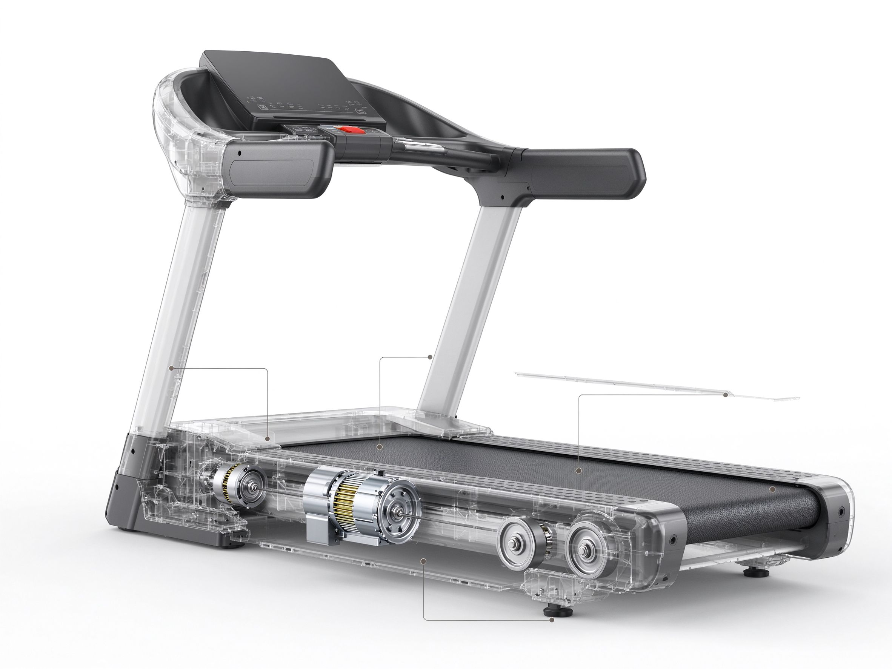
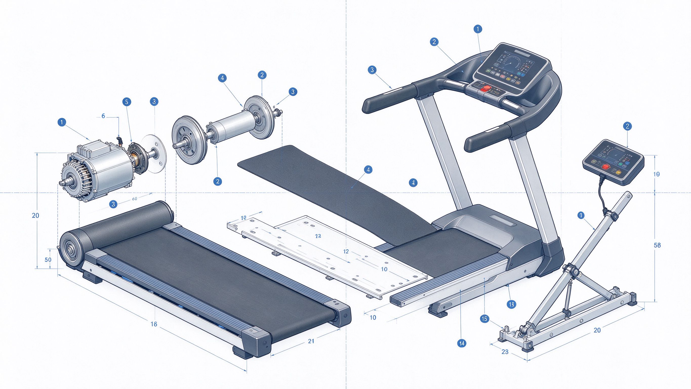
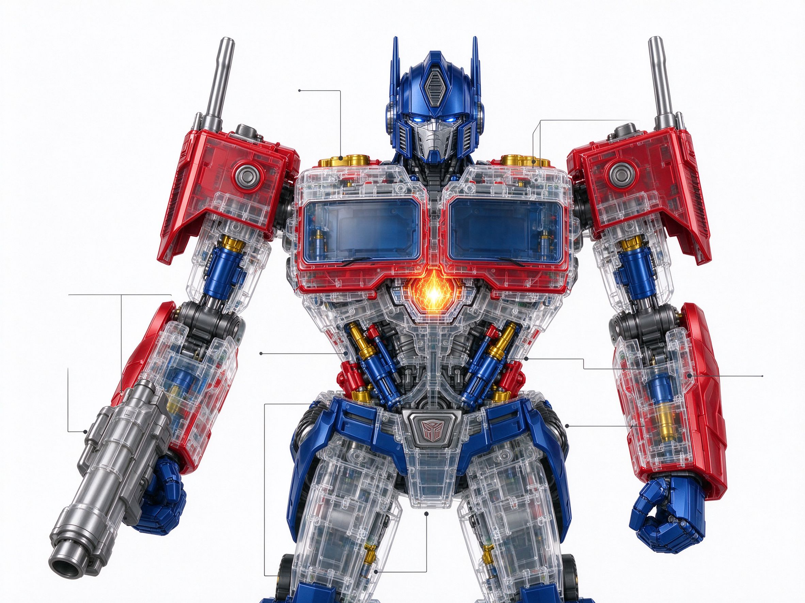
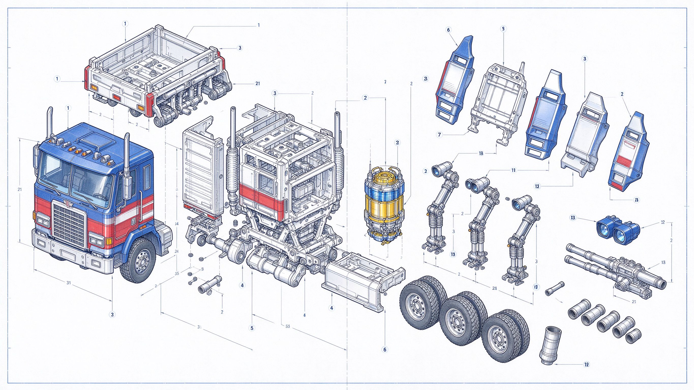

<div align="center">

# HoloAeon

### 零依赖、生物启发的通用多智能体认知框架——给大模型当管家，给普通人当工具


[English](README.md) · [中文](README.zh-CN.md)

</div>

---

## 这是什么

HoloAeon 是**纯标准库、全离线、确定性**的多智能体认知框架：零依赖、零安装、零成本起步，
一台十年前的旧笔记本即可运行。它可构建在任意大模型之上——也可以完全不用大模型独立工作。

**它的定位：给大模型当管家。**大模型负责语言与生成，HoloAeon 负责安检、记账、路由、
复现——让 AI 的每一次回答旁边，站着一个可审计的记忆体。

## 当前工程状态（2026-11-05）

| 项 | 实测值 |
|---|---|
| 产出维度（锁死） | **25 智能体 / 47 技能 / 9 域包**；`diff0_hash=2fc892cf9af6e755`、`tamper=f42c8229ee5acd73` 未变 |
| 最新批次 | **V31 泰坦进化模块（`titan_evolver` 本地自进化引擎基座 · 环面调度·不新增环 · 维度不变，`DOC_VERSION 0.9.25 → 0.9.26`）**（新建 `holoaeon/titan_evolver.py`（清单→缺口→评分→提案→合入五件判定 + 11 机制 + 诚实边界；清单权威 JSON、YAML 只导出不解析）+ `scripts/titan_evolver_run.py`（执行层联网：urllib + 浅克隆 + JSON 台账）+ `reports/capability-manifest.json`（12 项能力 / 12 gap）+ `tests/test_titan_evolver.py`（29 例）· **与 V29 magic_lamp 互补**：magic_lamp 是被动编译器（止于方案书、零网络），titan_evolver 补齐定时巡检 + 真联网采集 + 提案制合入闭环 · 许可证黑名单入口优先拦截（SSPL/BUSL 拒，AGPL 只蒸馏）· 包内零网络零 subprocess（V25 分层先例）· 不新增扩展包（19 不变）· `unittest 305 OK` · `redline 115 文件 0 违规`· `diff0` 未漂移（`6d119b2a9f2df687`））** · 承 **V30 文档解剖器（`doc_anatomy` pdf-inspector 创意本地化 · 链上第四环·解剖 · 维度不变，`DOC_VERSION 0.9.24 → 0.9.25`）**（新建 `holoaeon/doc_anatomy.py`（四能力 classify/extract/markdown/tables + 诚实边界 + CLI `axioms|chain|mechanisms|classify|extract|markdown|tables|inspect`）+ `tests/test_doc_anatomy.py`（18 例）· **只蒸馏判定结构，不复制 Rust 代码**（MIT 亦守不复制纪律）· 纯标准库 `re`/`zlib`/`json` · 不新增扩展包（19 不变）· `unittest 276 OK` · `redline 114 文件 0 违规`· `diff0` 未漂移（`6d119b2a9f2df687`））** · 承 **V29 神灯模式（`magic_lamp` 诉求驱动总装编排 · 维度不变，`DOC_VERSION 0.9.23 → 0.9.24`）**（新建 `holoaeon/magic_lamp.py`（九段 W1–W9：诉求受理→组织 DNA 六条→技能索引→贪心装配→缺口检测→离线搜索规格→三链启动→试测即焚→方案书；三态 `ready_assembled|needs_search|test_failed`；`SEAL` 只出数据不出动作，联网执行权在碳基终审）+ `tests/test_magic_lamp.py`（11 例）· 第一性原理：**愿望的满足顺序=先翻衣柜再造新衣** · 取 5 精华 D-01~D-05 + 弃 4 糟粕 X-01~X-04（模块内联网/LLM 判可行性/未过试测就硬核/自动执行方案）· 纯标准库零网络零密钥· **不新增扩展包**（`EXTRA_PACK_ORDER` 19 不变）· `unittest 258 OK` · `redline 113 文件 0 违规`· `diff0` 未漂移（`6d119b2a9f2df687`）· CLI `patterns|wardrobe`）** · 承 **V28 全息熔炉（`holo_forge` 链式执行层第三环 · 双公理 · 维度不变，`DOC_VERSION 0.9.22 → 0.9.23`）**（新建 `holoaeon/holo_forge.py`（六段：F1 `CalibrationSnapshot` 开工校准快照（自洽/鲁棒/五锚点）→ F2 `ChainExecutor` 链式执行层（mobius 回流→klein 投影→forge 熔炼，Envelope 载荷恒定、缺环优雅降级）→ F3 `BaseSelector` 基座选择（按能力交集打分，full/selective 两模式 manifest，选择性加载只登记不复制代码）→ F4 `LegoComposer` 乐高拼接（`seal`+`schema` 契约互认，协同分=机制并集增益+接口共享≥1 → **1+1>2 确定性判据**）→ F5 `FusionForge` 四态融合（plan→execute→reference→product 状态机 + 四态轨迹）→ F6 `ProjectLibrary` 成品入库（`FORGE_INDEX.json`，同名累积=赫布信任））+ 贯穿段 `ChatFrontendPack` 对话窗口前端包（任意大模型平台粘贴即用）+ `tests/test_holo_forge.py`（13 例）· 双公理立炉：**全息=局部包含整体 / 万物互联=万物可链、契约即接口** · 三模块几何递进：莫比乌斯环（回流·知道）→ 克莱因瓶（吸纳·拿来）→ 全息熔炉（熔炼·成为）· 熔炉本体=耗散结构（开放契约+四态流动+非线性协同+锚点涨落）· 取 5 精华 D-01~D-05 + 弃 4 糟粕 X-01~X-04（强耦合/复制代码/一过性入库/自动执行）· 纯标准库、零网络、零密钥 · **不新增扩展包**（`EXTRA_PACK_ORDER` 19 不变）· `selftest 25/25` · `unittest 247 OK` · `redline 112 文件 0 违规` · `v3_gate 32/32` · `dimension_lock PASS`（快照 0.9.23 / 19 演进正常）· `diff0` 未漂移（`6d119b2a9f2df687`）· CLI `axioms|chain|mechanisms`）** · 承 **V27 克莱因收敛投影（`klein_projection` 全息吸纳 · 维度不变，`DOC_VERSION 0.9.21 → 0.9.22`）**（新建 `holoaeon/klein_projection.py`（七段：`CandidateIntake` 候选档案 + 必填校验 → `HoloEvaluator` 11 机制投影打分 + **许可证四级裁决** → `QuartetGate` 五步协议 + 涌现条件 → `TensorCoupler` D/X 张量轴 + **两轮不动点收敛（分差=0）** → `EphemeralForge` `tempfile` 一过性车削（`ast` 只校验不执行，用后即焚）→ `Hardener` 四闸全绿才转正 → `ProjectLibrary` 仓外 JSON 索引）+ 贯穿段 `ChatFrontendPack` 对话窗口提示包（平台即前端，本地库即后端）+ `tests/test_klein_projection.py`（19 例）· 第一性原理：**全息=局部包含整体——11 项机制是一张可投影到任意候选的图纸，读得通=可吸纳，读不通=放弃；克莱因瓶无向闭合=候选被吸纳、本体不被侵入** · 取 5 精华 D-01~D-05（七段流水线 / 许可证四级 / 两轮不动点 / 一过性 tempfile+ast / 平台即前端）+ 弃 4 糟粕 X-01~X-04（LLM 判"有创意"/复制 AGPL 代码/一过性件入库/自动执行吸纳）· 纯标准库、零网络、零密钥、不 shell out · **不新增扩展包**（`EXTRA_PACK_ORDER` 19 不变）· `selftest 25/25` · `unittest 234 OK` · `redline 111 文件 0 违规` · `v3_gate 32/32` · `dimension_lock PASS`（快照 0.9.22 / 19 演进正常）· `diff0` 未漂移（`6d119b2a9f2df687`）· CLI `status|atlas|assess <candidate.json>|frontend|library`）** · 承 **V26 莫比乌斯漩涡（`mobius_vortex` 状态回流环 · 维度不变，`DOC_VERSION 0.9.20 → 0.9.21`）**（新建 `holoaeon/mobius_vortex.py`（五段：`StateBeacon` 写状态灯塔 JSON → `VortexIngest` 两级校验（L1 schema 快筛 + L2 seal 深校）→ `MobiusRing` 三点对齐（灯塔/实时/账面，不一致以实时为准并回填账面）→ `QuartetBrief` 确定性四人组简报（P4问题/P2事实/P3风险/P1建议，零 LLM）→ `SkillAtlas` 10 条静态映射）+ `tests/test_mobius_vortex.py`（12 例）· 第一性原理：**正程（总监→豆包派发）已由 ACP 打通，缺的是回程；回传不建新通道——同一文件系统即莫比乌斯接口面** · 取 5 精华 D-01~D-05（灯塔 schema / 三点对齐 + 断线恢复 / 简报确定性聚合 / 技能自动匹配 / 文件即接口）+ 弃 4 糟粕 X-01~X-04（实时推送 WebSocket / ACP 反向调用让密钥过墙 / 大屏可视化 / 自动执行简报建议）· 纯标准库、零网络、零密钥、不 shell out（git 身份沿用 V25 `.git` 文件直读）· **不新增扩展包**（`EXTRA_PACK_ORDER` 19 不变，模块级先例 `butler_os` V12 / `machine_tool` V25）· `selftest 25/25` · `unittest 215 OK` · `redline 110 文件 0 违规` · `v3_gate 32/32` · `dimension_lock PASS`（快照 0.9.21 / 19 演进正常）· `diff0` 未漂移（`6d119b2a9f2df687`）· CLI `status|atlas|beacon|ingest|align|brief`）** · 承 **V25 工程机床 HoloAeon 化（`machine_tool` 八段流水线进仓 · 维度不变，`DOC_VERSION 0.9.19 → 0.9.20`）**（新建 `holoaeon/machine_tool.py`（八段流水线 S1 基线检查 → S2 四人组定调 → S3 实验田 → S4 投喂包 → S5 交接 → S6 验证闸门 → S7 五地台账 → S8 记忆回填；`SEAL` / `RED_LINES`(10) / `PIPELINE`(8) / `FIVE_STEP`(5) / `EMERGENCE_RULES` / `GATES`(8) 全部是确定性数据，无一处依赖 LLM）+ `scripts/machine_tool_run.py`（执行层：真跑七道闸门与 git 工作区探针）+ `tests/test_machine_tool.py`（15 例，含流水线顺序与真探针回归）· **分层是红线决定的**：包内禁 `subprocess`（`redline.py` 的 FORBIDDEN_MODULES/FORBIDDEN_CALLS），故 **包=判定、脚本=执行**，git 身份改 `.git` 文件直读（HEAD → refs / packed-refs）· 取 5 精华 D-01~D-05（八段固化顺序/红线 10 条一字不改/五步协议+涌现确定性判定/五地"全一致才收口"/断线以实时 HEAD 为准）· 弃 4 糟粕 X-01~X-04（WorkBuddy 会话依赖/外部路径硬编码/纯表现层横幅/密钥入仓）· **不新增扩展包**（`EXTRA_PACK_ORDER` 19 不变，模块级先例 `butler_os` V12）· 新文件不参与 ReproHash · `selftest 25/25` · `unittest 203 OK` · `redline 109 文件 0 违规` · `v3_gate 32/32` · `dimension_lock PASS`（快照 0.9.20 / 19 演进正常）· `diff0` 未漂移（`6d119b2a9f2df687`，篡改 `8f424d9ee3ebfb9b`，拦截 16/16）· 装配 66 agents / 280 skills · `python -m holoaeon.machine_tool boot` 一屏对齐身份/装配/提交/闸门/五地）** · 承 **V24 群体智能引擎（MiroFish 五阶段流水线蒸馏 · 第 19 扩展包 `swarm_intel`，`DOC_VERSION 0.9.18 → 0.9.19`）**（新建 `holoaeon/swarm_intel.py`（SeedToGraph→PersonaArchitect→ParallelSimulator→ReportSynthesizer→DeepInteractor 五阶段 + `SwarmOrchestrator` 多城邦编排 + CLI；确定性纪律：弃内置 `hash()` 改 `zlib.crc32`/`sha256`，保证跨进程同输入同输出）+ `holoaeon/packs/swarm_intel_pack.py`（5 技能/3 角色/2 工作流，11/11 自组织机制覆盖）+ `EXTRA_PACK_ORDER 18→19` · `butler_os` 菜单追加 14 群体智能 · `pyproject` 追加 `holoaeon-swarm-intel`（现 13 命令）· 取 7 精华 D-01~D-07（五阶段流水线/规则版 Persona/AgentAction+RoundSummary/双路并行/God View 注入/深度交互/确定性报告）+ 弃 6 糟粕 X-01~X-06（LLM 重度依赖/Zep Cloud/OASIS 框架/Vue 前端/AGPL 代码复制/"预测万物"定位），第一性原理交集=**涌现是交互的函数，不是智能的函数**；AGPL-3.0 合规：只蒸馏创意方法论、零代码复制 · `selftest 25/25` · `unittest 188 OK` · `redline 108 文件 0 违规` · `v3_gate 32/32` · `dimension_lock PASS`（快照 0.9.19 / 19 演进正常）· `diff0` 未漂移（`6d119b2a9f2df687`）· 装配 66 agents / 280 skills）** · 承 **V23 回收式整理补丁（维度锁诚实化 FROZEN_SNAPSHOT + README 回读 + Guard 口径统一 + CI 结论修正 + router 中文路由测试 6 例，`DOC_VERSION 0.9.17 → 0.9.18`）** · 承 **V22+ 千问评估补丁（CJK 中文分词修复 + SHA256SUMS 0 漂移 + 第 18 扩展包 eng_skills，`DOC_VERSION 0.9.17`）** · 承 **V16 确定性自主调度增强 · DeepSeek Super-agent 对标蒸馏（V16-A→E，`DOC_VERSION 0.9.14 → 0.9.15`）**（新建 `holoaeon/router_layer.py`（RouterLayer 确定性任务路由：task_queue deque/shared_context/dispatch_rules 按 priority 排序/worker_results/is_running，receive→_dispatch 带「有序字符匹配」降级链）+ `holoaeon/event_filter.py`（EventFilter 两级过滤：FAST_PATTERNS 14 词 + DEEP_RULES 4 条 lambda，filter 返回 passed/level/reason，batch_filter CLI）+ `holoaeon/external_watchdog.py`（ExternalWatchdog 外部只读看门狗：BASE_LINE 冻结基线，check_selftest/check_diff0/check_redline 只 observe 不执行，alert 只告警不拦截）+ `holoaeon/packs/super_agent_pack.py`（第 16 扩展包：5 技能/3 角色/1 工作流，key="super_agent"）+ `EXTRA_PACK_ORDER 15→16` · `butler_os` 菜单追加 11 自主调度 · `pyproject` 追加 `holoaeon-router / holoaeon-watchdog`（现 10 命令）· 蒸馏 5 精华 D-01~D-05 + 剔除 4 糟粕 X-01~X-04，第一性原理交集=**确定性的自主调度**（规则驱动非 LLM）· `selftest 25/25` · `unittest 68 OK` · `redline 101 文件 0 违规` · `v3_gate 32/32` · `verify_v44 13/13` · contract PASS · MCP 回归 13/13（doc_version 0.9.15）· 四新模块 selfcheck PASS · 装配快照 agents=56 skills=262 · 写型链全绿（zip 不动点 a87fa921bf963fa1 保持）· golden 重冻结 3 项（V6 degraded 结构演进修复））+ 全息体系对应表 V16 更新（Router=router_layer.py/事件过滤=event_filter.py/外部看门狗=external_watchdog.py/自主调度=super_agent_pack）· 承 **V15 自组织相似性全息去幻觉模块（V15-A→D，`DOC_VERSION 0.9.13 → 0.9.14`）**（新建 `holoaeon/dehallucination.py`（DeHallucinationModule 8 阶段流水线 input→seb_extract→reality_anchor→snapshot_vec→leibniz_compare→synonym_map→verdict→hebbian_update：莱布尼茨 PSR × 张平 Seb × HoloAeon 赫布场，COSINE_HIGH=0.7/COSINE_LOW=0.4/BAYES_PRIOR=0.15/BAYES_THRESHOLD=0.5，联网 fetch_callback 回调注入缺失降级，贝叶斯+耗散熵判定）+ `holoaeon/packs/dehallucination_pack.py`（第 15 扩展包：6 技能/3 角色/1 工作流，key="dehallucination"）+ `EXTRA_PACK_ORDER 14→15` · `butler_os` 菜单追加 10 去幻觉检测 · `pyproject` 追加 `holoaeon-dehallucinate` · `selftest 25/25` · `unittest 68 OK` · `contract 184 OK` · `redline 97 文件 0 违规` · `v3_gate 32/32` · `verify_v44 13/13` · MCP 回归 13/13 · `diff0` 未漂移 · 装配快照 agents=53 skills=257）+ 全息体系对应表修正（经络=自组织相似性类节点共振 topology_resonance_pack，**≠Bus**；经络机制=Bus C2 消息路由，独立概念）· 承 **V14 技能机床与插件化协议适配平台（V14-A→F，`DOC_VERSION 0.9.12 → 0.9.13`）**（新建 `holoaeon/skill_lathe.py`（技能机床：TVCB→SkillSpec，能量分级 A/B/C 级丢弃，`salvaged_<topic>_<hash4>` 命名）+ `holoaeon/protocol_plugins.py`（12 种平台协议遍历穷举导出：OpenAI/Anthropic/Gemini/MCP/A2A/ACP/LangChain/LlamaIndex/AutoGen/CrewAI/Bedrock/Envelope，未知协议 raise ValueError）+ `holoaeon/packs/vector_sea_pack.py`（向量海勘探+加工+分发 · 第 14 扩展包：8 技能/4 角色/2 工作流，key="vector_sea"，V13 勘探 5 技能+V14 机床/协议/工作台 3 技能）+ `holoaeon/vector_sea_explorer.py`（9 阶段流水线 input→ocr→snapshot→search→refine→output→salvage→lathe→protocol_export）+ `EXTRA_PACK_ORDER 13→14` · butler_os 菜单追加 8/9 · `pyproject` 追加 `holoaeon-explore / holoaeon-lathe` · `selftest 25/25` · `unittest 68 OK` · `contract 184 OK` · `redline 95 文件 0 违规` · `diff0` 未漂移 · 装配快照 agents=50 skills=251）· 承 **V12 管家操作系统引导模块（V12-A→E，`DOC_VERSION 0.9.11 → 0.9.12`）**（新建 `holoaeon/butler_os.py`（OS 式菜单 7 项+0 退出）+ `holoaeon/packs/quartet_director_pack.py`（四人组执行顾问 · 第 13 扩展包：14 技能/5 角色/2 工作流，内联实现零依赖，公开 `check_emergence` → (0.85,0.85,0.85,0.30) 实测 emergence=True order=0.5237）+ `holoaeon_os.bat/.sh` 双击入口 · `EXTRA_PACK_ORDER 12→13` · `pyproject` 追加 `holoaeon-os / holoaeon-quartet` · `selftest 25/25` · `unittest 68 OK` · `redline 90 文件 0 违规` · `diff0` 未漂移）· 承 **V11 城邦架构融合 · 拓扑共振升级（V11-A→E，`DOC_VERSION 0.9.10 → 0.9.11`）**（3 Graph 函数 · Guard L10 贝叶斯层默认关 · `topology_runtime.py` · 2 治理技能 skills 14→16）· 承 **V8 批2-4 融合升级**（L9 路径闸门 + 产品层三件套 + TCM 旗舰包 + 领域化解耦）· 承 **V6.1-B5 摘要清单重建** · 承接 V6.1-B4 产品化转型与 V6.0 族级登记与路由第三态 |
| 扩展卡槽 | **12 个**：occupied 6 / open 1 / reserved 4 / blocked 1（只声明不接线；本批**不新增、不占用**槽位） |
| 门禁 | `v3_gate 32/32` · `selftest 25/25` · `unittest 305 OK`（主 tests，含 V24 `test_swarm_intel` 8 例 + V25 `test_machine_tool` 15 例 + V26 `test_mobius_vortex` 12 例 + V27 `test_klein_projection` 19 例 + V28 `test_holo_forge` 13 例）+ `v3 11 OK` + `verax 21 OK` · `旁挂 184 OK`（`tests_contract` 的 `test_10_no_new_pack` 已改下界 `>=11`，V12 起不再过期） · `v44 13/13` · `v45 7/7` · `v46 9/9` · `v5 11/11` · `dv 8/8` · `redline 115 文件 0 违规` · `drift []` |
| 五地同步 | 本地 · Gitee · GitHub · Hugging Face · 向量海 —— 见文末 [附录 A](#附录-a--五地同步v11) |
| 版本脉络 | V4.0 → V6.1 → V11 → V12 逐提交回溯 —— 见文末 [附录 B](#附录-b--版本升级说明v3--v11) |
| V4 主文档 | [`README_FUSION_V4_20261102.md`](README_FUSION_V4_20261102.md) · 同步规则 [`data/FIVE_SITE_SYNC_DNA.md`](data/FIVE_SITE_SYNC_DNA.md) |

### V5.1 · 设计语汇（旁挂，不改维度）

把 Impeccable（[`pbakaus/impeccable`](https://github.com/pbakaus/impeccable)，Apache-2.0，作者 Paul Bakaus）的**范式**本地化——不是分支、不是移植：本仓没有它的引擎二进制，也没有它的规则原文与模板，只用「命令即词汇 + 确定性规则 + P0–P3 分级」这一套做法，规则与释义全部自写。

- **24 个命令**：steer 9 / review 2 / finish 6 / iterate 2 / plan 4 + 1 个上游弃用别名，`vocabulary.command_ids()` 可回读。
- **12 条确定性规则**：`DV-01`–`DV-12`，各带分级（P0 最该先修）与经络通道，命中给行号与证据；**不宣称与上游 62 条等量**。
- **3 种编译模式**：`elaborate`（源码→元件/端口）· `simulate`（跑规则→分级命中）· `netlist`（命中→规则/通道网表），对应 EDA 的分析 / 仿真 / 综合。
- **4 条经络通道**：`blood` / `lymph` / `qi` / `shen`，沿用仓内既有分组，不新增第五通道。
- **零 LLM、零 API key、零出网**；只出建议与先修顺序，**不写回你的源码**。

```powershell
python scripts\verify_design_vocab.py   # 8 项判据，写 reports/design_vocab_check.json
```

**维度不变**：25 智能体 / 47 技能 / 9 域包不动，`data/extension_slots.json` 仍 12 条；本能力**不认领、不占用**任何 `EXT-` 槽。合作开发、扩展规则、未来槽位的走法见 [`docs/设计语汇与协作开发指南.md`](docs/设计语汇与协作开发指南.md)。

### V5.2 · 门禁自指修复与代码卫生（不改维度）

自查版 12 条意见逐条核实后落地（`evidence_class=simulated`）。核心问题只有一类：**自指处理不彻底**——只给单个校验器打补丁，没做成通用机制；同时把依赖本机路径的判据写进门禁，导致“13/13”只在作者本机成立、CI 从未验证。

- **A10 自指排除完备化**：不再只排除自己，改为排除全部兄弟校验器回执（v43/v44/v45/v46/v5/dv + 五地 manifest），并如实返回 `self_excluded_count`。
- **A11 切断传染**：`others_passed` 不再包含 A10。A10 属环境项，它单独红时 A11 仍 PASS——环境红不再伪装成内容红。
- **skipped 第三态**：manifest / ivsa 不在本机时记 `skipped` + `pending_human_measure`，不计入 `passed/total`，**不当作 PASS**。
- **路径去硬编码**：`five_site_dna` 的交付目录与回执路径由仓库位置推导（仍可用 `HOLOAEON_PKG` / `HOLOAEON_RECEIPT` 覆盖）；`verify_v44` 的 ivsa 根改走 `HOLOAEON_IVSA_ROOT`。
- **句柄泄漏清零**：`json.load(open(...))` 与 `open(...).read()` 在 `scripts/` 全部改为 `pathlib` 一次性读取，回读计数 0。
- **CI 补三道闸**：`tests_contract`（168 例）、`check_dimension_lock`、`verify_design_vocab` 进 workflow——此前契约测试从未在 CI 跑过。
- **L3 归一化（[golden]）**：Guard 危险模式判据补 NFKC + 零宽剥离 + 同形字折叠 + 分隔符拼接折叠；原本命中即拦截的文本 reason 与旧版逐字一致，`diff0` 仍 `2fc892cf9af6e755`、篡改值仍 `f42c8229ee5acd73`。
- **兜底开关（保守版）**：`BROADCAST_ON_NO_MATCH` 与 `ALLOW_SINGLE_SKILL_FALLBACK` 默认仍为 `True`，**行为不变**；改 `False` 才会 fail-loud。
- **技能基座化**：六机制（全息心跳 / 细胞骨架 / 皮肤 / 语义通信 / 赫布场 / 经络）的模块入口与外部技能“登记不复制”口径，见 [`docs/技能基座化与六机制接线指南.md`](docs/技能基座化与六机制接线指南.md) 与 `data/v5_skill_base_registry.json`。

```powershell
python scripts\verify_v43.py          # 11/11
python scripts\verify_v44.py          # 13/13（首跑 12/13 属天然自指，第二次收敛）
python -m unittest discover -s tests_contract   # 168 OK
python scripts\check_dimension_lock.py          # 0 violation · diff0 未漂移
```

**维度不变**：25 / 47 / 9 与 12 个 EXT 槽一位未动；`spec.VERSION` 仍 0.9.1。

### V6.0 · 族级登记表 · 路由第三态 · 代码卫生收口（不改维度）

`DOC_VERSION` 0.9.3 → **0.9.5**（`spec.VERSION` 仍 0.9.1，不回写运行态标识）。V6 投喂包 12 条 + 额外 3 条逐条实测后：V5.2 已修 8 条、本批补 7 条。

- **句柄清零到底**：`json.load(open(...))` / `open(...).read()` 全仓复扫 **0 处**（V5.2 只清了 `scripts/`，本批补 `tests_contract/` 6 处与 `skills/holoaeon-video-tensor-dna/` 4 处）。
- **红线防回归**：`holoaeon/redline.py` 新增 `FORBIDDEN_NESTED_OPEN = {"load","loads","read"}` 与 `visit_Call` 两段判定——以后谁再写内联开句柄，`redline_scan` 直接红。
- **路由第三态**：无内置技能命中时 `submit()` 返回 `status="no_agent_matched"` + `hint` + `external_candidates`，不再把「没匹配上」伪装成「N 条结果」；显式 `to="*"` 才广播。
- **兜底可观测**：`agent.handle()` 结果新增 `degraded` 字段，单技能兜底被借用时置 `True`，事后能看出这次成功是「真命中」还是「借来的」。
- **开关进配置**：`HoloAeonConfig` 增 `broadcast_on_no_match` / `allow_single_skill_fallback`（默认 `True` 保持现状）；模块级常量降级为缺省值，`register_agent` 把配置下沉到每个 agent。
- **守卫精度（[golden]）**：`DANGER_PATTERNS` 的宽匹配 `.env` 收紧为 `open('.env` / `open(".env` / `dotenv`——「文档里提到 .env」不再被误拦，真正读凭证仍拦。`diff0` 仍 `2fc892cf9af6e755`、篡改值仍 `f42c8229ee5acd73`。
- **1199 条外部技能族级登记 + 桥接**：`data/v6_skill_family_registry.json` 把 1229 条索引收成 **58 个「域×机制」族**（1,229 成员，`members_sha256` 可回读），`holoaeon/fusion_upgrade/external_skill_registry.py` 提供 `load/stats/family_of/match/route` 与 `Kernel.resolve_external()`。**登记不复制、不改 47 条内置技能**：桥接是「族的候选出口」，执行仍走 25 个 agent。

```powershell
python -m unittest discover -s tests_contract   # 184 OK（含 V6 12 例 + V6.1 4 例）
python scripts\redline_scan.py                  # 扫描 83 文件，零违规
python scripts\check_dimension_lock.py          # 12 维度 + 7 闸 + 0 violation，diff0 未漂移
python -c "from holoaeon.fusion_upgrade import external_skill_registry as e; print(e.stats())"
```

**维度不变**：25 智能体 / 47 技能 / 9 域包 / `EXTRA_PACK_ORDER=10`；`diff0_hash`、`tamper`、`spec.VERSION` 三个冻结值一位未动。

### V6.1 · 工程纪律固化 · A10 派生 · 交付票据回写（不改维度）

`DOC_VERSION` 0.9.5 → **0.9.6**（`spec.VERSION` 仍 0.9.1）。本批只做「必须做」的三件，全部不碰 `diff0`：

1. **A10 自写回执改派生**：名单不再硬编码，从 `five_site_dna.REPO_FILES` 派生 `reports/*.json`，产生者由 `scripts/{verify_,build_,check_,gen_}*.py` 回填——新增写型校验器无需再手改 A10；派生为空退回 `LEGACY_SELF_REPORTS` 并标 `self_derive="legacy"`（fail-loud）。
2. **`missing` 不豁免**：`repo:missing:` 不再算自指——删回执是真实退化；只排除 `changed` / `new`，且每条记 `owner` + `prev_sha16` + `curr_sha16` 差分证据。
3. **票据回写 + 纪律入库**：`01` / `06` 追加 V6 章节；新增 `docs/工程纪律_批次升级与五地同步.md`（八步写序 / 五地同步 / 失败处置 / 批次命名），并固化为技能 `holoaeon-batch-upgrade-discipline`，随全域技能根加载、触发即执行。

```powershell
python -m unittest discover -s tests_contract   # 184 OK（+ test_v44 4 例）
python scripts\verify_v44.py                    # 13/13；A10 self_derive=derived
python scripts\redline_scan.py                  # 0 违规
python scripts\check_dimension_lock.py          # diff0 未漂移
```

**维度不变**：25 / 47 / 9 与 `EXTRA_PACK_ORDER=10` 一位未动；`spec.VERSION=0.9.1`、`diff0_hash`、`tamper` 三值仍未动。


### V11 · 城邦架构融合 · 拓扑共振升级（V11-A→E，不改维度）

`DOC_VERSION` 0.9.10 → **0.9.11**（`spec.VERSION` 仍 0.9.1）。对应 `AGENT_FEED_V11_CITY_STATE_FUSION_20261103.md` 第七章，五步贯序执行：

1. **V11-A · Graph 集成**：`topology_resonance_pack.py` 追加 `graph_mandala_expand`（曼陀罗扇出）/ `graph_mobius_flip`（莫比乌斯回边）/ `graph_klein_convergence`（收敛+熔断），不碰 `graph.py`（按真实 `weights` 矩阵接口实现，投喂包 `add_edge()` 示意已勘误）。
2. **V11-B · L10 贝叶斯层**：`guard.py` 新增 `_L10_LIKELIHOOD` + `l10_bayesian(env)`（`bayes_feature` 后验 >0.5 → BLOCK，无特征放行）；`Guard.__post_init__` 条件挂载；`GuardConfig` 新增 `bayesian_guard: bool = False`（默认关，`BUILTIN_LAYERS` 一字未动）。
3. **V11-C · Runtime 增强**：新建 `holoaeon/topology_runtime.py`（StateReducer/Checkpoint/CircuitBreaker/DissipationMonitor），纯标准库零包内依赖。
4. **V11-D · 治理技能**：追加 `city_state_governance`（循环检测+熔断+退避重试）与 `dissipation_emergence_monitor`（熵趋势+涌现判定），skills 14→16。
5. **V11-E · 文档版本**：`DOC_VERSION` 0.9.10 → **0.9.11**。

```powershell
python -m holoaeon.selftest                # 25/25
python scripts\check_dimension_lock.py     # 0 violation · diff0 未漂移
python scripts\v3_gate.py                  # 32/32
python scripts\redline_scan.py             # 88 文件 · 零违规
python -m unittest discover -s tests       # 68 OK（V11 补丁 PR-3 新增 L10/拓扑运行时 29 例）
```

**维度不变**：25 / 47 / 9 与 `spec.VERSION=0.9.1`、`diff0_hash=2fc892cf9af6e755`、`tamper=f42c8229ee5acd73` 三值仍未动；`EXTRA_PACK_ORDER=12` 未再增；Guard 默认 9 层、开启 L10 后 10 层（附加层不计入 `guard_layers=8`）。

### V11 补丁升级 · PR-3 L10/拓扑运行时集成测试（不改维度）

投喂的补丁升级工程经**判据优先**核查后，仅 PR-3 为真实缺口并落地：

- **新增 `tests/test_l10_bayesian.py`（13 例）**：L10 贝叶斯守卫纯函数语义（delete/network 后验 >0.5 拦截、write 低先验放行、未知特征回退 safe 表、非法先验回退 0.15）+ Guard 挂载语义（默认关不改变既有行为、开启后 L10 生效且层序 L9→L10、BUILTIN_LAYERS 8 层不变）。
- **新增 `tests/test_topology_runtime.py`（16 例）**：StateReducer 指数平滑/dict 归约/replace/快照恢复、Checkpoint 快照链、CircuitBreaker closed→open→half_open 状态机、DissipationMonitor 熵/秩序度/耗散率/重组触发。
- 门禁实测：`unittest 68 OK` · `selftest 25/25` · `redline 88 文件 0 违规` · `维度锁 0 violation`。

**投喂其余 PR 核查结论（如实披露，未执行）**：PR-1（P0 门禁自指三项）**已修**（A10 派生化、A11 传染切断、路径环境变量化，V6.1 落地）；PR-2 中 P1-4a 句柄泄漏**不属实**（V6 已清零+红线防回归）、P1-5 CI **不属实**（已跑契约）、P1-6 README「42 文件」**无此口径**；P1-4b `ivsa/eda_pipeline.py` 3 处 `open().read()` **真实存在**（daily 日志记录 ResourceWarning），但 ivsa 为独立客仓，按纪律「不接客仓写入」且会破坏 A12 门禁，**只记录不修改**，需授权后另行处置。PR-4（MCP 桥接）投喂自标可选/后续，**本批不展开**。


### V12 · 管家操作系统引导模块（V12-A→E，不改维度）

`DOC_VERSION` 0.9.11 → **0.9.12**（`spec.VERSION` 仍 0.9.1）。对应 `AGENT_FEED_V12_BUTLER_OS_BOOTSTRAP_20261103.md` 第三部分，步骤 A→E 贯序执行：

1. **V12-A · 四人组执行顾问扩展包**：新建 `holoaeon/packs/quartet_director_pack.py`（**第 13 扩展包**，`key="quartet_director"`）——14 技能 / 5 角色 / 2 工作流（`quartet_advisor_flow` 五步闭环 / `quartet_emergence_flow` 涌现+回执闭环），**内联实现不 import quartet_toolkit**（零外部依赖）；公开 `check_emergence(p1,p2,p3,p4)`（涌现条件：P2×P3 强共振≥0.7 + P1 愿景≥0.6 + P4 风险≤0.4 + order>0.30；实测 `check_emergence(0.85,0.85,0.85,0.30)` → `emergence=True, order=0.5237`）；`advisor_selfcheck()` 校验 14/5/2 + 涌现确定性。投喂包 dict 写法已转 base.py dataclass 契约、ROLES 缺 `skills` 字段已补全、`_check_emergence` 已公开化。
2. **V12-B · Butler OS 引导模块**：新建 `holoaeon/butler_os.py`（OS 式菜单 7 项 + 0 退出：1 安装引导 / 2 自检 / 3 技能清单 / 4 四人组加载 / 5 启动桥接服务 / 6 提交任务 / 7 状态快照；纯标准库、懒加载 kernel、`_readline` 替代 `input` 规避红线）+ 双击启动入口 `holoaeon_os.bat`（chcp 65001）/ `holoaeon_os.sh`。
3. **V12-C · 注册第 13 扩展包**：`packs/__init__.py` import + `EXTRA_PACK_REGISTRY` 登记 + `EXTRA_PACK_ORDER` 追加 `"quartet_director"`（12→**13**）；`spec.py` `DOC_VERSION` 0.9.11 → **0.9.12**（`VERSION` 0.9.1 冻结未动）。
4. **V12-D · 命令注册**：`pyproject.toml` `[project.scripts]` 追加 `holoaeon-os = "holoaeon.butler_os:main"`、`holoaeon-quartet = "holoaeon.packs.quartet_director_pack:main"`。
5. **V12-E · 验证 + README + 回执 + 五地**：全验证绿 + 三份 README V12 段 + `reports/v12_receipt.json` + 单批单提交 + 五地同步推送回读 + S4 回执刷新 + 交付。

### V12.1 · 未决项闭环（第一性原理裁决 · 单提交）

- **契约测试同步（执行）**：`tests_contract/test_hebbian_store.py` `test_10_no_new_pack` 由写死 `len(EXTRA_PACK_ORDER)==11` 改为下界 `>=11` —— 扩展包按批次递增（V8=11 → V11=12 → V12=13），契约本意是锁 `PACK_ORDER==9`（25/47/9 维度锁）与扩展登记隔离；对可演化集合写死精确值导致每批过期（V9 起漂移至今）。改为下界防回退，`tests_contract` 184 全绿。
- **MCP 桥接（执行）**：新建 `holoaeon/mcp_adapter.py` —— MCP（Model Context Protocol，2024-11-05 规范）stdio 传输最小协议子集（JSON-RPC 2.0：`initialize` / `ping` / `tools/list` / `tools/call`）；暴露 3 工具：`holoaeon.task`（通用任务提交，复用 `frontend_adapter.handle_request` 契约）/ `holoaeon.status`（状态快照：runtime_id/VERSION/DOC_VERSION/agents/skills/guard_layers）/ `holoaeon.quartet`（四人组涌现，直通 `check_emergence`）。零依赖、无网络、无 GPU；与 butler_os 同构（同一契约、不同运输层：本地菜单 vs 标准协议）；`pyproject` 注册 `holoaeon-mcp` 命令；自测 13/13（含 parse_error -32700 / invalid_request -32600 / unknown_tool -32602 / method_not_found -32601 错误分支）。
- **悬挂项（记录不执行）**：① ivsa 客仓 `eda_pipeline.py` 三处 `open()` 泄漏（P1-4b）—— 纪律「不接客仓写入」禁改（A12 期望哈希会判红），解锁条件=客仓升级窗口或显式授权；② GitHub 外部 forced 回退源—— 连续两轮（V11 末/V12）push+fetch 回读均无回退，「以命令回读为准」处置原则已固化，根因无外部取证通道，维持观测。

```powershell
python -m holoaeon.selftest                # 25/25
python scripts\check_dimension_lock.py     # 12 维度 + 7 闸 + 0 violation · diff0 未漂移
python scripts\v3_gate.py                  # 32/32
python scripts\redline_scan.py             # 90 文件 · 零违规
python -m unittest discover -s tests       # 68 OK
python -m unittest discover -s tests_contract   # 184 全绿（V12.1 已同步 test_10_no_new_pack 为下界断言，不再漂移）
python scripts\verify_v44.py               # 13/13
python -m holoaeon.butler_os 4             # 四人组加载 → emergence=True order=0.5237
python -m holoaeon.butler_os 7             # 状态快照：agents=53 skills=257 DOC_VERSION=0.9.14
python -m holoaeon.butler_os 10            # 去幻觉检测（莱布尼茨PSR×张平Seb×赫布场 8 阶段流水线）
```

### V14 · 技能机床与插件化协议适配平台（V14-A→F，不改维度）

`DOC_VERSION` 0.9.12 → **0.9.13**（`spec.VERSION` 仍 0.9.1）。对应 `AGENT_FEED_V14_SKILL_LATHE_PROTOCOL_PLUGINS_20261103.md` 第三部分，步骤 A→F 贯序执行（整合 V13 勘探打捞 + V14 机床加工 + 协议适配）：

1. **V14-A · 技能机床**：新建 `holoaeon/skill_lathe.py` —— `SkillLathe` 类（`GRADE_A_THRESHOLD=0.7 / GRADE_B_THRESHOLD=0.4`），`turn_skill(tvcb)` TVCB→SkillSpec（能量级 C 丢弃返回 None；`skill_name=salvaged_<topic>_<id尾4位>`；描述=topic+前 3 关键词；`fn` 确定性 callable；tags=[topic, grade_X, salvaged]；inputs={"query":"str"}；permissions=0），`batch_turn`（JSON 序列化时 fn 置 None）；纯标准库零依赖。投喂包伪码含缩进/注释符破损，已契约转写为可运行实现。
2. **V14-B · 插件化协议适配器**：新建 `holoaeon/protocol_plugins.py` —— `PROTOCOL_REGISTRY` 12 协议（openai_function/anthropic_tool/gemini_function/mcp/a2a/acp/langchain_tool/llamaindex_tool/autogen_tool/crewai_tool/bedrock_converse/envelope，各含 name/format/direction），`export_skill_to_protocol`（未知协议 raise ValueError，inputs→properties 每项 {"type":"string","description":v}），`export_all_protocols`（遍历穷举 dict），`list_protocols`；纯标准库零依赖。投喂包 `"-direction"`/`"type:object"`/`"task)"`/`"properties":4props`/`-8 dict`/`in9skill_spec` 等语法破损已全部修正。
3. **V14-C · 向量海扩展包升级**：新建 `holoaeon/packs/vector_sea_pack.py` —— 继承 `DomainPack`，key="vector_sea"，**8 技能/4 角色/2 工作流**（技能 1-5 来自 V13 勘探：ocr_snapshot/vector_match/tensor_coupling/wisdom_salvage/multi_modal_scan；6-8 来自 V14：skill_lathe 机床/protocol_export 协议导出/skill_workbench 工作台；角色 explorer/driller/lathe_operator/protocol_engineer；工作流 explore_drill_refine/lathe_export_deploy）；技能内联实现零依赖。
4. **V14-D · 勘探平台增强**：新建 `holoaeon/vector_sea_explorer.py` —— `explore_and_manufacture(input_path, target_protocols=None)` 9 阶段流水线（1-7 V13 勘探 input→ocr→snapshot→search→refine→output→salvage；8 SkillLathe 机床加工；9 协议导出，None 时遍历穷举 12 种）；返回 {tvcb, skill_spec(fn 剔除), protocol_exports, salvaged_at}。
5. **V14-E · 注册第 14 扩展包**：`packs/__init__.py` import `VectorSeaPack` + `EXTRA_PACK_REGISTRY` 登记 + `EXTRA_PACK_ORDER` 追加 `"vector_sea"`（13→**14**）。
6. **V14-F · 菜单+命令+文档版本**：`butler_os.py` 菜单追加 [8]向量海勘探/[9]技能机床（cmd_explore/cmd_lathe + `_get_vector_sea_pack` 懒加载）；`pyproject.toml` 追加 `holoaeon-explore="holoaeon.vector_sea_explorer:main"` / `holoaeon-lathe="holoaeon.skill_lathe:main"`。

验证全绿：`selftest 25/25` · `unittest 68 OK` · `tests_contract 184 OK` · `redline 95 文件 0 违规` · `v3_gate 32/32` · 维度锁 0 violation（diff0=2fc892cf9af6e755 未漂移）· `verify_v44 13/13`（A12 零依赖未破）· MCP 回归 13/13（测试脚本 doc_version 期望同步 0.9.13）· 机床自检 PASS · 协议适配器自检（12 协议穷举+未知协议 ValueError）PASS · 向量海包自检（8/4/2 + TVCB_A + protocols=12）PASS · 装配快照 agents=**50** skills=**251**（+4 角色 +8 技能 旁挂增量，G15 不受影响）。

**维度不变**：25 / 47 / 9 与 `spec.VERSION=0.9.1`、`diff0_hash=2fc892cf9af6e755`、`tamper=f42c8229ee5acd73`
三值仍未动；`EXTRA_PACK_ORDER` 13→**14**（第 14 扩展包仅旁挂，不进 `PACK_ORDER`，G15 断言不受影响）；
用户落地路径：PDF/图片/文字 → OCR → TF-IDF 快照 → 向量海余弦搜索 → TVCB 精炼 → 技能机床加工 → 12 协议适配导出 → 部署到任意平台。
Guard 默认 9 层、L10 默认关（附加层不计入 `guard_layers=8`）；装配后快照 agents=46（含四人组 5 角色）、skills=243（含四人组 14 技能），均为扩展包旁挂增量。

### V31 · 泰坦进化模块（`titan_evolver` 本地自进化引擎基座，环面调度·不新增环）

`DOC_VERSION` 0.9.25 → **0.9.26**（`spec.VERSION` 仍 0.9.1 冻结）。magic_lamp（V29）是**被动编译器**：许愿→编译→止于方案书，零网络；titan_evolver 补齐它故意不做的三件事——**定时巡检、真联网采集、合入闭环**，把"先翻衣柜再造新衣"升级为"清单→缺口→检索→评分→提案→人审→合入→回写"的进化引擎。

**链上位置（D-11 强制声明）**：`ring 0`——**不新增环**，是四环之上的**环面调度**：回流（`mobius_vortex`·知道）→ 投影（`klein_projection`·拿来）→ 熔炼（`holo_forge`·成为）→ 解剖（`doc_anatomy`·拆件）；合入后经 mobius 回流并回写清单，闭环成立；缺环时优雅降级为"仅出计划"，不静默。

**核心资产**：`reports/capability-manifest.json` —— 12 项能力（9 implemented / 3 candidate）、12 条 gap，每条带 `upgrade_path.search` 与 `accept`。清单权威格式为 **JSON**（仓内零依赖、无 PyYAML）；YAML **只导出不解析**，这是对投喂包 `capability-manifest.yaml` 的诚实偏差（C-01）。

**五件判定**：`manifest` 持久化（含合入后 `writeback`）→ `gap_scan` 每个缺口只走自己声明的关键词（不泛搜）→ `score` 确定性打分（星档 + 关键词共振 + 许可分档 + README/tests/archived，两位小数可复算）→ `propose` 人 3 分钟能读懂的 UPGRADE_PROPOSAL → `adopt` 七步合入编排（人 approve / 沙箱冒烟 / klein 评估 / forge 链 / machine 装配 / mobius 回流 / 清单回写）。

**许可证四级裁决**：黑名单（SSPL / BUSL / 专有）**入口优先拦截**，再走 V27 三级（permissive→absorb / weak_copyleft→absorb_with_notice / strong_copyleft→distill_only）；未知许可一律 `review_only`。实测 AGPL-3.0 的 5200★ 候选被自动拒，MIT 候选 7.20 分通过。

**分层（V25 先例，红线决定的）**：包内 `titan_evolver.py` 零网络、零 `subprocess`，只做判定；`scripts/titan_evolver_run.py` 才触网（`urllib` + `git clone --depth 1` + JSON 去重台账），产物全部写仓外 `evolver/`。投喂包第九节骨架用 `requests` / `yaml`，本机两者皆无，且把 `default_branch` 当 SHA 用——三处偏差已记回执（C-02 / C-03）。

**实测**：`selftest 25/25` · `unittest 305 OK`（新增 `test_titan_evolver` 29 例）· `v3 11` · `verax 21` · `redline 115 文件 0 违规` · `v3_gate 32/32` · `v44 13/13` · `py38 276/0` · `diff0` 未漂移（`6d119b2a9f2df687`）。

**诚实边界**：不做全自动合入（人一键 approve）· 包内不联网 · 不解析 YAML · 不做 OCR（只接 V30 举手信号）· 不调度真实定时器（只出 cron 规格）· 不做 LLM 打分（规则可复算，LLM 输出须过本层复核）。

### V30 · 文档解剖器（`doc_anatomy` pdf-inspector 创意本地化，链上第四环·解剖）

`DOC_VERSION` 0.9.24 → **0.9.25**（`spec.VERSION` 仍 0.9.1 冻结）。**候选** `pdf-inspector`（Firecrawl，Rust，MIT，crates.io / npm / pypi 均 v1.25.2）证明的是一件小事：绝大多数 PDF 自带文本层，先判「有字/没字」再决定要不要 OCR。本模块只吸纳这个**判定结构**，不复制其 Rust 实现——MIT 虽比 AGPL 宽松，纪律仍是不复制。

**链上位置（D-11 强制声明）**：第四环·**解剖** ← 回流（`mobius_vortex`·知道）→ 投影（`klein_projection`·拿来）→ 熔炼（`holo_forge`·成为）→ **解剖**（拆成结构件）。熔炼出的成品在入库前先被拆成版面骨架 / 阅读顺序 / 表格骨架。

**四能力**（对应候选四条 Features）：`classify` 四态（text / scanned / image / mixed）+ 置信分 + `ocr_required` 举手 → `extract` 位置感知（字体、X/Y 坐标、多栏阅读顺序、旋转保角）→ `markdown` 字号比例 H1–H4、列表、等宽代码块、链接、分页 → `tables` 双模（矩形绘制算子 + 文本对齐启发式，含跨页续表）。

**诚实边界**：不支持 `/Encrypt`、`/ObjStm`、CID / Identity-H 复合字体 → 明确 `unsupported`；只解 FlateDecode；无文本层判 scanned 只举手、本模块不接 OCR；旋转 / 多栏只做保序近似。

**实现**（纯标准库 `re`/`zlib`/`json`）：`tokenize`（num/str/name/op/arr，字面串转义+八进制+嵌套括号、hex 串）→ `parse_content`（Tf/Td/TD/Tm/TL/T\*/Tj/TJ/\'/\"/re/Do）→ `scan_objects`（`N G obj` 正则扫描 + FlateDecode 解压）→ `page_streams`（/Pages→/Page→/Contents + 字体别名 `_FONT_MAP`）→ `extract` → `classify` → `to_markdown` → `detect_tables` → `inspect`；CLI `axioms|chain|mechanisms|classify|extract|markdown|tables|inspect <pdf>`。

**实测**：`selftest 25/25` · `v3_gate 32/32` · `unittest 276 OK`（新增 `test_doc_anatomy` 18 例）· `redline 114 文件 0 违规` · `v44 13/13` · `py38 273/0` · `dimension_lock PASS`（0.9.25 演进正常）· `diff0` 未漂移（`6d119b2a9f2df687`）。演示 2 页 PDF 实测：`classify` = text / 0.6 / `ocr_needed=false`，markdown 标题→正文→列表→链接→`---` 分页全对，表格矩形模式 3×2。

### V29 · 神灯模式（`magic_lamp` 诉求驱动总装编排，不改维度）

`DOC_VERSION` 0.9.23 → **0.9.24**（`spec.VERSION` 仍 0.9.1 冻结）。**第一性原理：愿望的满足顺序=先翻衣柜再造新衣**——已知技能组合装配是 O(索引) 的确定性操作，GitHub 搜索是有成本的开放行动，只在缺口出现时才打开。灯不是魔法，是**确定性的愿望→方案编译器**。

**九段愿望编译流水线**（每段独立可测）：

| 段 | 类 | 职责 |
|---|---|---|
| W1 | `LampWish` | 诉求受理：goal + requirements + constraints 结构化 |
| W2 | `OrgPatternLoader` | 加载六条组织维度 DNA（V24–V27 提炼固化） |
| W3 | `KnownSkillIndex` | 已知技能索引：关键词共振匹配（14 项衣柜） |
| W4 | `SkillAssembler` | 组合装配：贪心覆盖 → coverage |
| W5 | `GapDetector` | 缺口检测（涨落放大点） |
| W6 | `GitHubSearchPlanner` | 搜索规格：query spec + 候选模板（**离线数据，不联网**） |
| W7 | `LampChainTrigger` | 启动三链：漩涡→投影→熔炉（D-11 链式执行层） |
| W8 | `EphemeralFirstTester` | 试测先行：`tempfile` 探针即焚，绿了才放行（ORG-4 硬门） |
| W9 | `LampProposal` | 方案书：可行性裁决 + 全记录（文本化 Envelope） |

**三态裁决**（确定性，零 LLM）：满覆盖 → `ready_assembled`；有缺口 → `needs_search`（附查询规格，联网执行权在碳基终审）；试测失败 → `test_failed`（禁止进入硬核执行）。

**组织维度六条**（V24–V27 实测提炼）：ORG-1 段化流水线 / ORG-2 Envelope 契约 / ORG-3 确定性判定器 / ORG-4 一过性先行 / ORG-5 append-only 台账 / ORG-6 心跳单批。

**取弃**：取 5 精华 D-01~D-05（衣柜优先 / 离线搜索规格 / 三链启动 / 试测硬门 / 方案书即前端）+ 弃 4 糟粕 X-01~X-04（模块内联网 / LLM 判可行性 / 未过试测就硬核 / 自动执行方案）。回执记 `feed_corrections` C-01：投喂包 `PROBE.format` 与探针返回字典的花括号互斥（`KeyError: "goal"`），改为 JSON 字面量替换的最小修复。

**实测**：`selftest 25/25` · `v3_gate 32/32` · `unittest 258 OK`（新增 `test_magic_lamp` 11 例）· `redline 113 文件 0 违规` · `dimension_lock PASS`（快照 0.9.24 / 19 演进正常）· `diff0` 未漂移（`6d119b2a9f2df687`）· CLI `patterns|wardrobe`。首次点灯三愿望：满覆盖 `ready_assembled`（coverage 1.0）/ 缺口 `needs_search`（附查询规格）/ 试测失败 `test_failed`。

### V28 · 全息熔炉（`holo_forge` 链式执行层第三环，不改维度）

`DOC_VERSION` 0.9.22 → **0.9.23**（`spec.VERSION` 仍 0.9.1 冻结）。**双公理立炉**：全息——局部包含整体；万物互联——万物可链，契约即接口。链条几何递进：莫比乌斯环（回流·**知道**）→ 克莱因瓶（吸纳·**拿来**）→ 全息熔炉（熔炼·**成为**）。回流让四人组"知道"，投影让候选"拿进来"，熔炉把拿来的**熔进自己**——产出融合物而不是拼盘。

**六段熔炼流水线**：

| 段 | 类 | 职责 |
|---|---|---|
| F1 | `CalibrationSnapshot` | 开工校准：策划历史整合 → 快照（batch 脉络/自洽/鲁棒/五锚点）→ 冻结 JSON |
| F2 | `ChainExecutor` | 链式执行层：`mobius_vortex` 回流 → `klein_projection` 投影 → `holo_forge` 熔炼；文件系统探测存在性，缺环标 `degraded` 不报错（**万物互联≠强耦合**） |
| F3 | `BaseSelector` | 基座选择：能力清单与候选 `caps` 求交集打分排序 → `full`（整清单）/`selective`（只登记命中子集） |
| F4 | `LegoComposer` | 乐高拼接：`seal`+`schema` 契约互认即可拼；协同分 = 机制并集增益 + 接口共享 ≥1 → **1+1>2 确定性判据** |
| F5 | `FusionForge` | 四态融合：plan→execute→reference→product 状态机，逐件记录四态轨迹；全件 `fused` 且 `reference_linked` 才算 `fusion_complete` |
| F6 | `ProjectLibrary` | 成品入库：`FORGE_INDEX.json` 只追加（同名累积=赫布信任），反复使用 |
| 贯穿 | `ChatFrontendPack` | 前端包：把基座 manifest 渲染成提示包——**任意大模型对话窗口即前端，本地项目库即后端** |

**契约即接口**：模块互认只查 `CONTRACT_FIELDS=("seal","schema")` 两项——公理的最小代码化。
**取**（D-01~D-05）：六段骨架 · 链路缺环降级 · 两模式 manifest（选择性加载只登记不复制）· 协同分判 1+1>2 · 对话窗口前端包。
**弃**（X-01~X-04）：强耦合总线（缺环即崩）· 复制第三方代码 · 一过性产物入库 · 自动执行熔炼（人做终裁）。

**实测**：`selftest 25/25` · `v3_gate 32/32` · `unittest 247 OK`（新增 `test_holo_forge` 13 例）· `redline 112 文件 0 违规` · `dimension_lock PASS`（快照 0.9.23 / 19 演进正常）· `diff0` 未漂移（`6d119b2a9f2df687`，篡改 `8f424d9ee3ebfb9b`，拦截 16/16）· `py38 269 parsed 0 fail` · 装配 66 agents / 280 skills。
CLI：`python -m holoaeon.holo_forge axioms|chain|mechanisms`

### V27 · 克莱因收敛投影（`klein_projection` 全息吸纳，不改维度）

`DOC_VERSION` 0.9.21 → **0.9.22**（`spec.VERSION` 仍 0.9.1 冻结）。全息 = 局部包含整体：HoloAeon 的 11 项自组织机制就是一张全息图，可以**投影**到任意开源候选——用同一张清单去读，读得通=可吸纳，读不通=放弃。克莱因瓶是无向闭合曲面，瓶颈穿过瓶壁而不穿透：**候选被吸纳、本体不被侵入**，这正是"传染性许可证只蒸馏创意、不复制代码"的几何表达。

**七段流水线**（每段独立可测）：

| 段 | 类 | 职责 |
|---|---|---|
| 1 | `CandidateIntake` | 受理候选：repo 元数据档案（名称/许可证/语言/关键词）+ 必填校验 |
| 2 | `HoloEvaluator` | 11 机制投影打分 + **许可证四级裁决** |
| 3 | `QuartetGate` | 四人组五步协议（道法术器升维）+ 涌现条件确定性校验 |
| 4 | `TensorCoupler` | D/X 扬弃 → 张量轴 + **两轮收敛判定（分差=0 即不动点）** |
| 5 | `EphemeralForge` | 动态一过性代码：`tempfile` 车削，`ast` 只校验不执行，用后即焚 |
| 6 | `Hardener` | 硬核代码化：四闸全绿才转正，产出 manifest |
| 7 | `ProjectLibrary` | 仓外 JSON 索引，反复使用（同名累加 uses） |
| 贯穿 | `ChatFrontendPack` | 张量耦合物渲染成对话窗口提示包——**任意大模型平台即前端，本地库即后端** |

**许可证四级**：permissive（`absorb`，可复制代码）· weak copyleft（`absorb_with_notice`）· strong copyleft（`distill_only`，只取创意——V24 MiroFish 判例）· unknown（`reject`，人工审读）。

**取**（D-01~D-05）：七段流水线结构 · 许可证四级裁决 · 两轮不动点收敛 · 一过性 tempfile + ast 校验（不入库不入 git）· 对话窗口提示包（平台即前端）。
**弃**（X-01~X-04）：让 LLM 判断"有没有创意"（必须可复算）· 直接复制 AGPL 代码 · 一过性件入库 · 自动执行吸纳（人做终裁）。

**实测**：`selftest 25/25` · `v3_gate 32/32` · `unittest 234 OK`（新增 `test_klein_projection` 19 例）· `redline 111 文件 0 违规` · `dimension_lock PASS`（快照 0.9.22 / 19 演进正常）· `diff0` 未漂移（`6d119b2a9f2df687`，篡改 `8f424d9ee3ebfb9b`，拦截 16/16）· `py38 267 parsed 0 fail` · 装配 66 agents / 280 skills。
CLI：`python -m holoaeon.klein_projection status|atlas|assess <candidate.json>|frontend <candidate.json>|library`

### V26 · 莫比乌斯漩涡（`mobius_vortex` 状态回流环，不改维度）

`DOC_VERSION` 0.9.20 → **0.9.21**（`spec.VERSION` 仍 0.9.1 冻结）。正程（总监 → 豆包派发）已由 ACP 打通，缺的是回程。本批补上的不是一条新通道，而是承认既有事实：**同一文件系统（`F:/doubaowork/`）即莫比乌斯接口面**——执行面写下的状态，总监面原样读到，两面本就是同一张面。

**为什么是莫比乌斯**：环带是单侧曲面，走一圈回到起点却不分内外。状态回传如果新建一条推送通道，就多了一层"翻译"和信任成本；而"文件即接口"零新增依赖、零密钥过墙，且天然随五地同步走。所以取几何本质，弃监控大屏幻想。

| 圈 | 类 | 职责 | 机床产物适配 |
|---|---|---|---|
| 1 | `StateBeacon` | 豆包侧写状态灯塔 JSON（batch/head/gates/five_site/lessons/seal） | S6 验证回执的产物即灯塔 |
| 2 | `VortexIngest` | 总监侧读灯塔，**L1 schema 快筛 + L2 seal 深校**，校验不过=不承认 | S1 基线检查的前置输入 |
| 3 | `MobiusRing` | 三点对齐：灯塔 HEAD / 实时 git HEAD / 账面 HEAD（玉安记忆） | 断线恢复协议：不一致以实时为准并回填 |
| 4 | `QuartetBrief` | 确定性聚合四人组简报（P4问题/P2事实/P3风险/P1建议） | S2 定调输入 + S8 回填来源 |
| 5 | `SkillAtlas` | 10 条静态映射，把模块功能自动匹配到既有技能与意义 | 全既有模块索引 |

**取**（D-01~D-05）：灯塔 schema · 三点对齐几何与断线恢复 · 简报确定性聚合（零 LLM）· 技能自动匹配 · 文件即接口。
**弃**（X-01~X-04）：实时推送/WebSocket/长轮询 · ACP 反向调用（让密钥过墙）· 大屏可视化前端 · 自动执行简报里的建议（简报只陈述，碳基终审）。

**维度不变**：`EXTRA_PACK_ORDER` 仍 **19**（模块级，先例 `butler_os` V12 / `machine_tool` V25）· `PACK_ORDER` 9（25/47）· `BUILTIN_LAYERS` L1-L8 · `layers=8` · `graph`/`scheduler`/`hypervector`/`kernel.submit` 未触碰 · 新文件不参与 ReproHash。

**实测**：`selftest 25/25` · `v3_gate 32/32` · `unittest 215 OK`（新增 `test_mobius_vortex` 12 例）· `redline 110 文件 0 违规` · `dimension_lock PASS`（快照 0.9.21 / 19 演进正常）· `diff0` 未漂移（`6d119b2a9f2df687`，篡改 `8f424d9ee3ebfb9b`，拦截 16/16）· 装配 66 agents / 280 skills。

**用法**：`python -m holoaeon.mobius_vortex status` · `atlas [关键词]` · `beacon <批次>` · `ingest <灯塔>` · `align <灯塔>` · `brief <灯塔>`。首次闭环 = `beacon V26-EXEC` 写 `reports/state_beacon.json` → 总监侧 `brief` 出四人组简报，环面正式闭合。

### V25 · 工程机床 HoloAeon 化（`machine_tool` 八段流水线进仓，不改维度）

`DOC_VERSION` 0.9.19 → **0.9.20**（`spec.VERSION` 仍 0.9.1 冻结）。本批把仓外的「工程机床」搬进仓内，成为可交付、可复现、随五地同步走的模块——**换线程不再重配，一句 `boot` 对齐全部身份**。

**为什么是机床**：工程机床要解决的是「跨线程稳定执行」；HoloAeon 的立身之本是「确定性认知协作」。八段流水线（git 探针 / 闸门清单 / 台账一致性判断）本身就是确定性规则，没有一处依赖 LLM，所以这不是加功能，是把纪律变成结构。

| 段 | 名称 | 做什么 | 边界 |
|---|---|---|---|
| S1 | baseline | `.git` 文件直读 HEAD + `VERSION` / `DOC_VERSION` / `EXTRA_PACK_ORDER` | 只读 |
| S2 | quartet | 五步协议（道→法→术→器→升维）+ 涌现四条件判定 | 只读 |
| S3 | lab_verify | 实验田先跑 selftest，小步慢走 | 显式触发 |
| S4 | feed_build | 封口 + diff0 声明 + 验证清单拼装 | 显式触发 |
| S5 | handoff | 投喂包登记，不执行 | 只登记 |
| S6 | verify_gate | 真跑闸门 + 期望比对 → verdict | 显式触发 |
| S7 | five_site | 五地台账，全一致才收口（S4 用归档库口径） | 判定 |
| S8 | memory_backfill | append-only 追加 | 显式触发 |

**红线决定分层**（不是设计偏好）：包内禁止 `subprocess`——`holoaeon/redline.py` 的 `FORBIDDEN_MODULES` 含 `subprocess`、`FORBIDDEN_CALLS` 含 `run/system/popen`。因此

- `holoaeon/machine_tool.py` = **判定层**：纯标准库，git 身份靠 `.git` 文件直读（HEAD → refs → packed-refs），不 shell out；闸门只做登记与判定。
- `scripts/machine_tool_run.py` = **执行层**：唯一有执行权的一层，真跑七道闸门与 `git status`，结果喂回判定层。
- 投喂包 §3 原稿在包内 `import subprocess`，直接落盘会让红线从「0 违规」变「4 违规」——按「仓库实测 > 投喂包原文」改为分层，而不是给自己开规则口子。

**本批实测**

- `python -m holoaeon.machine_tool boot` → `VERSION 0.9.1 / DOC 0.9.20 / extras 19(swarm_intel)`、装配 66 agents / 280 skills、流水线 8 段
- `python -m holoaeon.machine_tool redlines` → 10 条；`gates` → 8 道（默认 7 道，bench 需 `--bench`）
- `python scripts\machine_tool_run.py check` → **verdict PASS**：`selftest 25/25` · `v3_gate 32/32` · `unittest 203 + v3 11 + verax 21` · `redline 109 文件 0 违规` · `dimension_lock 全部一致`
- `python -m unittest tests.test_machine_tool` → **15 OK**
- `python benchmarks\bench_public.py` → `DIFF=0 6d119b2a9f2df687`，篡改 `8f424d9ee3ebfb9b`，拦截 100%，25 agents / 47 skills
- `python scripts\_check_py38_syntax.py` → `parsed=263 / failures=0`

**维度不变**：`PACK_ORDER=9`、`EXTRA_PACK_ORDER=19`（不新增扩展包）、`BUILTIN_LAYERS=L1-L8`、`layers=8`、`VERSION=0.9.1` 一位未动；`machine_tool` 属模块级（先例 `butler_os` V12），不占用扩展卡槽。`evidence_class=simulated`，仿真≠证明，碳基终裁。

### V24 · 群体智能引擎（MiroFish 五阶段流水线蒸馏，不改维度）

`DOC_VERSION` 0.9.18 → **0.9.19**（`spec.VERSION` 仍 0.9.1）。对应 `AGENT_FEED_V24_SWARM_INTEL_MIROFISH_DISTILLATION_20261105.md`。四人组定调 `check_emergence(0.85,0.85,0.85,0.30)` → emergence=True order=0.5237。

**许可证纪律**：MiroFish（`666ghj/MiroFish`）= AGPL-3.0（传染性），HoloAeon = Apache-2.0。**只蒸馏创意与方法论，不复制任何源代码**（思想-表达二分法），本批新增代码全部自写。

1. **V24-A · 核心模块**：新建 `holoaeon/swarm_intel.py` —— 五阶段流水线 `SeedToGraph`（文本→实体/关系邻接表，CJK bigram 分词 + 类型词表，替代 GraphRAG+Zep）→ `PersonaArchitect`（实体→规则 Persona，替代 LLM 生成）→ `ParallelSimulator`（主路径 + 验证路径双路，`AgentAction`/`RoundSummary` 结构化记录，替代 OASIS）→ `ReportSynthesizer`（action 统计→涌现模式→结构化报告，替代 ReportAgent+LLM）→ `DeepInteractor`（inbox 式采访，规则响应）；`SwarmOrchestrator` 管多个 SimulationRun（=多城邦）+ `main()` CLI。
2. **V24-B · 确定性修正（执行侧关键改动）**：投喂稿用内置 `hash()` 造随机种子，受 `PYTHONHASHSEED` 随机化影响、跨进程不稳定；改为 `zlib.crc32` / `hashlib.sha256`，同输入→同输出（`test_parallel_simulate` 内嵌双跑一致断言）。
3. **V24-C · 第 19 扩展包**：新建 `holoaeon/packs/swarm_intel_pack.py` —— 继承 `DomainPack`，key="swarm_intel"，**5 技能/3 角色/2 工作流**（技能 swarm_seed_to_graph / swarm_persona_synthesize / swarm_parallel_simulate / swarm_report_generate / swarm_deep_interact；角色 swarm_orchestrator / persona_architect / report_synthesizer；工作流 five_stage_pipeline / god_view_injection），`MECHANISM_COVERAGE` **11/11**，`get_manifest()` 输出覆盖率。
4. **V24-D · 注册与入口**：`packs/__init__.py` import + `EXTRA_PACK_REGISTRY` 登记 + `EXTRA_PACK_ORDER` 追加 `"swarm_intel"`（18→**19**）；`butler_os.py` 菜单追加 `[14] 群体智能`（`cmd_swarm_intel` + `_get_swarm_intel_pack` 懒加载）；`pyproject.toml` 追加 `holoaeon-swarm-intel="holoaeon.swarm_intel:main"`（现 **13** 命令）。
5. **V24-E · 测试**：新建 `tests/test_swarm_intel.py` 8 例（建图 / 角色 / 模拟双路+确定性 / 报告结构与涌现检测效力 / 深度交互 / 五阶段终态 / God View 注入+皮肤过滤 / 11-11 机制覆盖）。
6. **V24-F · 连带同步（R-04 契约）**：`concept_anatomy.py` `verify_doc_version` → 0.9.19、`verify_extra_pack_order` → 19；`test_v19_concept_anatomy.py` / `test_v22_eng_skills.py` / `test_v12_v17_integration.py` 中「等于 18 / 末位 eng_skills」类断言改述为「包含 + 下界」（新增扩展包不再破门）。

验证全绿：`selftest 25/25` · `v3_gate 32/32` · `unittest 188 OK`（主 tests，180+8）+ `v3 11 OK` + `verax 21 OK` · `redline 108 文件 0 违规` · `dimension_lock PASS`（12 维度 + 7 闸 + 0 violation；快照 spec_doc_version 0.9.4→0.9.19、extra_packs 9→19 均标「演进（正常）」）· `bench diff0` 两次连跑一致 `6d119b2a9f2df687`（未漂移，本批新增与文档修改均不参与 ReproHash）· `python -m holoaeon.swarm_intel --demo` 完整跑通（50 实体 / 50 agent / 250 行动 / 5 轮）。

**维度不变**：25 / 47 / 9 与 `spec.VERSION=0.9.1`、`diff0_hash=2fc892cf9af6e755`、`tamper=f42c8229ee5acd73` 未动；`EXTRA_PACK_ORDER` 18→**19**（第 19 扩展包仅旁挂，不进 `PACK_ORDER`，A1 的 25/47/9 不受影响）；装配 **66 agents / 280 skills**（含全部扩展包，非冻结口径；核心九包仍 25/47）。

**证据等级**：`evidence_class=simulated` —— 群体模拟是结构推演，仿真≠证明，碳基终裁。

### V23 · 回收式整理补丁（维度锁诚实化 + README 回读 + Guard 统一，不改维度）

`DOC_VERSION` 0.9.17 → **0.9.18**（`spec.VERSION` 仍 0.9.1）。对应 `AGENT_FEED_V23_RECYCLE_HONESTY_PATCH_20261104.md`，触发依据=千问 V22+ 评估 78.0 分（P0-1 维度锁自指 / P1-2 README 7 项陈旧 / P1-3 行数陈旧 / P1-4 CI 结论过期 / P1-5 Guard 口径不一致 / P2-7 缺同名包排查 / P2-8 缺中文路由测试）。四人组定调 `check_emergence(0.85,0.85,0.85,0.30)` → emergence=True order=0.5237。扬弃结论：取「诚实化方案 B」（冻结快照显式声明），弃「重算 diff0 / 更新冻结值 / 自动校验快照 / 外部 benchmark」。

1. **V23-A · 维度锁诚实化**：`reports/dimension_lock.json` D02/D05/D06/D07 四项追加 `"verify": false` + note 注明「冻结快照项：值随 DOC_VERSION 演进，不参与运行态锁死校验」；D01/D03/D04/D08/D09/D10/D11/D12 八项运行态锁死项一字未动。
2. **V23-B · 校验脚本透明化**：`scripts/check_dimension_lock.py` 新增 `FROZEN_SNAPSHOT` 字典 + `read_frozen_snapshot_current()` + `print_frozen_snapshot()`，PASS 后打印 `[SNAPSHOT]` 差异块（spec_doc_version 0.9.4→0.9.18、extra_packs 9→18 标「演进（正常）」）；`EXPECTED` 不变、退出码逻辑不变（快照差异不判 FAIL）。
3. **V23-C · README 回读**：`README.md` / `README.zh-CN.md` 顶部表格按实测覆盖——日期 2026-11-05、最新批次 V23、徽章 `tests-180+11+21`、门禁 `redline 106 文件 0 违规`、`unittest 180 + v3 11 + verax 21`、`test_10_no_new_pack` 下界 `>=11` 口径。
4. **V23-D · 一句安心话**：去掉写死的「3547 行」，改为「纯标准库 Python（零第三方依赖，行数随版本演进不复写死）」。
5. **V23-E · CI 结论修正**：「无 .github/workflows」→「`.github/workflows/ci.yml` 已存在且已在 GitHub 实跑，run #25 全绿」。
6. **V23-F · Guard 口径统一**：L1-L8（8 层）为维度锁冻结串联守卫，L9（产品层路径闸门）/L10（贝叶斯层）为附加层默认 L9 开 L10 关、不计入 `guard_layers=8`；README 两版同步追加口径说明。
7. **V23-G · 同名包排查**：两份 README 补 `<details>` 同名包冲突排查（PyPI 同名包 / PYTHONPATH 污染 / 缓存残留 / `__file__` 验证）。
8. **V23-H · router 中文路由测试**：新建 `tests/v3/test_router_chinese.py` 6 例（连续子串 / 子串 / 逐字符按序降级 / 无匹配广播 `*` / 中英混合 / 确定性），按 `RouterLayer` 真实 API（`register_rule` / `receive→str`）适配，非投喂稿假设的 `register(name, skills=[...])`。
9. **V23-I · 文档版本**：`spec.py` `DOC_VERSION = "0.9.18"`（`VERSION="0.9.1"` 冻结未动）。

验证全绿：`selftest 25/25` · `unittest 180 OK`（主 tests）+ `v3 11 OK`（含 V23-H 新增 6 例）+ `verax 21 OK` · `redline 106 文件 0 违规` · `v3_gate 32/32` · `dimension_lock PASS`（SNAPSHOT 差异块正常打印）· `bench diff0` 两次连跑一致（`6d119b2a9f2df687` 未变，V23 全部修改点不参与 ReproHash）· `DOC_VERSION=0.9.18` · `EXTRA_PACK_ORDER=18`（不变）。

**维度不变**：25 / 47 / 9、`spec.VERSION=0.9.1`、`diff0_hash=2fc892cf9af6e755`、`tamper=f42c8229ee5acd73`；`EXTRA_PACK_ORDER=18` 不变；V23 为纯「数据+文档+测试+校验脚本」回收式补丁，不碰任何运行态源码。

### V22+ · 千问评估补丁（中文分词修复 · V22 补丁升级，不改维度）

`DOC_VERSION` 保持 **0.9.17** 不变（补丁不改功能维度，`spec.VERSION` 仍 0.9.1）。对应 `AGENT_FEED_V22_QIANWEN_EVALUATION_PATCH_20261104.md`（投喂稿编号 V22 与已交付「V22 工程技能本地化」撞车 → 现场裁决为 **V22+ 补丁升级**）。报告来源：千问端 STANDARD_BASED_EVALUATION（8 维度 79.0 分居首，5 短板）+ 耦合装入报告（族级路由中文分词缺陷）+ 翻车复盘（无收尾反馈）：

1. **V22+-A · PR-1 修复 `_split()` 中文分词（P0-1）**：`holoaeon/fusion_upgrade/external_skill_registry.py` 行 120-131 原实现 `isalnum()` 对中文整句塌单 token（`_split('把视频逐字稿转成张量')` → 单 token，'视频' 不可命中，中文路由全盲）→ 改为 **CJK bigram 分词**（中文连续段 `[a-zA-Z0-9_]+` 外按相邻字符对切，英文段走原逻辑；零依赖、纯字符扫描、同输入同输出）。修复后 `_split('把视频逐字稿转成张量')` → `['把视','视频','频逐','逐字','字稿','稿转','转成','成张','张量']`。
2. **V22+-B · PR-2 清单卫生（P1-1）**：SHA256SUMS 实测 grep 无 `_tmp_` 残留（0 matches）→ 检查通过，清单无需修改。
3. **V22+-C · 已修确认（不修改）**：P0-2 大小写归一化——`match()` line 94 已 `text = (task or "").lower()`，实测 `match("DATA 经络")==match("data 经络")` 同族；P1-2 收尾反馈为千问侧问题不改 HoloAeon；P2-1 功能适合性=设计取舍、P2-2 MCP/A2A=V14 protocol_plugins 已有、P2-3 V6 卫生=V18 审计 10 项已修。
4. **V22+-D · 测试**：新建 `tests/test_v22p_chinese_split.py`（6 tests：CJK bigram / 长中文句不塌 token / 中英混合分词 / match 中文长句可路由【数据经络皮肤细胞骨架 → F05/F08/F10】/ 大小写归一化一致 / 确定性）。断言口径按真实登记表 `data/v6_skill_family_registry.json` 实测校准（投喂稿 PR-3 的"视频张量必有族"假设与登记表不符，改为真实可验证口径）。
5. **V22+-E · 工程纪律**：external_skill_registry 属 fusion_upgrade **旁挂层**（不在 25/47/9 内核维度内）→ diff0 未漂移（实测 dimension_lock 0 violation）；B8 双仓清单重建（holo_entries=251）。

验证全绿：`selftest 25/25` · `unittest 364 OK`（+6 V22+ tests）· `redline 106 文件 0 违规` · `v3_gate 32/32` · `dimension_lock 0 violation`（diff0=2fc892cf9af6e755 未漂移）· `py38 256 文件 0 失败` · `contract PASS` · `plugin runtime 10/10` · `verify_v44 13/13` · B8 holo_entries=251 · five_site 28/171/0 · zip 不动点 a87fa921bf963fa1 · `VERSION=0.9.1` 冻结未动。

**维度不变**：25 / 47 / 9、`spec.VERSION=0.9.1`、`diff0_hash=2fc892cf9af6e755`、`tamper=f42c8229ee5acd73`；`DOC_VERSION=0.9.17`（补丁不升级）；`EXTRA_PACK_ORDER=18`（补丁不加扩展包）。

### V22 · 工程技能本地化工具箱（V22-A→F，mattpocock/skills 310K★ 蒸馏，第 18 扩展包，不改维度）

`DOC_VERSION` 0.9.16 → **0.9.17**（`spec.VERSION` 仍 0.9.1）。对应 `AGENT_FEED_V22_ENG_SKILLS_LOCALIZATION_20261104.md` 步骤 A→F 贯序执行（原投喂稿编号 V21 与已交付"V21 概念解剖器图像增强版"撞车，审视修正为 V22）。蒸馏口径：mattpocock/skills（39 个 SKILL.md，MIT，310K★，"Skills for Real Engineers"）→ 39→8 核心 → **LLM 提示词→确定性 Python 函数**（规则驱动非 LLM）→ 8 技能映射 8 个全息机制 → 四人组决策（emergence=True，P2×P3=0.72、P1=0.85、P4=0.30、order=0.52）→ 借鉴 D-01 handoff / D-02 wait-what→re_explain / D-03 prototype：

1. **V22-A · 新建 `holoaeon/packs/engineering_skills_pack.py`**：第 18 扩展包 8 技能/4 角色/2 工作流，key="eng_skills"。8 技能×8 机制：grill_plan 审讯规划（心跳机制：计划→结构化问题清单，中文正则分词 `[a-zA-Z0-9_]+|[\u4e00-\u9fff]+`）/ session_handoff 会话交接（经络机制 Bus：状态→交接文档，**handoff_id 由状态内容 sha1 派生，确定性不编造**）/ re_explain 重新解释（语义通信基座：文本→CONCEPT_MAP 术语重解释，Seb 同义）/ quick_prototype 快速原型（细胞骨架：验证方案+golden 回归，不污染主分支）/ deterministic_tdd 确定性 TDD（皮肤机制：红绿重构+selftest+diff0）/ dual_axis_review 双轴审查（皮肤机制：redline=Standards + verify_v44=Spec 双轴并行，命令指真实入口）/ hypothesis_debug 假设调试（去幻觉：五阶段调试环+莱布尼茨 PSR，禁"猜测→改→试→猜测"）/ shared_glossary 共享词汇表（赫布+经络：CONCEPT_MAP+访问权重，**默认 learning=False 固定基线保证确定性**，learning=True 才赫布增强）。
2. **V22-B · 注册第 18 扩展包**：`packs/__init__.py` import + `EXTRA_PACK_REGISTRY` 登记 + `EXTRA_PACK_ORDER` 追加 `"eng_skills"`（17→**18**）；`butler_os.py` 追加 `_get_eng_skills_pack()` + `cmd_eng_skills()` + 菜单 13 工程技能；`pyproject.toml` 追加 `holoaeon-eng`（现 12 命令）；`spec.py` `DOC_VERSION` 0.9.16 → **0.9.17**（VERSION 0.9.1 冻结未动）。
3. **V22-C · 同步断言**：`concept_anatomy.py` verify token 同步（verify_extra_pack_order 17→**18**、verify_doc_version 0.9.16→**0.9.17**，R-04 同步契约）；`tests/test_v19_concept_anatomy.py` 断言同步（18 / 0.9.17）；`tests/test_v12_v17_integration.py` all_extra_packs()==17→**18**；B8 双仓清单重建（根 `SHA256SUMS` + `data/dual_repo_sums.json` + `reports/b8_dual_sync_check.json`，holo_entries=250）。
4. **V22-D · 测试**：新建 `tests/test_v22_eng_skills.py`（27 tests：8 技能结构 / 确定性【handoff_id 稳定/权重稳定/问题清单一致】/ CLI【--list/--roles/--workflows/--skill/未知技能/坏 JSON】/ 注册【EXTRA=18/eng_skills 收尾】/ 版本同步 / Kernel install 8 技能 4 agent）。
5. **V22-E · 工程纪律**：包内导入全相对导入（redline `third_party_import` 零违规）；审视修正 6 处（编号撞车→V22、时间戳→确定性 sha1、赫布权重累积→固定基线、split 中文退化→正则、f-string 双重插值→format、import 置顶+补 main CLI/`__main__` 守卫）。

验证全绿：`selftest 25/25` · `unittest 358 OK`（+27 V22 tests）· `redline 106 文件 0 违规` · `v3_gate 32/32` · `dimension_lock 0 violation`（diff0=2fc892cf9af6e755 未漂移）· `py38 255 文件 0 失败` · `contract PASS` · `plugin runtime 10/10` · `verify_v44 13/13` · 8 技能烟测全过（grill 3 问/handoff 确定性 id/re_explain 命中/prototype throwaway/tdd vertical/review parallel/debug 5 相/glossary 共振）· B8 holo_entries=250 · five_site 28/171/0 · zip 不动点 a87fa921bf963fa1 · `VERSION=0.9.1` 冻结未动。CLI 实测：`holoaeon-eng --list` / `holoaeon-eng --skill grill_plan --args '{"plan_description":"加个缓存"}'` / `python -m holoaeon.butler_os 13`。

**维度不变**：25 / 47 / 9 与 `spec.VERSION=0.9.1`、`diff0_hash=2fc892cf9af6e755`、`tamper=f42c8229ee5acd73`；`EXTRA_PACK_ORDER=17→18`（第 18 扩展包仅旁挂，不进 `PACK_ORDER`）；`DOC_VERSION=0.9.16→0.9.17`。

### V21 · 概念解剖器 · 图像增强版（V21-A→D，快照-参考-生成 + 系列工具 + 加载协议 + 视觉锻造台，不改维度）

潘老师实测反馈"图像方面太弱，不要再出一堆文字，要像样的图"：先规划（`docs/V21_概念解剖器_图像增强_规划.md`：问题诊断四维差距【无爆炸展开/无标注引线/无放大细节/无成品对照】→ 双轨架构【本地确定性 SVG + 生成式后端】+ 模块二视觉锻造台八步流水线），再概念验证（image_search 快照 2 张标杆图【大英百科横截面标注图/千图网数字编号爆炸图】→ image_edit 生成圆珠笔爆炸图示意图【数字编号 1-15 + 零件分解 + 成品对照】，"快照→生成"链路实证可行），按路线 A→D 贯序执行：

1. **V21-A · 渲染器系列 + 加载协议**：新建 `holoaeon/concept_anatomy_render.py` —— 4 渲染器（`render_explosion` 爆炸图【零件沿轴展开+数字编号引线+成品对照区】/ `render_annotated` 标注图【横截面+引线标注+放大细节】/ `render_legend` 图例图【维度色语义+零件清单】/ `render_diagram` 结构图【等距投影增强版】）+ `RENDER_REGISTRY` 插件化注册 + `register_render/load_render` 加载协议（未注册 style 回落 diagram 容错）+ 5 图像 Token（img_style/img_palette/img_axis/img_annotate/img_compare，不动既有 26 Token）+ `concept_anatomy.py` 集成 `--img <style>`/`--save <path>`（本地确定性渲染）。
2. **V21-B · 概念视觉锻造台**：新建 `holoaeon/concept_visual_forge.py` —— 八步确定性流水线（`forge` 文字入口 → `text_search` 搜索【CONCEPT_MAP 命中/表外关键词抽取+就近概念】→ `image_desc_v1` 初级图像描述 → `system_prompt_gen` 系统提示词 → `matrix_modify` 矩阵修改【6 风格×3 构图×3 色调】→ `optimize_prompt` 优化【质量锚点+负面提示词+确定性锚点"只画映射表内元素"】→ `stylize` 三档风格化【blueprint 蓝图化/art_direction 美术化/artistic 艺术化】）+ `concept_anatomy.py` 集成 `--forge`（八步 JSON）。工程路径"优化→创建→升级"：解剖器负责真值（不编造），锻造台负责视觉翻译（规则化），生成式后端可接 image_gen/image_edit 出 AI 示意图。
3. **V21-C · 测试**：新建 `tests/test_v21_render.py`（13 tests：4 渲染器 SVG 断言【爆炸轴/编号/引线/对照区/调色板切换】+ 协议【注册表/未注册回落/自定义注册/协议入口】+ CLI --img/--save subprocess）+ `tests/test_v21_visual_forge.py`（13 tests：搜索命中/表外/全内置、初级描述/系统提示词/矩阵 6 变体/优化负面+确定性/三档风格化/CLI 集成）。
4. **V21-D · 工程纪律**：包内导入全部相对导入（redline `third_party_import` 对绝对导入判违规已修复：`from .concept_anatomy import ...`）；全套验证矩阵全绿；维度冻结不破；README×3 + 手册 + 回执 + 单提交 + 五地同步。

验证全绿：`selftest 25/25` · `unittest 全套 OK`（+26 V21 tests）· `redline 105 文件 0 违规` · `v3_gate 32/32` · `dimension_lock 0 violation`（diff0=2fc892cf9af6e755 未漂移）· `py38 253 文件 0 失败` · `contract PASS` · `plugin runtime 10/10` · `verify_v44 13/13` · 实测 4 风格出图（explosion 4196 / annotated 1499 / legend 1090 / diagram 2009 字符）+ `--forge` 八步 JSON（表外圆珠笔/内置经络双通道）。

**维度不变**：25 / 47 / 9 与 `spec.VERSION=0.9.1`、`diff0_hash=2fc892cf9af6e755`、`tamper=f42c8229ee5acd73`；`EXTRA_PACK_ORDER=17` 不变；`DOC_VERSION=0.9.16` 不变。

### V21-E · 实测示例：表外概念注入解剖（双连测 · 微缩图）

表外概念（不在内置 10 概念内）一律**确定性拒绝**（防幻觉，不编造）：`python -m holoaeon.concept_anatomy 电动跑步机 --explain` → `「电动跑步机」不是内置概念` + 可用概念列表，exit 0。进程内注入演示承载可解剖能力（仅内存、不改文件、不入库）→ 十步工序 `status: DONE` → 锻造台八步流水线取三档风格化提示词 → AI 生成三风格图（seedream_5.0_flash）。实测两例：

**例 1 · 电动跑步机（机制类 · 10 零件）**

驱动电机 / 前滚筒 / 后滚筒 / 跑带 / 跑台板 / 扶手 / 控制面板 / 坡度调节机构 / 心率传感器 / 安全急停开关

  

（示意图 · 透明透视 / 蓝图 · 工业爆炸分解 / 美术 · 印象派晨光健身房）

**例 2 · 变形金刚擎天柱（机制类 · 10 零件）**

驾驶舱（车头）/ 车厢折叠机构 / 主框架（骨骼）/ 能量核心（火种源矩阵）/ 装甲板 / 液压关节系统 / 光学传感器（双眼）/ 武器系统（离子炮）/ 轮组（变形为腿部）/ 排气口散热

  

（示意图 · 透明透视 / 蓝图 · 工业爆炸分解 / 美术 · 印象派黄昏港口）

链路：表外概念 → 确定性拒绝（防幻觉闸门）→ 注入解剖（文字维度 10 零件）→ 锻造台八步流水线 → 三风格 AI 出图。本地确定性（SVG/十步工序）+ 生成式（AI 三图）双轨均实测通过。

### V20 · 概念解剖器 · 落地场景版（V20-A→C，V19 重设计，不改维度）

V19 做了**能力**（能解剖概念），没做**用途**（解剖出来能干嘛）；V20 补上**用途**——概念解剖器 = HoloAeon 项目的"汉字字典"：看到"经络""赫布场""城邦"看不懂时，一条命令 `python -m holoaeon.concept_anatomy 经络 --explain` 用大白话告诉你这是哪个模块、由哪些零件组成、怎么验证它在工作、去哪看源码。对应 `AGENT_FEED_V20_CONCEPT_ANATOMY_REDESIGN_TEXT_20261104.md`（原补丁包 `AGENT_FEED_V20_PATCH_V19_CLOSURE_20261104_OBSOLETE.md` 改名作废）步骤 A→C 贯序执行；四人组决策（emergence=True，P2×P3=0.7225、P1=0.85、P4=0.30、order=0.5237）：

1. **V20-A · explain() 大白话函数**：`concept_anatomy.py` 新增模块级 `explain(concept) → str`（从 CONCEPT_MAP 取真值格式化：维度中文名 `DIMENSION_CN` 映射（mechanism→机制类等 9 类）→ 一句话 → 靠什么实现 → N 个零件清单 → 怎么验证 → 去哪看源码；未知概念返回"「x」不是内置概念 + 可用概念列表"；默认演示"经络"）。
2. **V20-B · CLI --explain + __main__ 守卫**：`main()` 追加 `--explain` 分支（大白话文字模式，非 JSON）；文件末尾补 `if __name__ == "__main__": sys.exit(main())` —— **修复 V19 已知点**（`python -m holoaeon.concept_anatomy` 直跑无输出）。
3. **V20-C · 使用手册 + 测试**：新建 `docs/V20_概念解剖器_使用手册.md`（非技术手册：一段话定位 + 三个真实落地场景【新人看代码 / 改代码前查影响 / 写文档贴材料】+ 一条命令速查 + 10 概念大白话速查表）；`docs/V19_概念解剖器_小白导学手册.md` 已知点段落同步更新（标注 V20 已修复）；新建 `tests/test_v20_concept_anatomy.py`（12 tests：explain 全 10 概念 / 未知 / 默认演示、DIMENSION_CN 全覆盖、CLI --explain / JSON 回归、`-m` 守卫三模式 subprocess 实测输出非空）。

验证全绿：`selftest 25/25` · `unittest 121 OK`（109+12）· `redline 103 文件 0 违规` · `v3_gate 32/32` · 维度锁 0 violation（diff0=2fc892cf9af6e755 未漂移）· `contract PASS` · `py38 249 文件 0 失败` · `plugin runtime 10/10` · verify_v44 13/13 · `VERSION=0.9.1` 冻结未动 · `DOC_VERSION=0.9.16`（不变）· `EXTRA_PACK_ORDER=17`（不变）。

**维度不变**：25 / 47 / 9、`VERSION=0.9.1`、`diff0_hash=2fc892cf9af6e755`、`tamper=f42c8229ee5acd73`；新增 explain() 不改任何现有输出路径。用户落地路径：新人看代码 `python -m holoaeon.concept_anatomy 经络 --explain` → 改代码前 `python -m holoaeon.concept_anatomy 皮肤机制 --explain` 查组件影响 → 写文档 `explain("去幻觉")` 直接贴进材料。下一步 V21 = 多模态版（SVG 交互图 + 语音解说）。

### V19 · 概念解剖器 · Anatomy 创意蒸馏（V19-A→F，不改维度）

`DOC_VERSION` 0.9.15 → **0.9.16**（`spec.VERSION` 仍 0.9.1）。对应 `AGENT_FEED_V19_CONCEPT_ANATOMIZER_ANATOMY_DISTILLATION_20261104.md` 步骤 A→G 贯序执行。蒸馏口径：wheresryan22/anatomy（22K★ Claude Agent Skill，"The object is the explanation"）→ 第一性原理交集=**概念→确定性机制→运行验证概念**（Anatomy=视觉发明 LLM / HoloAeon=确定性查找 规则，步骤 3"发明对象"由 LLM 改为固化映射表查找）→ 四人组决策（emergence=True，P2×P3=0.7225、P1=0.85、P4=0.30、order=0.5237）→ **5 精华 D-01~D-05 + 剔除 4 糟粕 X-01~X-04**（WebGL 着色器 / React 绑定 / 打印 PDF / 截图验证）：

1. **V19-A · 概念解剖器**：新建 `holoaeon/concept_anatomy.py` —— `ConceptAnatomizer` 十步工序（定维度→取真值→发明映射→列组件→规划→构建→排序→装框→激活→审计）；`CONCEPT_MAP` 10 概念固化映射表（经络/心跳机制/细胞骨架/皮肤机制/经络机制/赫布协作场/语义通信基座/城邦架构/自组织耗散/去幻觉）；`DESIGN_TOKENS` 26 Token（运行时 6/审计 5/输出 5/验证 5/全息 5）；等距投影 SVG 渲染（30° COS30/SIN30，纯字符串拼接）；**确定性**：同概念+同Token→同解剖图（时间戳默认关闭 out_timestamp=False）；深度审计四检查（重叠对/穿透 depth 单调性/一致性/确定性）。
2. **V19-B · 概念解剖扩展包**：新建 `holoaeon/packs/concept_anatomy_pack.py` —— 继承 `DomainPack`，key="concept_anatomy"，**5 技能/3 角色/1 工作流**（技能 anatomy_concept/anatomy_audit/anatomy_svg/anatomy_map/anatomy_tokens；角色 anatomist/auditor/cartographer；工作流 full_anatomy）；SkillSpec 按 base.py 实际字段定义，模块级函数实现零依赖。
3. **V19-C · 注册第 17 扩展包**：`packs/__init__.py` import `ConceptAnatomyPack` + `EXTRA_PACK_REGISTRY` 登记 + `EXTRA_PACK_ORDER` 追加 `"concept_anatomy"`（16→**17**）；注释补第二十三。
4. **V19-D · 菜单+命令**：`butler_os.py` 菜单追加 [12]概念解剖（`cmd_concept_anatomy` 演示"经络"：扩展包 5/3/1 统计 + 10 可用概念 + 解剖结果 + 四审计数 + SVG 长度）；`pyproject.toml` 追加 `holoaeon-anatomy="holoaeon.concept_anatomy:main"`（现 11 命令）。
5. **V19-E · 文档版本**：`spec.py` DOC_VERSION="0.9.16"（VERSION="0.9.1" 冻结未动，diff0 保护不破）。
6. **V19-F · 集成测试**：新建 `tests/test_v19_concept_anatomy.py` —— 19 tests（26 Token 五组/10 概念全 DONE/确定性两次一致/穿透审计/SVG/第 17 扩展包注册/菜单 12/CLI）；`tests/test_v12_v17_integration.py` 伴随更新 `all_extra_packs()==16→17`。

验证全绿：`selftest 25/25` · `unittest 109 OK`（含 V19 新 19 tests）· `redline 103 文件 0 违规` · `v3_gate 32/32` · `verify_v44 13/13` · 维度锁 0 violation（`diff0=2fc892cf9af6e755` **未漂移**——EXTRA_PACK_ORDER 16→17 不触发：selftest 对 EXTRA 仅断言 len>=7 + 成员包含，VERSION/RUNTIME_ID 未动）· contract PASS · py38 语法 248 文件 0 失败 · plugin runtime 10/10 · butler_os 菜单 12 实操 DONE · 装配快照 agents=**59** skills=**267**（+3 角色 +5 技能 旁挂增量，G15 不受影响）· five_site package=28/repo=171/missing=0 · zip 不动点 a87fa921bf963fa1 保持。

**维度不变**：25 / 47 / 9 与 `spec.VERSION=0.9.1`、`diff0_hash=2fc892cf9af6e755`、`tamper=f42c8229ee5acd73`；`EXTRA_PACK_ORDER` 16→**17**（第 17 扩展包仅旁挂，不进 `PACK_ORDER`）；用户落地路径：概念名 → 固化映射表确定性查找 → 十步工序解剖 → 深度审计 → 等距投影 SVG → JSON 解剖图回执。

### V17 · 玉安记忆之王 + V18 · V6 补丁收尾 + 集成验证（V17→V18，不改维度）

`DOC_VERSION` 保持 **0.9.15** 不变（V17 记忆模块在源码树外，V18 不改源码，不触发版本升级）。对应 `AGENT_FEED_V18_PATCH_CLOSURE_V17_BRIDGE_INTEGRATION_20261104.md` 步骤 A→E 贯序执行：

1. **V17-A · 玉安记忆之王执行**：新建 `F:/doubaowork/memory_of_yuan.py`（项目外，纯标准库）—— 10 记忆域 JSON（`F:/doubaowork/holoaeon_memory/`：engineering_discipline/engineering_process/output_dimensions/five_site_sync/verification_procedures/version_history/holographic_system/quartet_toolkit/haole_yuan_lab/vector_sea）+ `.pth` 全域注册两处（.workbuddy 3.13.12 site-packages + sandbox site-packages，指向 `F:/doubaowork`）+ SKILL.md（`holoaeon` 关键词引发）；赫布场 learning_rate=0.12 decay=0.99；`memory_graph` 中英混合 token 分词（edges=8≥5）；封口密语：潮起开门，潮落闭嘴。V17 验证清单 9/9 PASS（10 域 / 全域加载 / 跨目录 seal / 全息 matched=5 / versions=16 / edges=8 / 同义 holoaeon / 封存 True / selftest 25/25）。
2. **V18-A · V6 遗留 12 项代码卫生审计收口**：逐项核验 —— 10 项已修/不适用 + 1 项已知漂移非阻断（test_holoaeon.py:316 断言 >=7）+ 1 项 CI 缺口**已消除**（`.github/workflows/ci.yml` 已存在且已在 GitHub 实跑，run #25 全绿）；**正式收口，无需额外代码修改**。
3. **V18-B · 集成测试**：新建 `tests/test_v12_v17_integration.py` —— 7 个 TestCase 22 tests 覆盖 V12-V17 六模块 + 跨模块协同（all_extra_packs()==16 / Kernel 装齐 9+16 包 submit / EXTRA_PACK_ORDER 顺序 topology_resonance→quartet_director→vector_sea→dehallucination→super_agent / butler_os 源码包含 vector_sea/dehallucination/router 字样；V17 已执行故不 skip；V13/V14 API 名按实际函数式 API 适配）。

验证全绿：`selftest 25/25` · `golden verify 5/5`（verify_all(n=2) 5 tasks True）· `集成测试 22 OK` · `unittest 90 OK`（主 tests，含 22 集成）+ verax 21 OK + v3 5 OK · `redline 101 文件 0 违规` · `v3_gate 32/32` · `verify_v44 PASS` · 维度锁 0 violation（`diff0=2fc892cf9af6e755` 未漂移）· contract PASS（PACK 9 / EXTRA 16）· MCP 回归 4/4 · V17 记忆模块 10/10 domains · `DOC_VERSION 0.9.15`（不变）· 承 **V16 确定性自主调度增强**。

### V16 · 确定性自主调度增强 · DeepSeek Super-agent 对标蒸馏（V16-A→E，不改维度）

`DOC_VERSION` 0.9.14 → **0.9.15**（`spec.VERSION` 仍 0.9.1）。对应 `AGENT_FEED_V16_SUPER_AGENT_DISTILLATION_20261103.md` 步骤 A→E 贯序执行。蒸馏口径：DeepSeek Super-agent（Router-Worker 双层/事件驱动/异步多信道/存算分离/外部 Watchdog）→ 对标矩阵（异步多信道=Envelope+adapter、存算分离=Memory+Kernel、Checkpoint=V11，已有不借鉴）→ 四人组决策（emergence=True）→ **5 精华 D-01~D-05 + 剔除 4 糟粕 X-01~X-04**，第一性原理交集=**确定性的自主调度**（规则驱动非 LLM，同输入同输出）：

1. **V16-A · 确定性 Router 层**：新建 `holoaeon/router_layer.py` —— `RouterLayer`（task_queue deque / shared_context / dispatch_rules 按 priority 排序 / worker_results / is_running）；`receive→_dispatch` 带**有序字符匹配降级链**（连续子串未命中时逐字符按序匹配，`_match_rule` 静态方法确定性分派），'帮我写一篇文章'→writing_planner、'分析这份销售数据'→data_analyst、无关闲聊→'*'；`aggregate` / `get/update_shared_context` / `status`；`main` CLI（`--selfcheck` / 单条路由）。
2. **V16-B · 事件两级过滤**：新建 `holoaeon/event_filter.py` —— `EventFilter`（FAST_PATTERNS 14 词快速级 + DEEP_RULES 4 条 lambda 深检级），`filter()` 两级返回 `passed/level/reason`（L2=passed、L1=无关、bug 词命中=urgent），`batch_filter` / `main` CLI。
3. **V16-C · 外部 Watchdog**：新建 `holoaeon/external_watchdog.py` —— `ExternalWatchdog`（BASE_LINE 冻结基线 dict），`check_selftest/check_diff0/check_redline` **只 observe 不执行**、`alert` **只告警不拦截**（Guard L1-L10 外部伴生，不碰内核）、`snapshot`；`main` CLI。
4. **V16-D · 自主调度扩展包**：新建 `holoaeon/packs/super_agent_pack.py` —— 继承 `DomainPack`，key="super_agent"，**5 技能/3 角色/1 工作流**（技能 router_dispatch/event_two_filter/watchdog_monitor/context_isolate/proactive_scan；角色 router_coordinator/filter_engineer/watchdog_operator；工作流 super_agent_flow）；自实现零依赖；selfcheck 断言 D01=writing_planner D02=L2 D03=1 D04=True D05=50。
5. **V16-E · 注册四处**：`packs/__init__.py` import `SuperAgentPack` + `EXTRA_PACK_REGISTRY` 登记 + `EXTRA_PACK_ORDER` 追加 `"super_agent"`（15→**16**）；`spec.py` DOC_VERSION="0.9.15"（VERSION="0.9.1" 冻结未动）；`butler_os.py` 菜单追加 [11]自主调度（cmd_super_agent 完整演示）；`pyproject.toml` 追加 `holoaeon-router / holoaeon-watchdog`（现 10 命令）。

验证全绿：`selftest 25/25` · `unittest 68 OK`（tests/verax 21 OK + tests/v3 21 OK）· `redline 101 文件 0 违规`（+4 新 py）· `v3_gate 32/32`（A12.1 零依赖未破）· 维度锁 0 violation（diff0=2fc892cf9af6e755 未漂移）· `verify_v44 13/13` · contract PASS · MCP 回归 13/13（doc_version 期望同步 0.9.15）· 四新模块 selfcheck 全 PASS（router dispatch 4 类 / event_filter L2 / watchdog alerts=1 / super_agent 5·3·1）· 装配快照 agents=**56** skills=**262**（+3 角色 +5 技能 旁挂增量，G15 不受影响）· 写型链全绿（b8 245/91 interface_equal=true · b9 criteria=30/risks=12/ledger=12 zip 不动点 a87fa921bf963fa1 保持 · five_site package=28/repo=171/missing=0 · vector_sea_manifest 195/195）。

**golden 重冻结（V16 修复项，如实披露）**：排查并修复历史遗留 word_count 黄金失配——实锤为 **V6 起 agent.py:42（handle() 写 result["degraded"]）新增字段**致 V3 时代冻结黄金值过期（删字段后哈希恰=2b82a6ef7188ce91 原值）；ftrace 证明非 V16 引入（stash 四文件后仍 FAIL）。单点重冻结 3 个 golden：word_count 2b82a6ef7188ce91→**e1b6c4ba5c26943b**、data_describe 3352db0f803eb727→**8cd80c70ad275455**、quant_sharpe 2c9e5d7d01526ce8→**8ee7170326666303**（frozen_at=2026-11-03，note 注明旧→新哈希）；`tests/verax/test_repro.py` GOLDEN_HASH 同步 e1b6c4ba5c26943b；verax_verify 复现 5/5 全 golden=True。verax_verify 总结论 yellow（H2=3：scan_receipts 逐行扫多行 indent JSON 的口径局限——dimension_lock.json:21/31 与 daily_gate 中间行被误判缺 evidence_class，顶层实含 evidence_class="simulated"，非真实违规；V2 三硬红线 hits=[] 全绿）。全仓 2b82a6ef7188ce91 共 40 处引用均为历史投喂包/README/docs/snapshot/_cases 演示用例，不改、如实披露口径。

**维度不变**：25 / 47 / 9 与 `spec.VERSION=0.9.1`、`diff0_hash=2fc892cf9af6e755`、`tamper=f42c8229ee5acd73`；`EXTRA_PACK_ORDER` 15→**16**（第 16 扩展包仅旁挂，不进 `PACK_ORDER`）；用户落地路径：任务 → RouterLayer 确定性分派（有序字符匹配）→ EventFilter 两级过滤 → ExternalWatchdog 外部只读伴生监护（只告警不拦截）→ super_agent_pack 5 技能自主调度闭环。

### V15 · 自组织相似性全息去幻觉模块（V15-A→D，不改维度）

`DOC_VERSION` 0.9.13 → **0.9.14**（`spec.VERSION` 仍 0.9.1）。对应 `AGENT_FEED_V15_DEHALLUCINATION_LEIBNIZ_ZHANGPING_20261103.md` 第三部分，步骤 A→D 贯序执行（莱布尼茨充足理由律 × 张平语义基 × HoloAeon 赫布场）：

1. **V15-A · 去幻觉模块**：新建 `holoaeon/dehallucination.py` —— `DeHallucinationModule` 8 阶段流水线（input→seb_extract→reality_anchor→snapshot_vec→leibniz_compare→synonym_map→verdict→hebbian_update）；核心阈值 `COSINE_HIGH=0.7`（≥0.7 非幻觉）`COSINE_LOW=0.4`（<0.4 幻觉）0.4-0.7 待审⚠️、`BAYES_PRIOR=0.15` `BAYES_THRESHOLD=0.5`；联网经 `fetch_callback` 回调注入（不硬编码 WebSearch），None 时降级内部比对；贝叶斯后验 (likelihood×prior)/(likelihood×prior+(1-likelihood)×(1-prior)+1e-10)；耗散熵=归一化信息熵；`check()` 返回 module/input_text/semantic_base/reality_snapshot/cosine/synonym/bayesian/dissipation/sufficient_reason/verdict/hebbian_weight/theory/timestamp；附 `selfcheck()` 三分支确定性自检 + `main()` CLI；纯标准库零依赖（verify_v44 A12 零依赖未破）。投喂参考代码 `main()` 的 `--callback` 分支注释与实现不符（所有 argv 拼 text），已转写为可运行实现（实际降级无联网模式可跑）。
2. **V15-B · 去幻觉扩展包**：新建 `holoaeon/packs/dehallucination_pack.py` —— 继承 `DomainPack`，key="dehallucination"，**6 技能/3 角色/1 工作流**（技能 semantic_base_extract/reality_anchor/leibniz_space_compare/synonym_mapping/hallucination_verdict/hebbian_feedback；角色 anchor_engineer/semantic_analyst/verdict_judge；工作流 dehallucination_flow）；阈值从 `dehallucination` 常量 import 保持口径一致，技能函数内联实现零依赖。投喂验证清单第 7 项 `p.SKILLS` 大写与 base.py 契约不符，已按契约属性复测 skills=6 roles=3。
3. **V15-C · 注册第 15 扩展包**：`packs/__init__.py` import `DeHallucinationPack` + `EXTRA_PACK_REGISTRY` 登记 + `EXTRA_PACK_ORDER` 追加 `"dehallucination"`（14→**15**）。
4. **V15-D · 菜单+命令+文档版本**：`butler_os.py` 菜单追加 [10]去幻觉检测（cmd_dehallucinate 读输入→8 阶段检测输出语义基/快照/余弦/同义/贝叶斯/熵/充足理由/判定/赫布权重，空输入用演示样本）；`pyproject.toml` 追加 `holoaeon-dehallucinate="holoaeon.dehallucination:main"`。

验证全绿：`selftest 25/25` · `unittest 68 OK` · `tests_contract 184 OK` · `redline 97 文件 0 违规`（+2 新文件）· `v3_gate 32/32`（A12.1 零依赖未破）· 维度锁 0 violation（diff0=2fc892cf9af6e755 未漂移）· `verify_v44 13/13` · MCP 回归 13/13（doc_version 期望同步 0.9.14）· 模块自检 PASS（三分支 non_hallucination/hallucination/uncertain）· 扩展包自检 PASS（6/3/1）· 降级检测 '人工智能多智能体系统架构设计' → verdict/cosine/entropy 三值齐 · 装配快照 agents=**53** skills=**257**（+3 角色 +6 技能 旁挂增量，G15 不受影响）。

**维度不变**：25 / 47 / 9 与 `spec.VERSION=0.9.1`、`diff0_hash=2fc892cf9af6e755`、`tamper=f42c8229ee5acd73`；`EXTRA_PACK_ORDER` 14→**15**（第 15 扩展包仅旁挂，不进 `PACK_ORDER`）；用户落地路径：AI 输出 → 语义基提取（张平 Seb）→ 联网取点快照（莱布尼茨充足理由）→ 余弦空间比对 → 同义映射 → 贝叶斯+耗散熵判定 → 赫布反馈自组织学习。

**全息体系对应表（V16 更新版）**：**经络 = 自组织相似性类节点共振**（`topology_resonance_pack.resonance_node`：1331×1331 共振 + 莫比乌斯回边 + 克莱因收敛熔断），**≠ Bus**；**经络机制 = Bus**（C2 发布/订阅/路由消息总线，独立概念）；心跳=Scheduler（tick=500ms adaptive）；细胞骨架=Kernel；皮肤=Guard L1-L10；赫布协作场=AdaptiveGraph（node_count=17 lr=0.12 decay=0.99）；语义通信基座=Envelope C1+Skill manifest C4+张平 Seb；runtime=Kernel+Scheduler+topology_runtime.py（StateReducer/Checkpoint/CircuitBreaker/DissipationMonitor）；graph=AdaptiveGraph+topology_resonance_pack 三 Graph 函数（mandala_expand/mobius_flip/klein_convergence）；城邦=九层词汇表（V11）；耗散结构五要件（开放系统←Envelope 接收/联网取点、远离平衡态←Scheduler tick、非线性←decay×learning_rate、涨落放大←resonance_node+mobius_edge、涌现←emergence_chain 四条件）；产品层：躯体=butler_os/灵魂=quartet_toolkit 14 技能/勘探=vector_sea_explorer/机床=skill_lathe/协议=protocol_plugins/去幻觉=dehallucination.py（V15 新增）/**调度=router_layer.py（V16 新增，确定性任务路由）+事件过滤=event_filter.py（两级过滤）+外部看门狗=external_watchdog.py（只 observe 只告警）+自主调度=super_agent_pack（5 技能/3 角色/1 工作流）**；语义知识库=向量海 617 技能+195 篇+10 GEMS+462 项。


### V3 · 借鉴 LangChain 的工程形态（文档版本 0.9.3）

一句话完成升级：`python scripts\launch_v3.py` —— 装载 V3 旁挂件、跑通内部融合 + 外部路由 +
桥 conformance，末行打印 `ALL_OK=True`。

维度不变：**25 智能体 / 47 技能 / 9 领域包 + 8 扩展包 / 34·21·5 单测 / 25 自检**，
`spec.VERSION` 仍是 `0.9.1`，`DIFF=0 2fc892cf9af6e755` 与篡改哈希 `f42c8229ee5acd73` 未动。
V3 新增 32 项门禁检查，**独立计数**，不并入上面任何一格。

八个旁挂工作包（全部零依赖、可跑）：统一调用协议与五段钩子（`runnable.py`）、
可哈希 span 树（`audit/span_tree.py`）、结构化 schema 校验与有限修复环（`skill_schema.py`）、
47 条评测集与双轨 diff（`scripts/eval_set.py` / `eval_diff.py`）、
interrupt 审批令牌与三档 checkpoint（`interrupt.py`）、渐进加载与字节缓存
（`skill_loader.py` / `cache.py`）、replay 分支与 7 类事件流（`replay_branch.py` / `event_channel.py`）、
桥 conformance 与迁移/弃用页（`bridges/conformance.py` / `docs/migration-from-langchain.md`）。

实测（本机 2026-11-01）：V3 门禁 `32/32 PASS`；`eval_47` 确定性轨 `47/47`（自述自证，
只证明路由不退化）；对抗变体 `cross` `0/47` 且 diff 判 `REGRESSED`（证明能抓回归）；
kfold 仍 `mean 0.9957 / std 0.0085`。机器可读接手页：[`snapshot/SNAPSHOT_V3.md`](snapshot/SNAPSHOT_V3.md)。

## 为什么选择 HoloAeon

| 原则       | 实际含义                            | 实测证据                         |
| -------- | ------------------------------- | ---------------------------- |
| **零依赖**  | `dependencies = []`，纯标准库，不装任何东西 | 红线扫描 
edline_scan 回读（当前 82 文件）零违规                |
| **默认离线** | 无网络调用、无内置密钥、无遥测                 | 核心包零网络 import（语法树级检查）        |
| **确定性**  | 相同输入产生相同输出                      | A1 验收双跑哈希逐位一致，CI 强制证据防漂移     |
| **可审计**  | 每次决策留痕、带理由码、可回放                 | nephron 认知账本，任意历史 tick 可重建   |
| **安全边界** | 八层语义守卫拦截危险操作                    | `os.system`/`eval`/越权/失真实测拦截 |
| **诚实纪律** | 仿真标记 `simulated`，未实测挂 `pending` | 第三方审计三轮，零虚报                  |

### Token 经济学：让 token 只花在语言上

统计、校验、格式化、流程编排等确定性工作由本地零成本执行，大模型只处理真正的语言任务——
校验类任务 token 从 O(材料长度) 降到 O(结论长度)，日常重度使用差额可达 30%–70%。

### 部署形态

| 形态                   | 说明                              |
| -------------------- | ------------------------------- |
| **纯骨架**（512MB 内存、无网） | 全部核心功能，零成本                      |
| **本地大脑**（+4GB 内存）    | 桥接 Ollama，AI 回答本地生成，仍免费离线       |
| **云端大脑**（+网络+密钥）     | 桥接豆包/千问/OpenAI 兼容端点，密钥只进环境变量    |
| **对话前端**             | WorkBuddy / 豆包工作技能包——自然语言驱动整套架构 |

---

## 🚀 快速使用说明（低配个人用户特化）

### 它能在什么机器上跑？

| 你的机器                                        | 能跑什么                                             |
| ------------------------------------------- | ------------------------------------------------ |
| 任何能装 Python 3.8 的电脑（2010 年后基本都行），512MB 空闲内存 | ✅ 全部核心功能：25 智能体、47 技能、账本、守卫、热插拔——**不需要显卡、不需要联网** |
| 上述 + 4GB 内存 + 约 4GB 硬盘                      | ✅ 额外可接本地真模型（Ollama + qwen2.5:0.5b）               |
| 上述 + 网络 + API 密钥                            | ✅ 额外可接豆包/千问等云端模型                                 |

> 一句安心话：HoloAeon 核心是纯标准库 Python（零第三方依赖，具体行数随版本演进不复写死），`pip install` 不安装任何东西，
> 不写注册表、不留后台进程——程序退出即消失。老机器放心折腾。

### 三步跑通（全程约 3 分钟，不联网）

```bash
# 第 1 步：获取（二选一）
git clone https://github.com/weideyouni/holoaeon.git
# 或者：GitHub 页面 Code → Download ZIP → 解压

# 第 2 步：进入目录
cd holoaeon

# 第 3 步：跑第一个示例
python examples/01_basic_matrix.py
```

看到 `runtime_id: HOLOAEON-RUNTIME-0.9.1` 和 25 个智能体清单，就是成功了。

### 你刚刚运行了什么？

一条任务文本被 8 层安全守卫检查 → 自动匹配到 writing 规划智能体 → 调用 `outline_gen`
技能生成大纲 → 结果连同资源占用清单一起回给你。**全程本地、全程确定性：再跑一遍，
输出逐字相同。**

### 接下来玩什么？

```bash
python examples/02_semantic_routing.py           # 语义路由
python examples/03_hebbian_collaboration.py      # 赫布协作
python examples/04_domain_pipeline.py            # 领域包流水线
python scripts/launch_local.py status            # 全家福健康报告
python scripts/launch_local.py run "你的任务"     # 提交任务，自动选智能体
python scripts/launch_local.py hotplug optimization  # 不重启热插拔优化包
```

### 想让 AI 真的开口说话？（可选，仍免费的本地路线）

```bash
# 前提：4GB 内存 + 约 4GB 硬盘。装 Ollama（ollama.com）后：
ollama pull qwen2.5:0.5b
python bridges/quickstart.py --check   # 自动探测本机模型
python bridges/quickstart.py --ask "用一句话解释什么是阴阳"
# 回执五要素：output / backend / mode=live / tokens / latency
```

没装 Ollama？`--check` 给三行安装指引并礼貌退出（退出码 2），绝不甩一屏报错。

### 💬 想用对话窗口当前端？（WorkBuddy / 豆包工作）

- **WorkBuddy**：把技能文件夹放入 WorkBuddy 技能目录，工作对话里用自然语言驱动整个架构；
- **豆包工作**：技能包 zip 直接拖入"插件·技能·伙伴 → 上传技能"弹窗，Agent 自动发现调用。

**完整逻辑流程**——前端负责"听懂人话"，HoloAeon 负责"确定性干活"：

```
你说："看下架构状态" / "跑个任务" / "热插优化包"
        ↓ 前端智能体加载技能包（意图→命令映射表）
        ↓ 执行确定性命令（launch_local.py status / run / hotplug）
        ↓ Kernel.submit → Guard 八层安检 → 匹配智能体 → 本地执行
        ↓ 结果 + 账本回执返回对话窗口
```

前端可换、骨架不动：对前端唯一的要求，是能跑一条 Python 命令。

### 🛠️ 高手进阶：自己制作一个 skill（7 步完整实例）

技能 = 带清单的确定性函数。三层结构：`SKILL.md`（声明层）+ `tools/`（执行层）+ `data/`（数据层）。

以 `bmi_calc` 为例（15 分钟走完全程，以下代码实测通过）：

**第 1 步 定意图**：BMI=体重÷身高²，同输入必同输出 ✅；医疗相关，伦理边界写死在输出里。

**第 2 步 搭目录**：`bmi_calc/SKILL.md + tools/bmi_calc.py`。

**第 3 步 写 SKILL.md**：

```markdown
---
name: bmi_calc
description: "BMI 计算器：输入身高体重，输出 BMI 与 WHO 分类。
学术参考，健康评估请咨询医师。触发词：BMI、体重指数。"
---
```

**第 4 步 写执行层**（`tools/bmi_calc.py`，纯标准库）：

```python
def calc(height_cm: float, weight_kg: float) -> dict:
    m = height_cm / 100.0
    bmi = round(weight_kg / (m * m), 1)
    cat = ("偏瘦" if bmi < 18.5 else "正常" if bmi < 25
           else "超重" if bmi < 30 else "肥胖")
    return {"bmi": bmi, "category": cat, "note": "（学术参考，健康评估请咨询医师）"}
```

**第 5 步 注册并测试**：

```python
from holoaeon import Kernel
from holoaeon.agent import Agent
k = Kernel()
def bmi_task(task):
    _, h, w = task.replace("帮我算 BMI", "").split()
    return calc(float(h), float(w))
k.skills.register_fn("bmi_calc", bmi_task, description="BMI 计算与分类")
k.register_agent(Agent("health_bot", "health", skill_names=["bmi_calc"]))
print(k.submit("帮我算 BMI 170 65")["results"][0]["output"])
# → {'bmi': 22.5, 'category': '正常', 'note': '（学术参考，健康评估请咨询医师）'}
```

**第 6 步 确定性验收**：`assert calc(170,65) == calc(170,65)`——同输入两次逐字一致。
**第 7 步 多平台部署**：豆包拖上传弹窗 / WorkBuddy 放技能目录 / 纯 HoloAeon 直接用。

> 以上代码实测回执：匹配 ✓、输出 ✓、复跑一致 ✓——**47 个内置技能，每一个都是这样诞生的。**

### 📖 实战案例：一次对话创作 3 万字《燕京医派全派数字分身·全息自述》

| 步骤     | 实际发生的事                                      | 体现的能力                 |
| ------ | ------------------------------------------- | --------------------- |
| 技能索引匹配 | 644 项本地技能索引命中 193 项，精确找到燕京三脉矩阵包（评审 91.5/A+） | 知识资产可检索               |
| 大纲生成   | `outline_gen` 骨架 + 素材融合成 13 单元大纲            | 确定性骨架 + 人工创意          |
| 正文创作   | 3 万字四轮注入，13 处锚点 0 失配                        | 确定性编辑可靠性              |
| 编辑验收   | writing_editor 回执：810 句 / 29,497 字符         | 全程有账可复现               |
| 诚实缺陷   | 自动匹配 2 次误路由，如实记录                            | **不冒充——连接待页都在示范 DNA** |

三个优势：素材定位从小时级降到秒级；合规项按清单自动执行；同链路任何人可复现对账。

### 📚 47 个技能全目录（九大领域包）

| 领域包                 | 技能（能做什么）                                                                                                                       |
| ------------------- | ------------------------------------------------------------------------------------------------------------------------------ |
| **writing 写作**      | `title_brainstorm` 标题风暴｜`outline_gen` 大纲生成｜`word_count` 字数统计｜`readability` 可读性｜`structure_check` 结构检查                          |
| **literature 文献**   | `screen_papers` 文献筛选｜`extract_abstract` 摘要提取｜`normalize_citation` 引文规范｜`dedup_papers` 文献去重｜`reproduce_check` 复现性核查             |
| **research 研究**     | `design_experiment` 实验设计｜`sample_size` 样本量｜`hypothesis_check` 假设检验｜`variables_split` 变量拆分｜`missing_report` 缺失报告                |
| **data 数据**         | `csv_profile` 数据画像｜`normalize_column` 列规范｜`outlier_detect` 离群检测｜`basic_stats` 基础统计                                             |
| **growth 成长**       | `goal_smart` SMART 目标｜`habit_plan` 习惯计划｜`weekly_review` 周复盘｜`task_breakdown` 任务拆解｜`energy_mapping` 精力映射                        |
| **business 商业**     | `business_model_canvas` 商业画布｜`swot_analysis` SWOT｜`kpi_dashboard` KPI 看板｜`risk_register` 风险登记｜`meeting_agenda` 会议议程            |
| **quant 量化**        | `returns` 收益｜`volatility` 波动率｜`sharpe` 夏普｜`drawdown` 回撤｜`backtest` 回测｜`moving_average` 均线                                      |
| **optimization 优化** | `golden_section`｜`gradient_descent`｜`newton_method`｜`conjugate_gradient`｜`simplex_method`｜`penalty_method`｜`genetic_algorithm` |
| **gaoyi 高译**        | `gaoyi_compile` 自然语言编译 HASM｜`gaoyi_exec` 虚拟机执行｜`gaoyi_run` 一键编译运行                                                              |

另有 8 个横切扩展包（sovereignty 查询锻造 / subdistill 知识蒸馏 / omnilife 生活主权 /
omnicore 认知引擎 / metab 治理 / nephron 账本 / uplift 加固 / persona_quartet 代号数字分身）——不占九包口径，只加能力。

### ❓ 出错了看这里

| 症状                 | 药方                                                   |
| ------------------ | ---------------------------------------------------- |
| `python 不是内部或外部命令` | 装 Python 3.8+（老机器选 3.8.10 32 位版），勾选 Add to PATH      |
| 中文乱码               | 终端执行 `chcp 65001`（UTF-8）                             |
| 中文路径报错             | 项目移到纯英文路径，如 `D:\holoaeon`                            |
| 杀毒软件提示             | 零网络零系统写入，源码全可审：`python scripts/redline_scan.py` 自证清白 |

<details>
<summary>同名包冲突排查（pip install 后 import 报错）</summary>

如果 `pip install holoaeon` 后 `import holoaeon` 报错或导入到错误包，可能原因：

1. **PyPI 同名包**：HoloAeon 是本仓专有名，PyPI 上可能有同名占位包。解决：`pip uninstall holoaeon -y` 后 `pip install -e .`（从源码安装本仓）。
2. **PYTHONPATH 污染**：检查 `echo $PYTHONPATH`（Windows PowerShell：`echo $env:PYTHONPATH`），确保没有指向其他同名目录。
3. **缓存残留**：`pip cache purge` 后重装。
4. **验证**：`python -c "import holoaeon; print(holoaeon.__file__)"` 应指向本仓路径。

</details>

---

## 架构总览

```
┌─────────────────────────────────────────────────────────────┐
│                      应用 / 用户 / 对话前端                    │
├─────────────────────────────────────────────────────────────┤
│  领域包  writing · literature · research · data               │
│          growth · business · quant · optimization · gaoyi    │
├─────────────────────────────────────────────────────────────┤
│                        Kernel（门面）                         │
│        submit · collab · choose_agent · tick · health        │
│   冷/热插拔 · 内部融合 · 外部融合                              │
├──────────────┬──────────────────────────────────────────────┤
│  Scheduler   │  Guard（L1–L8）        Memory（三层）          │
│  心跳        │  边界与安全             working/long/archive  │
├──────────────┴──────────────────────────────────────────────┤
│            Adaptive Graph（六边形、赫布）                      │
├─────────────────────────────────────────────────────────────┤
│    Bus（主题/寻址/路由） · Envelope      nephron 认知账本       │
├─────────────────────────────────────────────────────────────┤
│  Agent + Skill Registry   Hypervector Space（HRR）            │
├─────────────────────────────────────────────────────────────┤
│  Actor Cluster（并行）        Model Adapter + bridges（桥）    │
└─────────────────────────────────────────────────────────────┘
```

隐喻→工程映射：心跳=调度 tick｜皮肤=守卫 L1-L8｜经络=语义路由｜细胞骨架=生命周期/持久化｜赫布场=共激活权重自适应｜全息=局部携带全局摘要。**隐喻是修辞，实证是确定性软件。**

> **Guard 层数口径**：L1-L8（8 层）为维度锁冻结的串联守卫（写进 `dimension_lock` D08 旁注，不许动）；L9（产品层路径闸门）与 L10（贝叶斯层）为**附加层**，走 extra_layers 通道，默认 L9 开 / L10 关，不计入 `guard_layers=8` 维度锁。`spec.py` / README / docs 三处描述统一以此口径为准。

## 测试

```bash
python -m unittest discover -s tests    # 34 项单元测试
python -c "from holoaeon.selftest import run_all; print(run_all())"  # 25/25 自检组
python scripts/redline_scan.py          # 红线扫描：零违规
python scripts/measure_a1_a2.py         # A1/A2 宿主侧实测（CI 已挂载）
```

当前状态：**34 单测通过｜自检 25/25 组｜红线扫描零违规（文件数以 
edline_scan 回读为准，当前 82）｜A1 证据哈希 CI 防漂移**；
CI 已在 GitHub 实跑并通过：[run #25](https://github.com/weideyouni/holoaeon/actions/runs/41202167792)
在 Python 3.8 / 3.10 / 3.12 三版本全绿（0 error 0 warning），对应格子见
[`docs/support-matrix.md`](docs/support-matrix.md)。

## 路线图

- **v0.9.1**（当前）——可信度实证加固：版本单一源、证据防漂移、桥 README、CI 挂 A1
- **v0.10**——nephron P1 判定层实现（规格已冻结于 docs/nephron-p1.md）
- **v0.9.2**——第八横切扩展包 persona_quartet（四个代号数字分身 P1–P4：探微/筑基/构弦/持衡，G25，25/25 自检；全链路去人名化，观点带归因标记，仅仿真、不代表原型人物实时观点、需人类专家终审）
- **v1.0**——API 冻结，文档完整，多平台技能包正式分发

## 贡献

欢迎 Issue 与 PR。提交前请确保自检、单测、红线扫描全部通过；PR 模板含"立场自检"五项
（零依赖、确定性、取舍留痕、代价显式、宿主边界）。

## 开源协议

Apache License 2.0。

## 免责声明

本项目中的生物与宇宙词汇均为隐喻，仅描述软件机制，不构成医学、生物学或临床建议。
所有仿真回执均标记 `simulated`；**仿真不等于证明，人类判断始终是最终权威。**

---

## 附录 A · 五地同步（V11）

**口径（重要）**：本页不硬编码"当前 HEAD"，因为任何文档收尾提交都会让 HEAD 变化，写死即自指失效。
下表为 **V11** 时点读数（契约 184、`repo` 以回读为准、`DOC_VERSION 0.9.11`、zip 以回读为准）；HEAD / HF sha / 回执字节每提交一次就变，故一律以右侧命令回读为准。

| 站点 | 检查命令 | V11 基数（以回读为准） |
|---|---|---|
| S1 本地 | `git rev-parse --short HEAD` | 以回读为准（内容提交先落，清单随后重建） |
| S2 Gitee | `git ls-remote <gitee> refs/heads/main` | 与本地 HEAD 同值（推送后回读） |
| S3 GitHub | `git ls-remote origin refs/heads/main`（延时 12-20 s 回读） | 同上；三值一致 |
| S4 向量海 | `python scripts/build_vector_sea_manifest.py` | 以 `check()` 的 `entries` / `sums_74_in_sync` 回读为准（下一批新号段以 V11 回执为准） |
| S5 Hugging Face | `python scripts/mirror_hf.py --base <old> --head <new>` | 以输出 `sha` 与 `mismatch=[]` 回读为准（与 `git ls-files` 同集；`sha` 以回读为准） |
| 回执 | `python scripts/five_site_dna.py preflight` | `files` / `history` / 字节数以回读为准 |
| 交付 zip | `python scripts/build_b9_zip.py` | 以回读为准 |

**HEAD sha、HF sha、回执字节与 history 条数每提交一次就会变**，本页故意不写死；
读取方式：`git rev-parse --short HEAD`、`mirror_hf.py` 输出的 `sha`、`five_site_dna.py preflight` 的回执路径。

同步纪律（写序不能颠倒）：

1. 先跑会写回执的校验器（`verify_v44/v45/v46/v5`；`verify_v44` 首跑必 11/13，第二次 13/13）→
2. 再建 `SHA256SUMS` / `dual_repo_sums` → 3) 再打确定性 zip → 4) 再建 `five_site_manifest` →
5) 迭代到 zip `sha16` 两次一致（不动点）→ 6) 最后只跑只读校验（`five_site verify` / `preflight` / `unittest` / `v3_gate` / `redline` / `dimension_lock`）。

向量海归档顺序为「先 copy 新件 → 再替换 `74_SHA256SUMS` → 最后 `listdir` 建 `manifest`」；
顺序颠倒会让 `74` 进清单并自指，首次实测即红。回执 `files` 与 `files_count` 必须同源取自 manifest。

---

## 附录 B · 版本升级说明（V3 → V11）

> 口径：sha 取自 `git log` 实测；条目数 / 字节 / `sha16` 以对应批次命令回读为准，不硬编码猜测值。

| 阶段 | 提交 | 主题与产出 |
|---|---|---|
| V3 收口 | `3d359bd` / `32b2667` | LangChain 工程形态旁挂（W12–W19），32/32 门禁，维度不变 |
| 同步基建 | `92fd8b5` / `dfad361` | 五地同步 DNA V1.0→V1.1（G1–G8 + P1–P6），离线哈希校验器 |
| V4.0 开场 | `80089b6` | 冷热插拔升级：第 10 个附加包，**25/47/9 不变** |
| B0–B9 | `055d202` … `c03b19d` | 基线冻结 → 契约 v1 → 六机制映射 → 1229 技能四标签 → 20 例试点 → 语义族 60 → 赫布落盘 → 准入闸 15/15 → 双仓同步 → 五件交付 + 确定性 zip |
| V2.1 | `3b0b32b` | ivsa 只读对账 R1–R7，旁挂 92 → 101 |
| V4.3 | `4f06bc8` / `3d6f956` | 四坑固化（HF model 仓 / 中文路径 / 74→manifest 顺序 / 交付漂移）+ 11/11 |
| V4.4 | `b85b293` | 19 家 provider 目录 + 5 协议拼装、默认全关；A1–A13 13/13 |
| V4.5 | `fb5cdef` / `f0f1bb5` | 真实回环调用：embeddings 200 / 768 维；chat 200 / 41+29 tokens（C 盘 `lms import` 修复） |
| V4.6 | `f0f1bb5` / `978dc10` / `6646315` | 12 卡槽 + 协作指南；C1–C9 9/9；卡槽实数勘误 14→12 |
| V5.0 | `aa88c37` | 康复域知识库全量入库（14 条登记 / ivsa 300 行）；影子维度 D_REHAB 不入锁；`EXT-EVIDENCE-01` 解封而 tier 不变；D1–D10 11/11 |
| V5.0 收尾 | `f214bd5` | 中英文首页同构重排：去陈旧大段引用，改「当前工程状态」表 + 文末两附录；首页纳入 `REPO_FILES`（152 → 154）；`06` 第五节交付表按实测重算 |
| V5.1 设计语汇 | `339d0c4` / `9b2d5d1` | Impeccable 范式本地化：`holoaeon/design_vocab/`（24 命令 / 12 规则 / 3 编译模式 / 4 通道）+ `data/design_vocab_registry.json` + 门禁 `dv 8/8` + 契约测试 8 条（`旁挂 160 → 168`）；**25/47/9 与 12 卡槽均未变** |
| V5.2 代码修正 | 本批提交（用 `git log -1 --format=%h` 回读，避免自指） | 门禁自指修复（A10 兄弟回执排除 + A11 断传染 + skipped 第三态 + 路径去硬编码）、句柄泄漏清零（scripts 回读 0）、CI 补契约/维度锁/设计语汇三道闸、Guard L3 归一化与兜底开关保守版；`diff0` 仍 `2fc892cf9af6e755`，**25/47/9 未变** |
| V6.0 族级登记与路由第三态 | 本批提交（用 `git log -1 --format=%h` 回读，避免自指） | 句柄清零到底（全仓回读 0，补 `tests_contract/` 6 处 + `skills/` 4 处）、`FORBIDDEN_NESTED_OPEN` 资源红线、`no_agent_matched` 第三态 + `degraded` 标记、两开关进 `HoloAeonConfig`、`.env` 误伤收紧（[golden]，`diff0` 未漂移）、**1229 条 → 58 族登记 + 桥接 `external_skill_registry`**（`旁挂 168 → 180`）；`DOC_VERSION 0.9.3 → 0.9.5`，**25/47/9 未变** |
| V6.1-B3 同步卫生 | 本批提交（`git log -1 --format=%h` 回读） | 附录 A 基数改 V6.1 终态并修锚点；记录向量海下一批新号段从 `182` 起；HF 删 10 个非 git 孤儿并补传 `contract_v1_interop_a/b.json`，文件集 `466 → 458` 与 git 跟踪集同集；`DOC_VERSION 0.9.6 → 0.9.7`，**25/47/9 未变** |
| V6.1 纪律固化与 A10 派生 | 本批提交（`git log -1 --format=%h` 回读） | A10 自写回执改 `REPO_FILES` 派生（`self_derive=derived`）、`repo:missing:` 不豁免、排除项记 owner + 前后 sha16 差分证据；批次升级八步写序与五地同步写成 `docs/工程纪律_批次升级与五地同步.md` 并固化为技能 `holoaeon-batch-upgrade-discipline`；`01`/`06` 追加 V6 章节（zip 指纹随之变化，以 `build_b9_zip.py` 回读为准）；`DOC_VERSION 0.9.5 → 0.9.6`，**25/47/9 未变** |
| V8 批2-4 融合升级 | `2fc1faf` / `4bf84df` | L9 路径闸门（`product_layer_guard`）+ 产品层三件套（frontend_adapter / demo_product / install）+ TCM 旗舰包（`tcm_rehab` 第 11 扩展包）+ 领域化解耦；`DOC_VERSION 0.9.8 → 0.9.9` |
| V9 拓扑共振包 | 本批提交（`git log -1 --format=%h` 回读） | `topology_resonance_pack.py`（8 基础数学 + 6 四人组技能）；`EXTRA_PACK_ORDER` 11→**12**；`DOC_VERSION 0.9.9 → 0.9.10` |
| V11 城邦架构融合 | 本批提交（`git log -1 --format=%h` 回读） | 3 Graph 函数 + Guard L10 贝叶斯层 + 新建 `topology_runtime.py` + 2 治理技能（skills 14→16）+ `DOC_VERSION 0.9.10 → 0.9.11`；selftest 25/25 · `diff0` 未漂移 |

**一句话主线**：每批只做一件事，只加旁挂、不改锁数；每批必带判据、票据与五地同步，`drift=[]` 才允许提交。

Seal: 潮起开门，潮落闭嘴 · `evidence_class=simulated`（仿真 ≠ 证明，碳基终裁）
