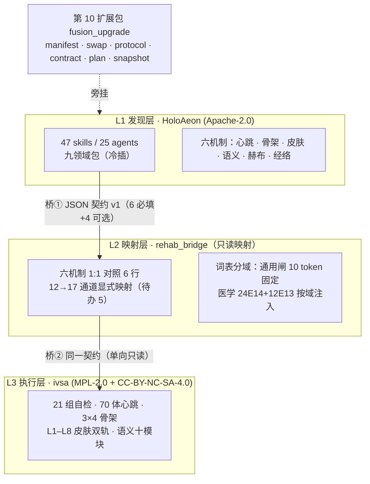

# HoloAeon · V4 冷热插拔赋能升级

> 本文是 V4 唯一入口；主 `README.md` / `README.zh-CN.md` 顶部已加指针，五地同步回执见 `vector-sea\_holoaeon_v4_five_site_receipt_20261102.json`。

> **装一个扩展包，门禁不变，能力可插拔。**
> 不合并引擎、不合并编号、不动维度锁：`25 agents / 47 skills / 9 packs` 仍是那个 `25/47/9`。

中文 | [English quickstart ↓](#english-quickstart)

---

## 这是什么

HoloAeon 是一个**可审计的多智能体编排内核**：九个领域包（写作 / 文献 / 研究 / 数据 / 增长 / 商业 / 量化 / 优化 / 高医）提供 47 个确定性技能与 25 个角色，八个横切扩展包叠加认知主权、蒸馏、生活域、全息纪元、代谢、肾单位、补齐短板与四人数字分身。

**V4 新增第 10 个扩展包 `fusion_upgrade`**，把"冷热插拔"和"内外融合协议"从文档变成**可执行、可验收入口**：

- **冷插**（九个领域包）：启动期整体装载，运行期**禁止卸载**，因为维度锁靠它撑着。
- **热插**（10 个扩展包）：任意时刻可装可卸，回滚点就是卸载本身。
- **内部融合协议**：信封 → 皮肤八层守卫 → 消息总线 → 心跳节拍 → 技能匹配 → 端到端提交，六步各给证据。
- **外部融合协议**：只做模型后端路由决策，**零网络调用**，回执一律 `simulated`。
- **两仓契约 v1**：与中西医融合康复工程（ivsa）之间只交换一条 JSON 回执，不搬代码、不共享编号。
- **十二批次计划**：每批九字段、判据可跑、禁形容词。
- **项目快照**：一条命令导出，供其他智能体读取与继续优化。

---

## 一句话升级

```bash
git clone https://github.com/weideyouni/holoaeon.git && cd holoaeon && python scripts/fusion_local.py fuse
```

看到 `内部协议：True` / `外部协议：True` / `网络调用：0`，就是升级完成。**其他一切维度不变。**

---

## 快速开始

```powershell
# Windows（编码先设，否则中文乱码）
$env:PYTHONIOENCODING="utf-8"; [Console]::OutputEncoding=[Text.Encoding]::UTF8
cd holoaeon

python scripts/verify_fusion_upgrade.py     # 融合包自检 17/17
python scripts/fusion_local.py status       # 冷热清单 + 现算锁值 25/47/9
python scripts/fusion_local.py fuse         # 内外协议全量演练
python scripts/fusion_local.py roundtrip fusion_upgrade   # 热插拔往返
python scripts/fusion_local.py contract     # 契约 / 六机制 / 12→17 通道
python scripts/fusion_local.py plan B2b     # 单批详情
python scripts/fusion_local.py snapshot out.json          # 项目快照
```

零第三方依赖：`dependencies = []`，`pip install` 零次。

---

## 架构：四层两桥



桥上只走**一条回执**，不走代码、不走编号、不走状态。回执必带 `contract_id` + `seal`，两次调用 `seal` 必须相等。

---

## 门禁（改动后必跑，全绿才算没破维度）

| 门禁 | 命令 | 期望 | 本轮实测 |
|---|---|---|---|
| 维度锁 | `python scripts/v3_gate.py --json reports/gate.json` | 32/32，A1=25/47/9 | ✅ 32/32 |
| 单元测试 | `python -m unittest discover -s tests` | 34 OK | ✅ 34 |
| 启动自检 | `python scripts/launch_local.py selftest` | 25/25 | ✅ 25/25 |
| 技能矩阵 | `python scripts/verify_skill_matrix.py` | 17/17 | ✅ 17 |
| 红线扫描 | `python scripts/redline_scan.py` | 零违规 | ✅ 71 文件 0 违规 |
| 融合包 | `python scripts/verify_fusion_upgrade.py` | 17/17 | ✅ 17 |
| 确定性黄金 | `python scripts/repro_core_emit.py` | `2fc892cf9af6e755` / `f42c8229ee5acd73` | ✅ `fails=[]` |

---

## V2.0 十二批次

`B0 基线冻结 → B1a 契约字段 → B1b 同参互认 → B2a 六机制映射 → B2b 12→17 + 词表分域 → B3 用途分类 → B4 康复域试点 20 例 → B5 语义 19→≥60 → B6 记忆与流量 → B7 分批准入 → B8 双仓同步 → B9 收口`

合计 **15 人天**；**不许跨批并行**：一批未全绿，不许开下一批。台账见 `data/十二批台账.csv`。

---

## 契约 v1（两仓唯一合法交换形态）

| 必填 | `contract_id` · `source` · `target` · `skill` · `mechanism` · `lane` |
|---|---|
| 可选 | `payload` · `nonce` · `budget` · `note` |
| 枚举 | `mechanism` ∈ 六机制；`lane` ∈ `read` / `write` |
| 纪律 | 校验失败即退出码 1；跨仓默认 `read`；回执必带 `mode=simulated` |

---

## 六护城河

零依赖 · 离线（无网络/无密钥/无遥测） · 确定性（两次同哈希 + 篡改敏感性） · fail-loud（失败退出码 1） · 证据链（可复算） · 稀疏逻辑拓扑（1331×1331 永不预分配）

---

## 医学红线（与康复域协作时一个字不改）

零剂量；C0 不写成疗效；L4/L5 禁外推；急症 E14 转 120；三场卡带物理参数且电场卡全轮 gap、禁 rTMS 顶替；一切跨域回执标 `simulated`。仿真 ≠ 证明，**碳基终裁**。

---

## 目录结构（新增部分）

```
holoaeon/
├── holoaeon/
│   ├── fusion_upgrade/          # 新增：冷热插拔 + 内外融合协议
│   │   ├── manifest.py          # 冷/热清单（现算，每行带回滚点）
│   │   ├── swap.py              # 装 / 卸 / 往返探针
│   │   ├── protocol.py          # 内部六步 + 外部离线路由
│   │   ├── contract.py          # 契约 v1 + 六机制 + 12→17 映射
│   │   ├── plan.py              # 十二批次（九字段可校验）
│   │   ├── snapshot.py          # 项目快照
│   │   └── selftest.py          # 17 项
│   └── packs/fusion_upgrade_pack.py   # 第 10 扩展包：8 技能 / 2 角色 / 1 工作流
└── scripts/
    ├── fusion_local.py          # 本地操作台
    └── verify_fusion_upgrade.py # 验收入口（--json 可机读）
```

---

## 已知限制（如实写，不藏）

- 热卸载后调度器 `watchers_left` 非 0：调度器 watch 列表无公开移除接口，残留的是对象引用，不参与技能路由。
- 语义技能原 19 个（六机制里最薄）；B5 已扩到 60 条并落满 ivsa 十模块（检索 16 条偏重，成因与 `module_basis` 已逐条登记在 B5 票据）。
- ivsa 侧 v1.2 插件（默认关闭）尚未落地；本轮只改 HoloAeon 一个仓。
- 快照内 `gates_last_known` 是上次已知值，接收方必须按 `recheck` 现场复跑。

---

## 许可

HoloAeon 本体 **Apache-2.0**。与 ivsa（代码 MPL-2.0 / 内容 CC-BY-NC-SA-4.0）**只经契约交换，不互相拷贝代码**，因此不存在许可混用。

---

## English quickstart

```bash
git clone https://github.com/weideyouni/holoaeon.git && cd holoaeon
python scripts/verify_fusion_upgrade.py      # 17/17
python scripts/fusion_local.py fuse          # internal + external protocol, 0 network calls
python scripts/fusion_local.py status        # 25 agents / 47 skills / 9 packs — unchanged
```

**One line:** install one extra pack, keep every dimension, make capability pluggable. `evidence_class=simulated`; simulation ≠ proof.

---

潮起开门，潮落闭嘴。

## First upgrade landed — B0 baseline freeze (2026-11-02)

| gate | command | result |
|---|---|---|
| v3_gate | `python scripts/v3_gate.py --json reports/gate_b0_v4.json` | **32/32**, A1 = 25/47/9 |
| unittest | `python -m unittest discover -s tests` | **Ran 34 OK** |
| launch selftest | `python scripts/launch_local.py selftest` | **25/25** |
| skill matrix | `python scripts/verify_skill_matrix.py` | **17/17**, digest `9a565741e1f72ab7` |
| redline | `python scripts/redline_scan.py` | 71 files, **0 violations** |
| fusion | `python scripts/verify_fusion_upgrade.py` | **17/17** |
| ivsa | `cd integrative-rehab-vsa && python main.py` | **21/21** |

Golden values unchanged: `diff0=2fc892cf9af6e755`, `tamper=f42c8229ee5acd73`, `spec.VERSION=0.9.1`.

- 14-dimension lock: `reports/b0_lock_v4fusion.json`
- Ticket: `data/B0_基线票据_v4fusion.md`
- Skill auto-match (1229 → 365 candidates, deterministic, offline, zero external skills executed): `python scripts/b0_match.py` → `data/B0_自动匹配技能.csv`
- Batch progress: `data/B0_批次进度.csv` (B0–B9 complete: B7-1 signed by 潘荟丞 on 2026-11-02 with cumulative 4/15; B8 dual-repo sync green; **B9 closed out** (five-file delivery + deterministic zip))
- B4 rehab pilot: `data/rehab_pilot_20.json` + `data/B4_康复域试点票据.md` — 20 contracts (12 general / 8 medical), 4 negative probes rejected, `python scripts/check_rehab_pilot.py` (R1–R9)
- B5 semantic family: `data/semantic_family.json` + `data/semantic_modules.json` + `data/B5_语义技能族票据.md` — 60 members on the ivsa ten modules (no uncovered module, no 11th module), base 19 index entries → 16 unique + 44 expanded, 4 rehab bridge candidates registered not admitted, `python scripts/check_semantic_family.py` (S1–S9)

- B6 hebbian persistence: `data/hebbian_store.json` (6218 B, 23 edges / 28 nodes / 9 seeds, sha256 `399505b0e695…de282`) + `data/channel_quota.csv` (17 rows: 12 mapped / 5 pending, quota 1200, load 24) + `data/B6_赫布落盘票据.md`; restart proof = real child interpreter, top-k byte-identical; `python scripts/check_hebbian_store.py` (H1–H9), sidecar 51 → 61

- B7 admission: `data/admission_rules.json` (≤5/批, ≤15 累计, 4 gates, signature) + `data/admission_ledger.csv` (4 rows, decision `ADMITTED`, signer 潘荟丞 / 2026-11-02, cumulative 4/15) + `data/B7_准入票据_B7-1.md`; `python scripts/admit_batch.py --check` → `PASS, admitted=4, remaining=11`, sidecar 61 → 71

- B8 dual-repo sync: `data/ivsa_plugin_v1.2.json` (plugin `SG-B8-IVSA-V1.2-PLUGIN`, disabled by default, 6 capabilities read-only) + `SHA256SUMS` (166 files, digest `9bb48c2b5cd41920…`) + `data/dual_repo_sums.json` (ivsa 91 entries recomputed 91/91, 17-channel groups 5/4/4/4) + `data/许可分层清单.csv` (5 rows, 0 mixed) + `data/B8_双仓开源同步票据.md`; `python scripts/verify_b8_dual_sync.py` → 11/11, sidecar 71 → 82

B9 close-out is done: five files + ledger v2 + deterministic zip; `python scripts/verify_b9_closeout.py` must be V1–V12 PASS before any V2.1 work starts.
## Five-site sync DNA (刚性)

`data/FIVE_SITE_SYNC_DNA.md` + `data/five_site_dna.json` — `SG-DNA-FIVE-SITE-SYNC-V1.2`

| site | role | acceptance |
|---|---|---|
| S1 local | write source | `git rev-parse HEAD` |
| S2 Gitee | authority mirror | `git ls-remote main` |
| S3 GitHub | public align | `git ls-remote origin main` |
| S4 vector sea | archive index | `manifest.json` sha256 |
| S5 Hugging Face (`weideyouni/holoaeon`) | external mirror | hf commit sha |

Rules R1–R10 (one-way, same commit, object hash, read-only automation, stash→rebase→pop, credential discipline, dimension gate, readback-not-trust, one receipt, degrade per site) are in the DNA doc. V1.1 adds the batch chain **L1–L9**, the engineering discipline **G1–G8** (preflight before every batch, one batch one scope, no parallel batches, one commit per batch, 3 hard dimension assertions, evidence must be re-runnable, never overwrite receipts, red lines outrank schedule) and the pre-batch gate **P1–P6**. Mechanical checks:

```bash
python scripts/five_site_dna.py build      # write reports/five_site_manifest.json
python scripts/five_site_dna.py verify     # recompute + drift list (offline, no git)
python scripts/five_site_dna.py preflight  # P1-P6 gate: no batch may start unless PASS
```

## V4.1 / V4.2 三项遗留闭环（2026-11-02）

| 批次 | 内容 | 判据 | 回执 |
|---|---|---|---|
| V4.1-B1 | B8 六项插件接实际推理（能力注册表 + `ReasoningBridge`，密令启用，红线四条） | 10/10 | `reports/v41_plugin_runtime_check.json` |
| V4.1-B2 | 语义技能族 60 → 100（另立 V2 规格件，旧判据不动） | 6/6 | `reports/v41_semantic_100_check.json` |
| V4.2-B1 | 三场卡电场补齐（13 卡 = 磁 5 / 电 3 / 液 5；电场 3 张结构化补参数维度 + 检索计划） | 9/9 | `reports/v42_three_field_check.json` |

维度不变量 `agents 25 / skills 47 / packs 9` 未动；三张批次票据见 `data/V4.1_插件接推理票据.md`、`data/V4.1_语义扩容至100票据.md`、`data/V4.2_三场卡电场补齐票据.md`；`evidence_class=simulated` 全程贯穿，远端 sha 与回执字节以命令回读为准。

## V4.3-B1 工程硬化与遗留收尾（2026-11-02）

把上一轮踩到的四个坑从复盘文字改成「脚本 + 可实测判据」，并把三项未做各自推到可交代的位置。

| 批次 | 内容 | 判据 | 回执 |
|---|---|---|---|
| V4.3-B1a | **HF 镜像器** `scripts/mirror_hf.py`：只认 model 仓、`git -c core.quotepath=false` 取中文路径、git blob sha1 判等、`--check` 干跑 | H1/H4 | `reports/v43_hardening_check.json` |
| V4.3-B1b | **向量海清单器** `scripts/build_vector_sea_manifest.py`：固定「先 74、后 manifest」，带自指检测与 `--check` | H2 | 同上 |
| V4.3-B1c | **交付目录诊断器** `scripts/check_delivery_pkg.py`：PKG 漂移一条命令诊断，`--fix` 按写序重建 | H3 | 同上 |
| V4.3-B1d | **B8 接适配层** `holoaeon/fusion_upgrade/reasoning_adapter.py`：事实包进 `ModelAdapter` 路由 + simulated 用量；红线命中不进适配层、不联网 | M1–M4 | 同上 |
| V4.3-B1e | **gap 卡检索执行** `data/v43_gap_literature_probe.json`：`TF-E-01/02/03` 三卡实测检索 9 条指南/共识来源；证据等级仍 `none` | L1 | 同上 |
| V4.3-B1f | **族身份 V2** `data/semantic_family_identity_v2.json`：对外 `SG-V41-SEMANTIC-FAMILY-V2`，与族数据 `sha256=253044a0…`、100 成员硬绑定；族数据本体不动 | I1/I2 | 同上 |

合计 `verify_v43.py` **11/11 PASS**，旁挂单测 `tests_contract/test_v43.py` **9 OK**，`REPO_FILES` 115 → 125。维度不变量未动、判据未放宽、证据口径未升。

常用命令：

```bash
python scripts/mirror_hf.py --base <旧sha> --head HEAD --check   # 只看要推哪些件
python scripts/build_vector_sea_manifest.py --check               # 74 与 manifest 是否自洽
python scripts/check_delivery_pkg.py                              # 交付目录是否漂
python scripts/check_delivery_pkg.py --fix                        # 漂了就按写序重建
python scripts/verify_v43.py                                      # 11 条判据逐项实测
```

实测更正：`build_b9_closeout.py` 只**读** zip，真正打包的是 `build_b9_zip.py`，它按交付目录**全目录**压入（新增补记件会进 zip、sha 必然变化）。上一轮「zip 不含 01」的判断有误，本批已重打并核对 zip 内 01 与交付件同字节。票据见 `data/V4.3_工程硬化与遗留收尾票据.md`。

## V4.4-B1 · 真实模型桥接（2026-11-02）

接真模型这件事改成「目录化 + 开关化 + 可自设定」：不写死一家，也不偷偷联网。

| 维度 | 内容 |
|---|---|
| provider | **19 家**（8 全球 + 9 国内 + 1 聚合 + 1 自定义兜底 + 4 本地运行时） |
| 协议族 | **5 种**：`openai_chat` / `anthropic_messages` / `google_gemini` / `bedrock_converse` / `azure_openai` |
| 本地运行时 | Ollama `:11434/v1`、vLLM `:8000/v1`、llama.cpp `:8080/v1`、LM Studio `:1234/v1`（均 OpenAI 兼容，免 key） |
| 默认态 | **全关**：`enabled=[]`，适配层只剩 `fact-pack-local`，事实包封缄 `6704fb78e5cb` 不变 |
| 开启 | `HOLOAEON_REAL_MODELS=1` + 该家 `*_API_KEY` 有值（本地免 key） |
| 判据 | `python scripts\verify_v44.py` → **A1–A13，13/13 PASS** |
| 单测 | `python -m unittest tests_contract.test_v44` → **9 OK** |

新增件：`data/model_provider_catalog.json`（`SG-V44-MODEL-PROVIDER-CATALOG-V1`）、
`holoaeon/fusion_upgrade/model_gateway.py`、`docs/接入真实模型_配置指南.md`、
`scripts/verify_v44.py`、`tests_contract/test_v44.py`、票据 `data/V4.4_真实模型桥接票据.md`。
`REPO_FILES` 125 → **132**。

常用命令：

```bash
python scripts/verify_v44.py                       # A1–A13 逐条实测
python -c "from holoaeon.fusion_upgrade.model_gateway import build_gateway; print(build_gateway('.').state())"
python -c "from holoaeon.fusion_upgrade.model_gateway import build_gateway; print(build_gateway('.').sample_plans())"
```

边界（不冒充）：本仓**只拼请求、不发请求**，不内置价目表（`input_cost/output_cost=0.0` 是占位不是免费），
型号串为代表性示例、随官方版本增删，运行时以用户传入的 `model` 为准。真发请求需用户按指南注入凭证，
在**自己的运行环境**完成；医学红线（不接设备 / 不出剂量 / 不做诊断）在任何 provider 下都不变。
票据见 `data/V4.4_真实模型桥接票据.md`，用户配置入口见 `docs/接入真实模型_配置指南.md`。

## V4.5-B1 本地运行时联调（真实回环调用，零成本）

V4.4 把「请求怎么拼」做完了但一条都没真发。V4.5 在本机起真实推理服务，用真实 HTTP 调用验证
`model_gateway.plan("lmstudio")` 的同形请求能被真实服务接受——**只打回环、只打 OpenAI 形状、不落凭证**。

| 项 | 实测值（2026-11-02） |
|---|---|
| 服务 | LM Studio 本地 OpenAI 兼容服务，`lms server start` → port **1234** running |
| 端点 | `POST http://localhost:1234/v1/embeddings`，body `{"model","input"}` |
| 响应 | **200** · 4,882 ms · raw 23,316 B · **768 维向量** |
| 证据等级 | `live_local`（真实调用，不是 simulated） |
| 判据 | `python scripts\verify_v45.py` → **B1–B7，7/7 PASS** |
| 单测 | `python -m unittest tests_contract.test_v45` → **8 OK** |
| 回执 | `reports/v45_live_probe.json`（`SG-V45-LIVE-PROBE-V1`，1,080 B / sha16 `3767d37c22d6d3dd`） |

新增件：`scripts/live_gateway_probe.py`（`--mode chat|embeddings`、`LOOPBACK` 白名单硬拒公网 host、
只记 `key_present` 布尔）、`scripts/verify_v45.py`、`tests_contract/test_v45.py`、
票据 `data/V4.5_本地运行时联调票据.md`、回执 `reports/v45_live_probe.json`。`REPO_FILES` 132 → **137**。

常用命令：

```bash
python scripts/live_gateway_probe.py --model text-embedding-nomic-embed-text-v1.5 --mode embeddings
python scripts/live_gateway_probe.py --model qwen2.5-0.5b-instruct --mode chat
python scripts/verify_v45.py
```

边界（不冒充）：本批**chat 端点未真发**——本机唯一可用模型是 embedding 类，对话模型因 LM Studio
`downloadsFolder` 指向 `D:\` 盘根、`lms import` 报 `EPERM mkdir 'D:\'` 而未入索引；该修法属用户应用配置，
本仓不擅自改。云端 provider 仍未真发（无凭证与计费账户）。医学红线（不接设备 / 不出剂量 / 不做诊断）不变。
票据见 `data/V4.5_本地运行时联调票据.md`。

## V4.6-B1 扩展卡槽与协作开发指南（只声明、不接线）

V4.4 拼请求、V4.5 真发请求之后，补的是**接续结构**：后来者要加一家 provider、扩一个语义族、
提一张 gap 卡，必须知道"往哪儿加、会不会破锁数、谁点头才算数"。本批把这套位置落地成卡槽声明。

| 项 | 值 |
|---|---|
| 卡槽文件 | `data/extension_slots.json`（`SG-V46-EXTENSION-SLOTS-V1`，14 槽 / 8 类 / 4 态） |
| 只读加载器 | `holoaeon/fusion_upgrade/slot_registry.py`（无网络、无写盘、无 eval） |
| 指南 | `docs/扩展卡槽与协作开发指南.md`（五步认领法 + 三条使用路径 + 升级口子 + 故障处置） |
| 判据 | `python scripts\\verify_v46.py` → **C1–C9，9/9 PASS** |
| 单测 | `python -m unittest tests_contract.test_v46` → **9 OK** |
| 维度锁 | **25 / 47 / 9 不变**（卡槽是旁挂声明，不改锁数） |

槽分布：`occupied` 4（embeddings / chat / 五地门禁 / 飞书入口）、`open` 1（Ollama）、
`reserved` 5（vLLM-TGI / 新协议形状 / 康复域 V5 影子槽 / 插件钩子 / 端侧模型）、
`blocked` 2（语义族 V2 待定 family_id、gap 卡 tier 上调待拍板）。

新增件：`data/extension_slots.json`、`holoaeon/fusion_upgrade/slot_registry.py`、
`docs/扩展卡槽与协作开发指南.md`、`scripts/verify_v46.py`、`tests_contract/test_v46.py`、
`reports/v46_slot_check.json`、票据 `data/V4.6_扩展卡槽与协作指南票据.md`。`REPO_FILES` 137 → **145**。

边界（不冒充）：卡槽**没有**任何运行时接线，`model_gateway` 不读卡槽、`enabled` 仍为 `[]`；
`EXT-DIM-01` / `EXT-EVIDENCE-01` 保持 `blocked`，等你拍板；Ollama / vLLM 未装未测。

## 附录 · Git 版本升级说明（V3 收口 → V4.6，按提交回溯）

> 口径：sha 与提交主题取自 `git log --oneline` 实测；数字类指标（条目数、字节数、sha16）
> 以对应批次 `verify_*` / `five_site_dna` 命令回读为准，不在此处硬编码猜测值。

| 阶段 | 代表提交 | 主题与产出 |
|---|---|---|
| V3 收口 | `3d359bd` / `32b2667` | LangChain 工程形态旁挂（W12–W19），32/32 门禁，维度不变 |
| 同步基建 | `92fd8b5` / `dfad361` | 五地同步 DNA V1.0→V1.1（G1–G8 + P1–P6），离线哈希校验器 |
| **V4.0 开场** | `80089b6` | 冷热插拔升级：第 10 个附加包，**25/47/9 不变**，32/32 门禁、17/17 融合自检 |
| B0 基线 | `055d202` | 基线冻结 7/7 绿、14 维锁、1229 → 365 技能自动匹配 |
| B1a | `63af1bb` | 契约字段草案 v0.1（6 必填 + 4 可选，指纹/白名单/医学红线） |
| B1b | `2c35c35` | 契约 v1 指纹互通（11 旁挂测试、跨进程字节相等、冻结 `contract_v1.json`） |
| B2a | `ec74e08` | 六机制 1:1 映射（M1–M6 检查器，`mapping_rule` 必填） |
| B2b | `76cd834` | 12→17 通道显式分组（不做算术），皮肤词表域切分（E13/E14 不外溢） |
| B3 | `91fc8b3` / `7091a86` | 1229 技能用途重分类（K/M/T/X/U 两阶段确定性，抽样 37/40）+ 向量海清单自检 |
| B4 | `310981e` | 20 个康复域试点契约（12 通科 / 8 医学，4 个负样本被拒） |
| B5 | `4c5a4a8` | 语义技能族 19 → 60（不设第 11 模块；4 个康复候选未准入） |
| B6 | `6dd5128` | 赫布权重持久化（23 边 / 28 节点，重启字节相等）+ 17 通道配额表（12 映射 / 5 待定） |
| B7-1 | `c39e75f` | 准入闸上线：≤5/批、≤15 累计、四硬闸、需签字；4 个候选 `WAITING_SIGNATURE` |
| B7-2 | `ec79c9b` / `97e0794` | 5 技能签字准入（累计 9/15）；重建 `dual_repo_sums` 保 R6 一致 |
| B7-3/4 | `969c83b` | 5 + 1 签字准入，**B7 收口 15/15**；DNA G9 排除项 9→10 |
| B8 | `06f11ad` / `1235805` / `0353613` | ivsa v1.2 插件默认关 + 双仓 `SHA256SUMS` 互认（Apache-2.0 / MPL-2.0 分层）；断 SUMS 自指 + 强制 LF |
| B9 | `c03b19d` | 五件交付 + 台账 v2 + 确定性 zip；DNA V1.2（G9 写序 / G10 密令等同签字 / P7 五地回读） |
| V2.1 | `3b0b32b` | ivsa 只读对账 R1–R7 开票，旁挂 92→101 |
| V4.3 | `4f06bc8` / `3d6f956` | 四坑固化（HF model 仓 / 中文路径 / 74→manifest 顺序 / 交付目录漂移）+ 11/11 判据 |
| V4.4 | `b85b293` | 19 家 provider 目录 + 5 协议拼装 + 默认全关 + 配置指南；A1–A13 13/13 |
| V4.5-B1 | `fb5cdef` | 真实回环调用：`/v1/embeddings` 200 / 768 维；B1–B7 7/7、8 OK |
| V4.5-B2 | 本批 | chat 补做：`/v1/chat/completions` 200 / 41+29 tokens；卡槽放到 C 盘模型目录后 `lms import` 成功 |
| V4.6-B1 | 本批 | 14 卡槽 + 协作指南；C1–C9 9/9、9 OK；**25/47/9 不变** |

**升级主线一句话**：每一批只做一件事，且**只加旁挂、不改锁数**；每批必带 `verify_*` 判据、
必带票据、必过五地同步（`drift=[]` 方可提交）。

