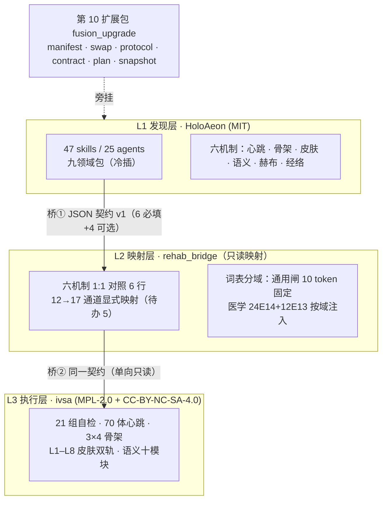

# HoloAeon · V4 冷热插拔赋能升级

> **装一个扩展包，门禁不变，能力可插拔。**
> 不合并引擎、不合并编号、不动维度锁：`25 agents / 47 skills / 9 packs` 仍是那个 `25/47/9`。

中文 | [English quickstart ↓](#english-quickstart)

---

## 这是什么

HoloAeon 是一个**可审计的多智能体编排内核**：九个领域包（写作 / 文献 / 研究 / 数据 / 增长 / 商业 / 量化 / 优化 / 高医）提供 47 个确定性技能与 25 个角色，八个横切扩展包叠加认知主权、蒸馏、生活域、全息纪元、代谢、肾单位、补齐短板与四人数字分身。

**V4 新增第 10 个扩展包 `fusion_upgrade`**，把"冷热插拔"和"内外融合协议"从文档变成**可执行、可验收入口**：

- **冷插**（九个领域包）：启动期整体装载，运行期**禁止卸载**，因为维度锁靠它撑着。
- **热插**（10 个扩展包）：任意时刻可装可卸，回滚点就是卸载本身。
- **内部融合协议**：信封 → 皮肤八层守卫 → 消息总线 → 心跳节拍 → 技能匹配 → 端到端提交，六步各给证据。
- **外部融合协议**：只做模型后端路由决策，**零网络调用**，回执一律 `simulated`。
- **两仓契约 v1**：与中西医融合康复工程（ivsa）之间只交换一条 JSON 回执，不搬代码、不共享编号。
- **十二批次计划**：每批九字段、判据可跑、禁形容词。
- **项目快照**：一条命令导出，供其他智能体读取与继续优化。

---

## 一句话升级

```bash
git clone https://github.com/weideyouni/holoaeon.git && cd holoaeon && python scripts/fusion_local.py fuse
```

看到 `内部协议：True` / `外部协议：True` / `网络调用：0`，就是升级完成。**其他一切维度不变。**

---

## 快速开始

```powershell
# Windows（编码先设，否则中文乱码）
$env:PYTHONIOENCODING="utf-8"; [Console]::OutputEncoding=[Text.Encoding]::UTF8
cd holoaeon

python scripts/verify_fusion_upgrade.py     # 融合包自检 17/17
python scripts/fusion_local.py status       # 冷热清单 + 现算锁值 25/47/9
python scripts/fusion_local.py fuse         # 内外协议全量演练
python scripts/fusion_local.py roundtrip fusion_upgrade   # 热插拔往返
python scripts/fusion_local.py contract     # 契约 / 六机制 / 12→17 通道
python scripts/fusion_local.py plan B2b     # 单批详情
python scripts/fusion_local.py snapshot out.json          # 项目快照
```

零第三方依赖：`dependencies = []`，`pip install` 零次。

---

## 架构：四层两桥



桥上只走**一条回执**，不走代码、不走编号、不走状态。回执必带 `contract_id` + `seal`，两次调用 `seal` 必须相等。

---

## 门禁（改动后必跑，全绿才算没破维度）

| 门禁 | 命令 | 期望 | 本轮实测 |
|---|---|---|---|
| 维度锁 | `python scripts/v3_gate.py --json reports/gate.json` | 32/32，A1=25/47/9 | ✅ 32/32 |
| 单元测试 | `python -m unittest discover -s tests` | 34 OK | ✅ 34 |
| 启动自检 | `python scripts/launch_local.py selftest` | 25/25 | ✅ 25/25 |
| 技能矩阵 | `python scripts/verify_skill_matrix.py` | 17/17 | ✅ 17 |
| 红线扫描 | `python scripts/redline_scan.py` | 零违规 | ✅ 67 文件 0 违规 |
| 融合包 | `python scripts/verify_fusion_upgrade.py` | 17/17 | ✅ 17 |
| 确定性黄金 | `python scripts/repro_core_emit.py` | `2fc892cf9af6e755` / `f42c8229ee5acd73` | ✅ `fails=[]` |

---

## V2.0 十二批次

`B0 基线冻结 → B1a 契约字段 → B1b 同参互认 → B2a 六机制映射 → B2b 12→17 + 词表分域 → B3 用途分类 → B4 康复域试点 20 例 → B5 语义 19→≥60 → B6 记忆与流量 → B7 分批准入 → B8 双仓同步 → B9 收口`

合计 **15 人天**；**不许跨批并行**：一批未全绿，不许开下一批。台账见 `data/十二批台账.csv`。

---

## 契约 v1（两仓唯一合法交换形态）

| 必填 | `contract_id` · `source` · `target` · `skill` · `mechanism` · `lane` |
|---|---|
| 可选 | `payload` · `nonce` · `budget` · `note` |
| 枚举 | `mechanism` ∈ 六机制；`lane` ∈ `read` / `write` |
| 纪律 | 校验失败即退出码 1；跨仓默认 `read`；回执必带 `mode=simulated` |

---

## 六护城河

零依赖 · 离线（无网络/无密钥/无遥测） · 确定性（两次同哈希 + 篡改敏感性） · fail-loud（失败退出码 1） · 证据链（可复算） · 稀疏逻辑拓扑（1331×1331 永不预分配）

---

## 医学红线（与康复域协作时一个字不改）

零剂量；C0 不写成疗效；L4/L5 禁外推；急症 E14 转 120；三场卡带物理参数且电场卡全轮 gap、禁 rTMS 顶替；一切跨域回执标 `simulated`。仿真 ≠ 证明，**碳基终裁**。

---

## 目录结构（新增部分）

```
holoaeon/
├── holoaeon/
│   ├── fusion_upgrade/          # 新增：冷热插拔 + 内外融合协议
│   │   ├── manifest.py          # 冷/热清单（现算，每行带回滚点）
│   │   ├── swap.py              # 装 / 卸 / 往返探针
│   │   ├── protocol.py          # 内部六步 + 外部离线路由
│   │   ├── contract.py          # 契约 v1 + 六机制 + 12→17 映射
│   │   ├── plan.py              # 十二批次（九字段可校验）
│   │   ├── snapshot.py          # 项目快照
│   │   └── selftest.py          # 17 项
│   └── packs/fusion_upgrade_pack.py   # 第 10 扩展包：8 技能 / 2 角色 / 1 工作流
└── scripts/
    ├── fusion_local.py          # 本地操作台
    └── verify_fusion_upgrade.py # 验收入口（--json 可机读）
```

---

## 已知限制（如实写，不藏）

- 热卸载后调度器 `watchers_left` 非 0：调度器 watch 列表无公开移除接口，残留的是对象引用，不参与技能路由。
- 语义技能仅 19 个（六机制里最薄），B5 扩到 ≥60 尚未执行。
- ivsa 侧 v1.2 插件（默认关闭）尚未落地；本轮只改 HoloAeon 一个仓。
- 快照内 `gates_last_known` 是上次已知值，接收方必须按 `recheck` 现场复跑。

---

## 许可

HoloAeon 本体 **MIT**。与 ivsa（代码 MPL-2.0 / 内容 CC-BY-NC-SA-4.0）**只经契约交换，不互相拷贝代码**，因此不存在许可混用。

---

## English quickstart

```bash
git clone https://github.com/weideyouni/holoaeon.git && cd holoaeon
python scripts/verify_fusion_upgrade.py      # 17/17
python scripts/fusion_local.py fuse          # internal + external protocol, 0 network calls
python scripts/fusion_local.py status        # 25 agents / 47 skills / 9 packs — unchanged
```

**One line:** install one extra pack, keep every dimension, make capability pluggable. `evidence_class=simulated`; simulation ≠ proof.

---

潮起开门，潮落闭嘴。

## First upgrade landed — B0 baseline freeze (2026-11-02)

| gate | command | result |
|---|---|---|
| v3_gate | `python scripts/v3_gate.py --json reports/gate_b0_v4.json` | **32/32**, A1 = 25/47/9 |
| unittest | `python -m unittest discover -s tests` | **Ran 34 OK** |
| launch selftest | `python scripts/launch_local.py selftest` | **25/25** |
| skill matrix | `python scripts/verify_skill_matrix.py` | **17/17**, digest `9a565741e1f72ab7` |
| redline | `python scripts/redline_scan.py` | 67 files, **0 violations** |
| fusion | `python scripts/verify_fusion_upgrade.py` | **17/17** |
| ivsa | `cd integrative-rehab-vsa && python main.py` | **21/21** |

Golden values unchanged: `diff0=2fc892cf9af6e755`, `tamper=f42c8229ee5acd73`, `spec.VERSION=0.9.1`.

- 14-dimension lock: `reports/b0_lock_v4fusion.json`
- Ticket: `data/B0_基线票据_v4fusion.md`
- Skill auto-match (1229 → 365 candidates, deterministic, offline, zero external skills executed): `python scripts/b0_match.py` → `data/B0_自动匹配技能.csv`
- Batch progress: `data/B0_批次进度.csv` (B0 done, B1a next)

Next batch **B1a contract field draft** stays blocked until this ticket is re-run green.
## Five-site sync DNA (刚性)

`data/FIVE_SITE_SYNC_DNA.md` + `data/five_site_dna.json` — `SG-DNA-FIVE-SITE-SYNC-V1.0`

| site | role | acceptance |
|---|---|---|
| S1 local | write source | `git rev-parse HEAD` |
| S2 Gitee | authority mirror | `git ls-remote main` |
| S3 GitHub | public align | `git ls-remote origin main` |
| S4 vector sea | archive index | `manifest.json` sha256 |
| S5 Hugging Face (`weideyouni/holoaeon`) | external mirror | hf commit sha |

Rules R1–R10 (one-way, same commit, object hash, read-only automation, stash→rebase→pop, credential discipline, dimension gate, readback-not-trust, one receipt, degrade per site) are in the DNA doc. Mechanical check:

```bash
python scripts/five_site_dna.py build    # write reports/five_site_manifest.json
python scripts/five_site_dna.py verify   # recompute + drift list (offline, no git)
```